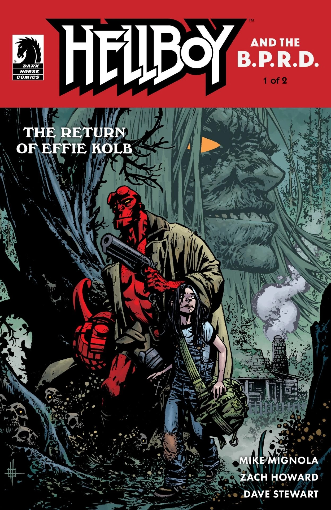
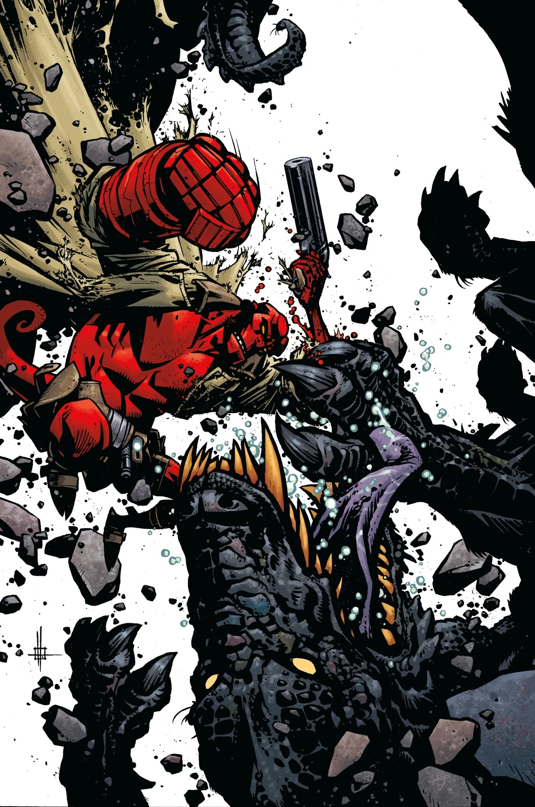

***The Return of Effie Kolb*** is two-issue *[Hellboy and the B.P.R.D.](/entry/Hellboy_and_the_B.P.R.D.)* arc written by [Mike Mignola](/entry/Mike_Mignola) and drawn by [Zach Howard](/entry/Zach_Howard). The second issue was delayed due to COVID-19. The story is a sequel to *[Hellboy: The Crooked Man](/entry/The_Crooked_Man_(comic_story))*.

## Synopsis

### Part One

Years after he banished the infamous backwoods demon known as the [Crooked Man](/entry/Jeremiah_Witkins), [Hellboy](/entry/Hellboy_(character)) returns to Appalachia when a [young psychic](/entry/Sara_May_Blackburn) warns [Tom Ferrell](/entry/Tom_Ferrell) of looming danger. But the [Crooked Man’s house](/entry/The_Hurricane) is no longer empty and threats both new and old simmer in the Virginia woods.

### Part Two

Following Hellboy’s strange encounter with the new residents of the Crooked Man’s home, a young spiritual sensitive still feels that something bad is going on in the old Virginia mansion… and she’s right.

## Gallery

Covers by [Zach Howard](/entry/Zach_Howard) unless otherwise stated.

Mike Mignola variant

Hellboy and the B.P.R.D. Publication Order

&#10;
Preceded by
Long Night at Goloski Station
The Return of Effie Kolb

Followed by
The Seven Wives Club

|Issue #1

|Issue #2
