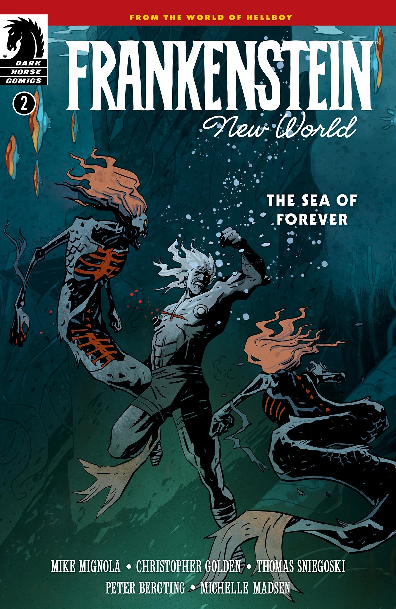
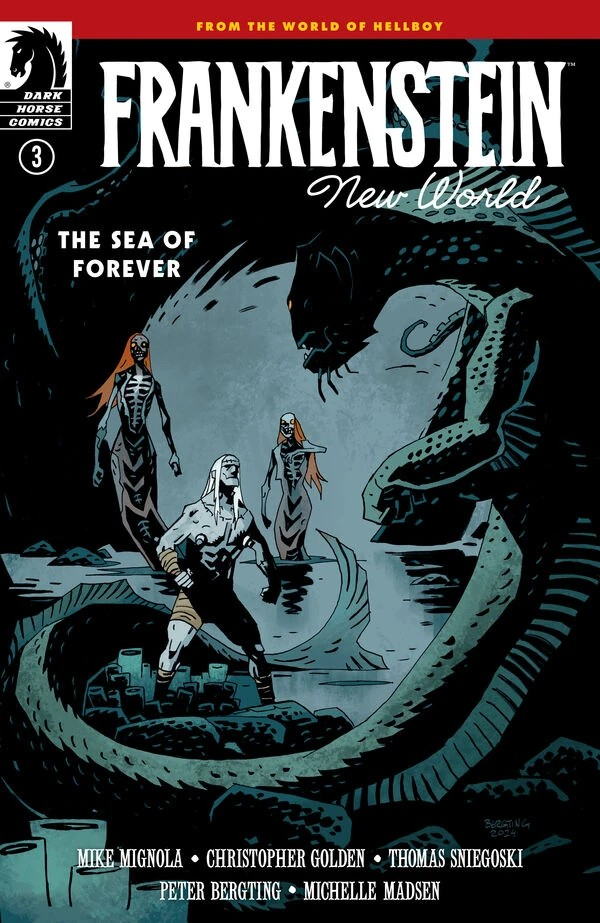
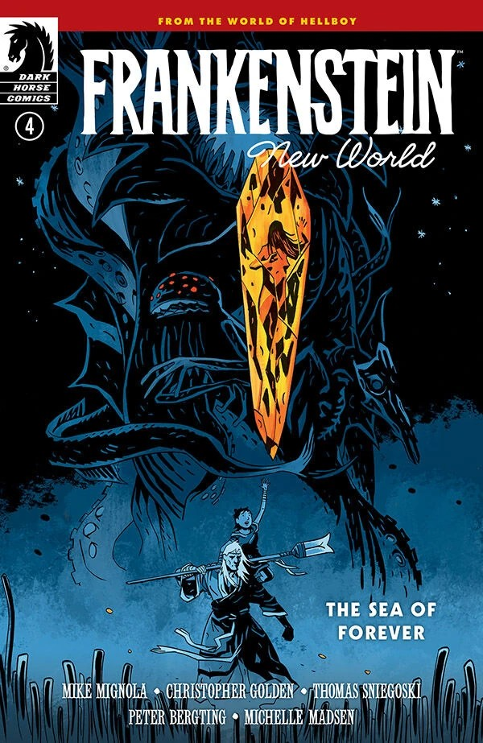

***Frankenstein: New World—The Sea of Forever*** is a four-issue miniseries written by [Mike Mignola](/entry/Mike_Mignola), [Christopher Golden](/entry/Christopher_Golden), and [Thomas Sniegoski](/entry/Thomas_E._Sniegoski) with art by [Peter Bergting](/entry/Peter_Bergting). It is the second arc in the [*Frankenstein: New World* story cycle](/entry/New_World_(Frankenstein_story_cycle)).

## Synopsis

### Part One

Frankenstein and the young Lilja navigate the world above ground to follow Lilja’s vision, but an ancient and familiar evil follows them wherever they go.

### Part Two

Unknown attackers strike in their pursuit of Frankenstein and Lilja, so they look for help underwater only to find a powerful creature who has her own dark means of survival.

### Part Three

A legendary creature threatens Frankenstein and Lilja below the water’s surface, while an evil force above infects everything around it.

### Part Four

Frankenstein and Lilja confront the darkness that led to the new world and the deeper evil that still has its roots in the finale to *The Sea of Forever*.

## Gallery

All covers by [Peter Bergting](/entry/Peter_Bergting).

Issue \#1

|Issue #2

|Issue #3

|Issue #4
