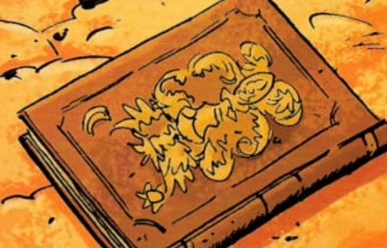

 ***The Secret Fire**'', or***Flamma Reconditus**'', was a Greek translation of an Egyptian text written by Ini-Herit in 700 A.D., in the sunken city of Menouthis. Ini-Herit claimed to have deciphered a version of the Emerald Tablet (the legendary stone that fell from Lucifer's head when he was cast out of heaven) engraved by the magician Hermes Trismegistus (Hermes Thrice-Great).

The significance and the meaning of the tablet's thirteen lines have baffled mystics for centuries; Ini-Herit's version purported to be "a true record of the workings of the Universal Machine, of the nature and function of celestial bodies, the transmutation of metals, and the creation and reconstruction of living things."

According to the Vatican Library, only five printed editions of the full translation of *The Secret Fire* were only known and had remained elusive to the present day. In later editions of *The Secret Fire* included Ini-Herit's notes on his experiments, which included his field in the work of [homunculi](/entry/Homunculus) generation and restoration. In 1533, [Edel Mischrasse](/entry/Edel_Mischrasse) discovered a copy of *The Secret Fire* and became the basis for Mischrasse to create his homunculi - among them was the homunculus known as [Roger](/entry/Roger). Another copy of the book, an edition by John Isaac Hollandus, was possessed by the Marquis [Adoet de Fabre](/entry/Adoet_de_Fabre), a five-hundred-year-old collector of rare occult artifacts. The Marquis offered [Kate Corrigan](/entry/Kate_Corrigan) (who had come for the book to restore Roger) the book in exchange for [Abraham Sapien](/entry/Abraham_Sapien). However, Corrigan thwarted Fabre's plan when he is dragged to Hell by the demon [Marchosias](/entry/Marchosias), but the book was lost in the chaos.

The creator of the V.E.S ([Vril Energy Suit](/entry/Vril_Energy_Suit)) mentioned Flamma Reconditus while describing how [Anum](/entry/Anum) stole [Vril](/entry/Vril) from [God](/entry/God). It is implied to be another name for Vril, implying the book describes how Vril works and possibly how to harness it.
