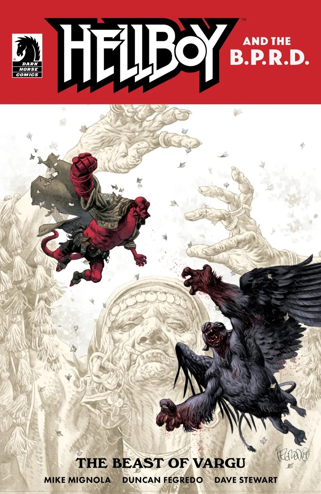
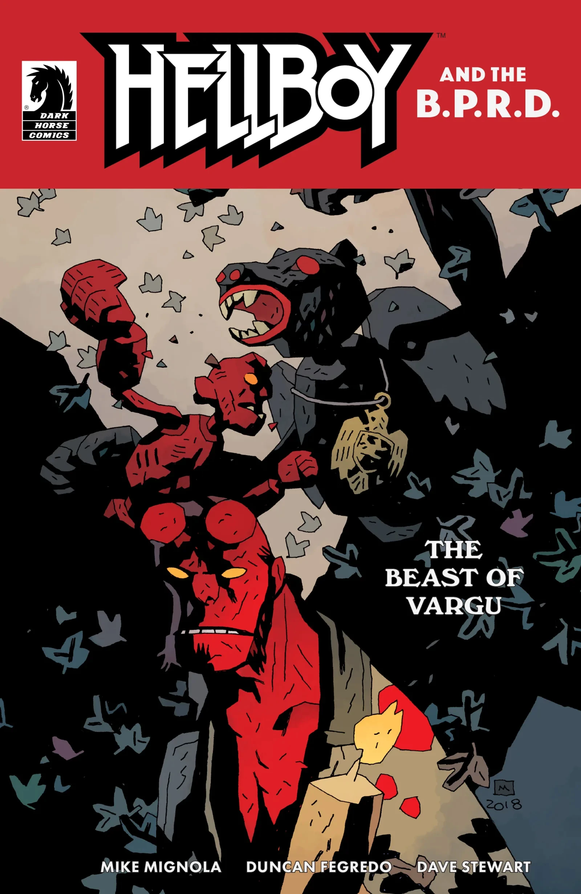

***The Secret God of the Roma*** is a short story that originally appeared as a back-up to [*Hellboy and the B.P.R.D.: The Beast of Vargu*](/entry/The_Beast_of_Vargu), though the full story appeared in advance of the issue's release as a preview on io9 on June 14, 2019.

## Synopsis

This first issue in a new era of *Hellboy and the B.P.R.D.* sees Mignola and Fegredo send Hellboy to Romania for a pair of tales set in a small village with a centuries-old curse and a man-eating monster which culminate in a sinister puppet show and a demigod’s ill-fated dinner.

## Gallery

[Duncan Fegredo](/entry/Duncan_Fegredo) cover

[Mike Mignola](/entry/Mike_Mignola) variant cover

Hellboy and the B.P.R.D. Publication Order

&#10;
Preceded by
The Beast of Vargu
The Secret God of the Roma

Followed by
Saturn Returns

|Duncan Fegredo cover

|Mike Mignola variant cover
