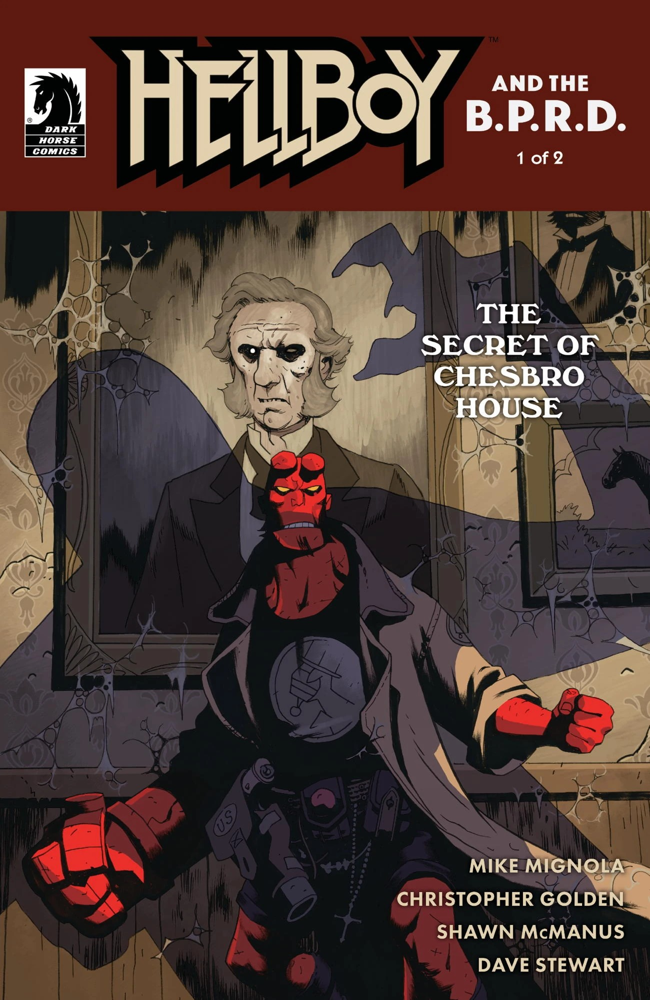
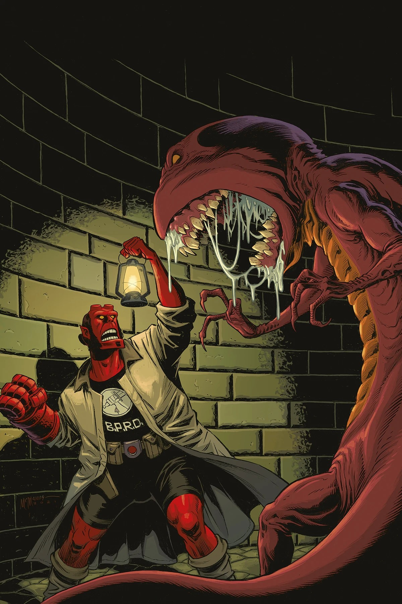
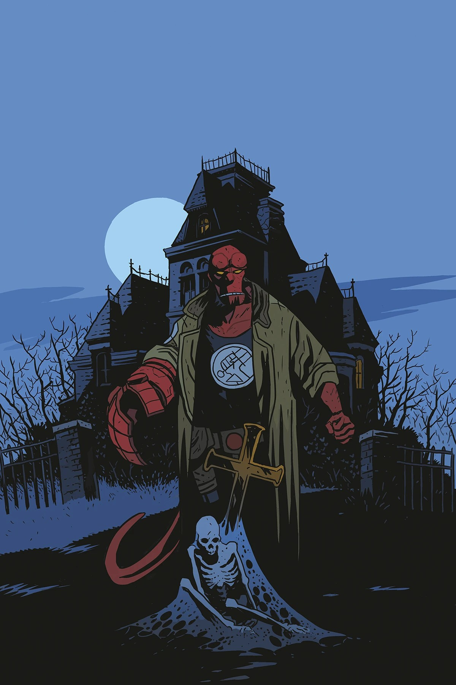

***The Secret of Chesbro House*** is two-issue *[Hellboy and the B.P.R.D.](/entry/Hellboy_and_the_B.P.R.D.)* arc written by [Mike Mignola](/entry/Mike_Mignola) and [Christopher Golden](/entry/Christopher_Golden), drawn by [Shawn McManus](/entry/Shawn_McManus). While Golden had worked in the Hellboy Universe several times since he started writing *[Hellboy: The Lost Army](/entry/Hellboy%3A_The_Lost_Army)* in 1996, this comic marks the first time he has written a *Hellboy* comic. However, Golden has promised much more in the future.

## Synopsis

### Part One

Hellboy works with a psychic to clear a haunted mansion for auction. But the ghosts in residence aren’t quite ready to go gentle into that good night, and the answer may lie in a connection with the living world...

### Part Two

Hellboy is plunged headlong into the dark history of a haunted mansion, witnessing at last the dark truth behind the ghost in residence... and how it might be made to leave.

## Gallery

All covers by [Shawn McManus](/entry/Shawn_McManus) unless otherwise stated.

Issue \#1

Issue \#1  
[Ben Stenbeck](/entry/Ben_Stenbeck) variant

[Matt Smith](/entry/Matt_Smith) variant

|Issue #1 Ben Stenbeck variant

|Issue #2

|Issue #2 Matt Smith variant
