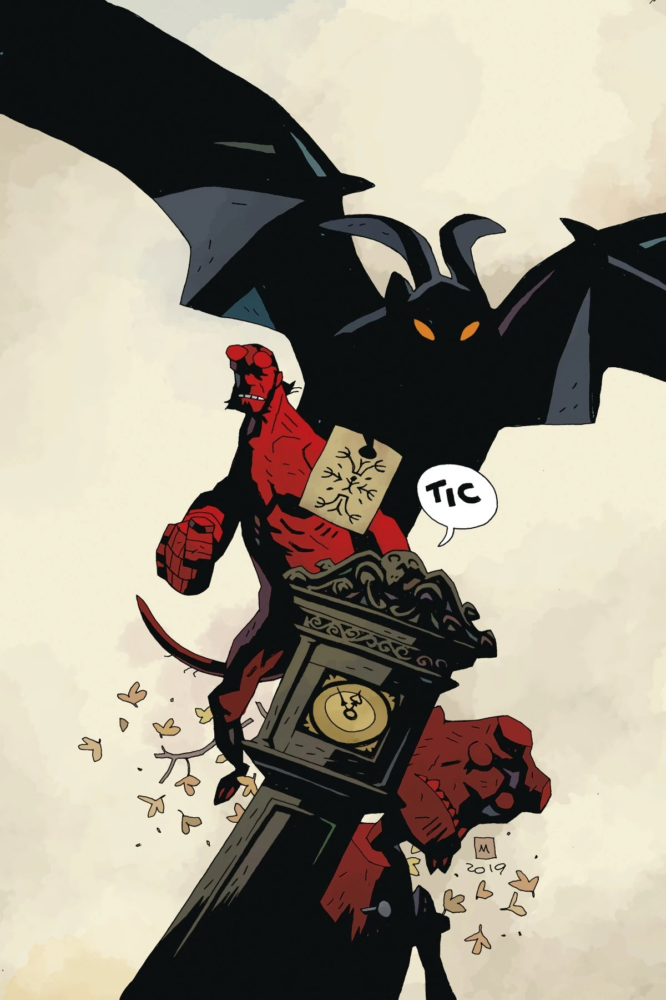

***The Sending*** is a short story published in a one-shot together with *[Her Fatal Hour](/entry/Her_Fatal_Hour)*, both written by [Mike Mignola](/entry/Mike_Mignola) and drawn by [Tiernen Trevallion](/entry/Tiernen_Trevallion).

## Synopsis

Hellboy goes head to head with a phantom who is looking for an object completely unknown to the living people the ghost is terrorizing.

## Gallery

*Hellboy and the B.P.R.D.:  
Her Fatal Hour and The Sending*  
[Tiernen Trevallion](/entry/Tiernen_Trevallion) cover

*Hellboy and the B.P.R.D.:  
Her Fatal Hour and The Sending*  
[Mike Mignola](/entry/Mike_Mignola) variant cover

Hellboy and the B.P.R.D. Publication Order

&#10;
Preceded by
Her Fatal Hour
The Sending

Followed by
The Secret of Chesbro House

|Hellboy and the B.P.R.D.: Her Fatal Hour and The Sending Mike Mignola variant cover
