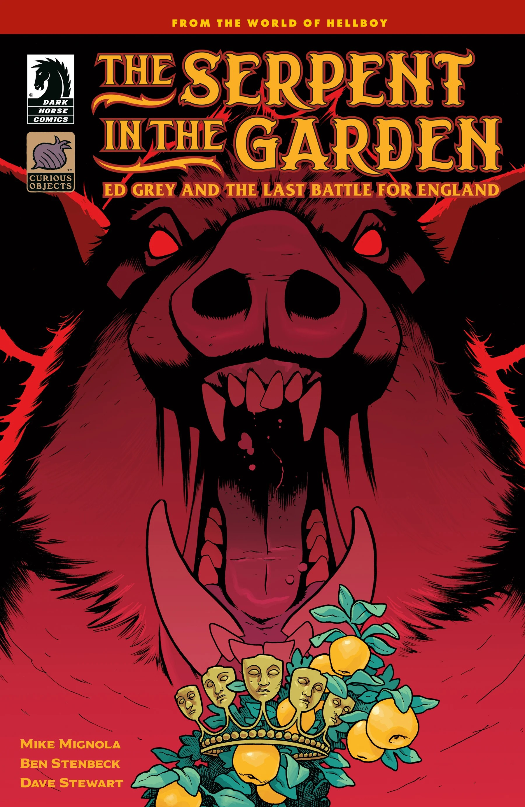
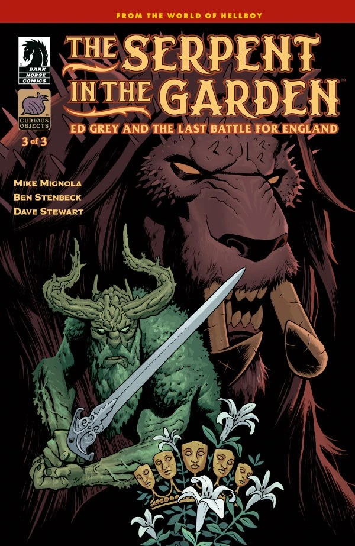

*This article is a stub. You can help Hellboy Wiki by expanding it.*

***The Serpent in the Garden: Ed Grey and the Last Battle for England*** is a three-issue miniseries written by Mike Mignola and illustrated by Ben Stenbeck.

## Publication History

This comic is the first to be published by Mike Mignola's Curious Objects imprint at Dark Horse Comics. *The Serpent in the Garden* will be Stenbeck's last Hellboy Universe story for some time, as he will be focusing on his creator-owned *Lands Unknown* universe with Mignola.

## Synopsis

### Part One

Witchfinder Ed Grey is summoned by Alice, queen of the last standing realm on earth, to defend her and England against Morgan Le Fay and her champion in a final standoff.

### Part Two

Witchfinder Ed Grey is summoned by Alice, queen of the last standing realm on earth, to defend her and England against Morgan Le Fay and her champion in a final standoff.

### Part Three

The battle comes to a head as Gruagach and the Witchfinder face off in their final fight.

## Gallery

All covers by Ben Stenbeck

Issue \#1

|Issue #2

|Issue #3
