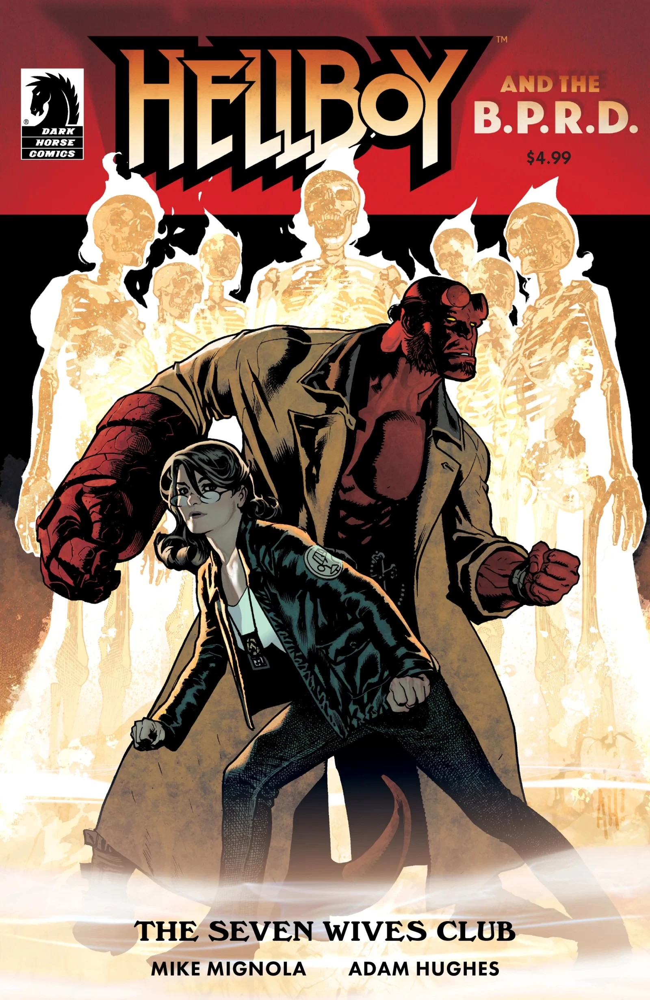

***The Seven Wives Club*** is a 2020 one-shot story which reunited [Mike Mignola](/entry/Mike_Mignola) and [Adam Hughes](/entry/Adam_Hughes) following their acclaimed collaboration, *[Hellboy: Krampusnacht](/entry/Krampusnacht)*. It was informally considered a *Hellboy Winter Special* when it was first announced, though it is not officially branded as such.

## Publication History

The story was originally scheduled for December 2019, but was later bumped back to April 2020. It was delayed again due to COVID-19.

## Synopsis

Hellboy comes to the aid of a young girl whose ghost hunt goes wrong, and a visit to an abandoned medical school reveals sinister layers to a grisly, long-ago murder.

## Gallery

Mike Mignola variant cover

|Adam Hughes cover
## External Links

- Mike Mignola and Adam Hughes Are Reuniting for an All-New Hellboy Story
- DarkHorse.com Product Page

Hellboy and the B.P.R.D. Publication Order

&#10;
Preceded by
The Return of Effie Kolb
The Seven Wives Club

Followed by
Her Fatal Hour
