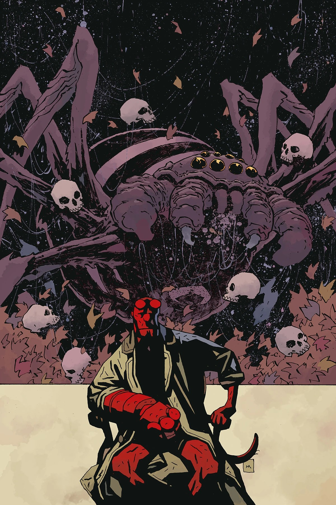
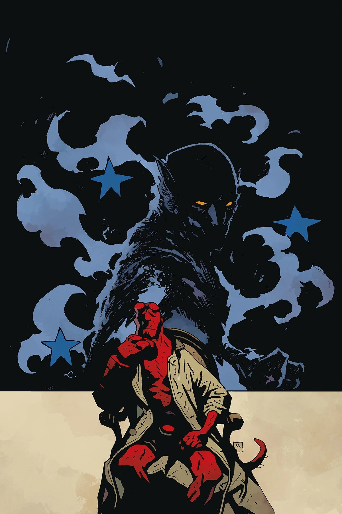
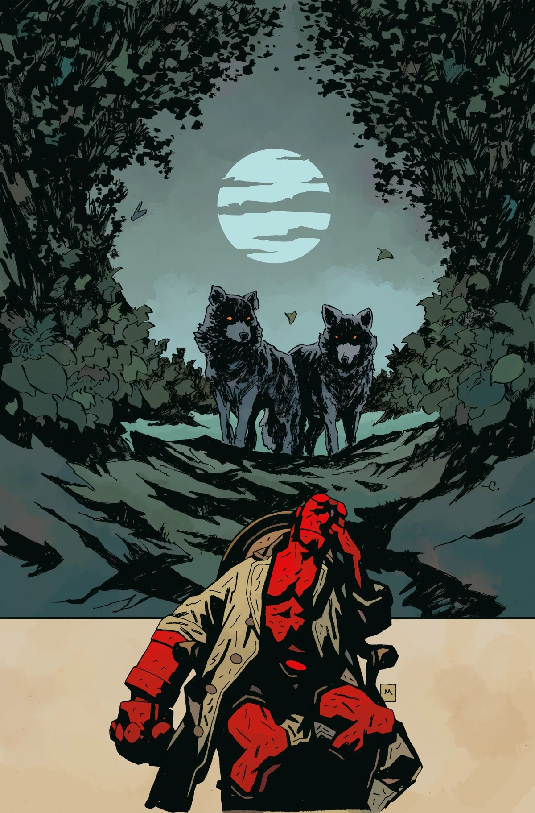
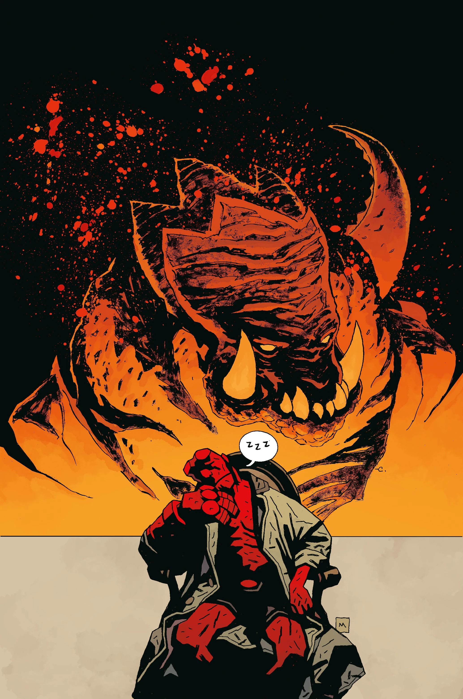

***The Silver Lantern Club*** is five-issue *[Hellboy](/entry/Hellboy)* arc written by [Mike Mignola](/entry/Mike_Mignola) and [Chris Roberson](/entry/Chris_Roberson), drawn by [Christopher Mitten](/entry/Christopher_Mitten) and [Ben Stenbeck](/entry/Ben_Stenbeck).

## Synopsis

### Part One

Hellboy learns about the mysteries of an exorcism gone wrong and more when his occult investigator relative reveals secretive and perilous adventures of one of the Hellboy Universe’s most mysterious societies! Silver Lantern Club member Simon Bruttenholm relates a tale from the dawn of radio, in which Sir Edward Grey and Sarah Jewel go toe to toe with… technology?

### Part Two

What could a missing explorer and a string of strange killings possibly have in common? Silver Lantern Club members Sarah Jewell, Lady Bai, Major Singh, and Sir Edward Grey bring fresh eyes to each other's cases… and find they meet unexpectedly in the middle!

### Part Three

Reliving old stories with Hellboy and Professor Bruttenholm, Simon Bruttenholm recalls the strange tale of a woman whose synesthetic visions revealed the presence of a mysterious and malevolent entity. What ensues is a hair-raising confrontation worthy of the Silver Lantern Club’s finest!

### Part Four

Simon Bruttenholm relates a strange tale to Hellboy and the Professor, this time spinning a tale of dangerous creatures stalking the streets of London. The Silver Lantern Club teams up with an old vodka-loving, werewolf-hunting friend of Edward Grey’s to capture the ferocious beasts. But the chase is especially difficult when you’re not in your full faculties!

### Part Five

When Hellboy and the Professor face a dead-end in their supernatural investigations, Simon Bruttenholm offers inspiration in the form of a tale when the combined forces of the entire Silver Lantern club were required to defeat a strange occult endeavor!

## Gallery

All covers by [Christopher Mitten](/entry/Christopher_Mitten), [Mike Mignola](/entry/Mike_Mignola), and [Dave Stewart](/entry/Dave_Stewart).

Issue \#1

|Issue #2

|Issue #3

|Issue #4

|Issue #5
