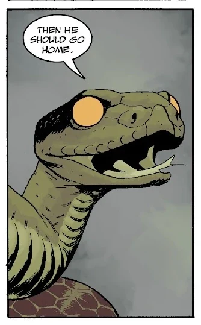

*This article is a stub. You can help Hellboy Wiki by expanding it.*

**The Snake** is a character that first apppeared in the short story *[The Magician and the Snake](/entry/The_Magician_and_the_Snake)* as one of the titular characters. It has since appeared in arcs of *[Hellboy in Hell](/entry/Hellboy_in_Hell_(series))* and *[Koshchei](/entry/Koshchei_(series))*.

## Nature of the character

The Snake's first appearance in *The Magician and the Snake* is a kind of [fairy tale in the Hellboy Universe](/entry/The_Magician_and_the_Snake), the sort of story Hellboy would have been told as a child. However, the Snake later appears as a character in *[Hellboy: The Three Gold Whips](/entry/The_Three_Gold_Whips)*, able to talk to other character and influence events. The exact nature of the Snake has never been explained and is left to the reader's interpretation. To a certain extent, the Snake is a metatextual metaphor, but it can also be read as literally the very same Snake that appeared in *The Magician and the Snake* and has somehow manifested from a work of fiction into reality. Whatever it is, it does not appear to be bound by physical laws, instead operating under a kind of "dream logic" where it can appear wherever and whenever it wishes.
