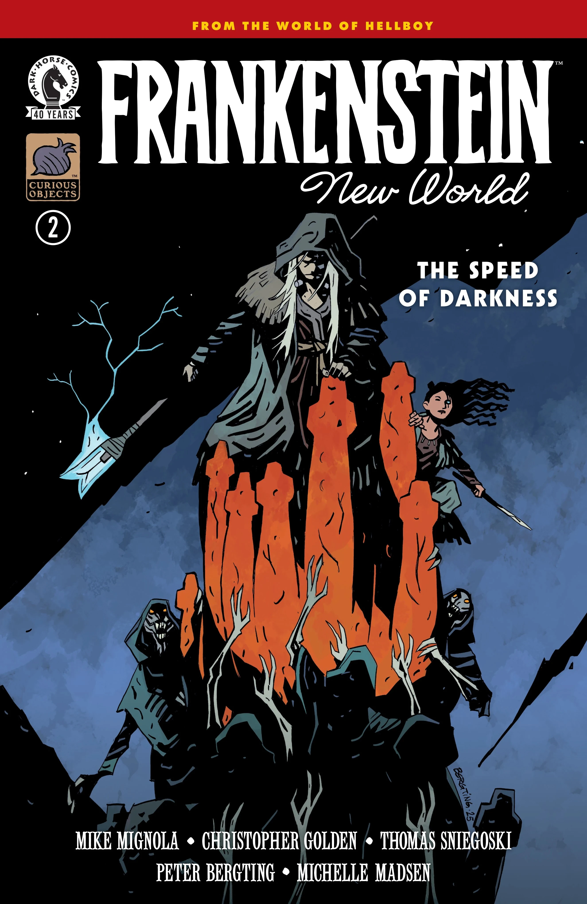
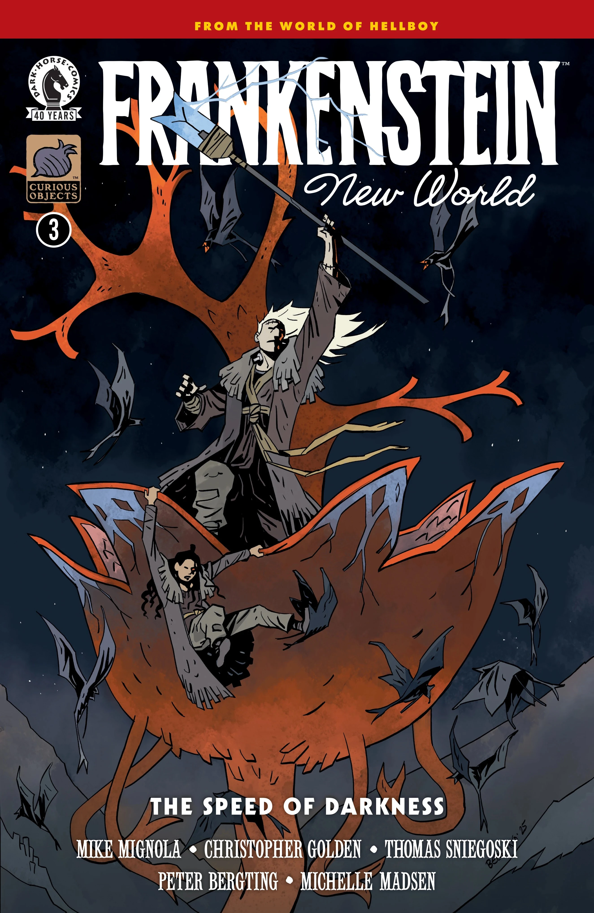
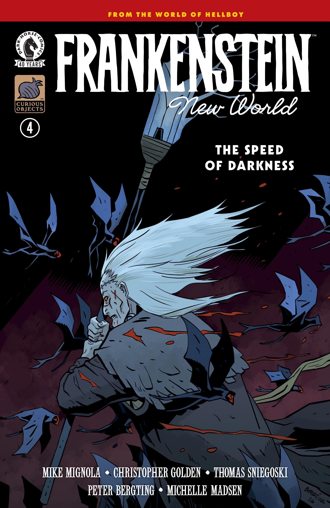

***Frankenstein: New World—The Speed of Darkness*** is a four-issue miniseries written by [Mike Mignola](/entry/Mike_Mignola), [Christopher Golden](/entry/Christopher_Golden), and [Thomas Sniegoski](/entry/Thomas_E._Sniegoski) with art by [Peter Bergting](/entry/Peter_Bergting). It is the third arc in the [*Frankenstein: New World* story cycle](/entry/New_World_(Frankenstein_story_cycle)).

## Synopsis

### Part One

Called by Liz Sherman in visions to save the new world, Frankenstein and Lilja begin using Vril energy to try and find her. But the earth is being corrupted by a parasitic and powerful evil, and their time to stop it is running out.

### Part Two

Frankenstein and Lilja push forward on their journey to find Liz Sherman as Lilja’s visions grow more urgent, but danger is coming from all directions as an insidious evil continues to corrupt the world around them.

### Part Three

In a life-or-death moment, Frankenstein summons a power within himself that he didn’t know he had, and he and Lilja fight their way to Liz before vampiric creatures destroy them all—and the New World.

### Part Four

With a final push to save the New World, Frankenstein and Lilja must face a horde of bloodthirsty monsters—as well as an even more sinister, lurking danger—to make it to Liz Sherman.

## Gallery

All covers by [Peter Bergting](/entry/Peter_Bergting).

Issue \#1

|Issue #2

|Issue #3

|Issue #4
