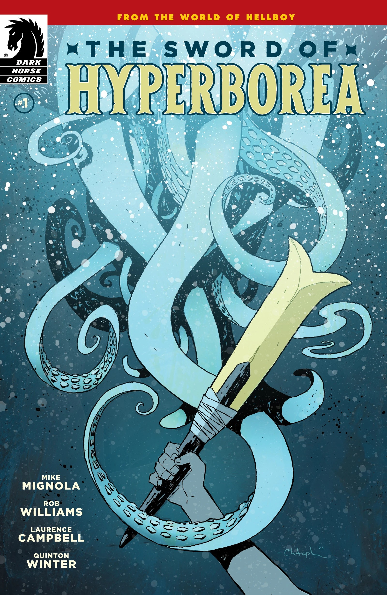
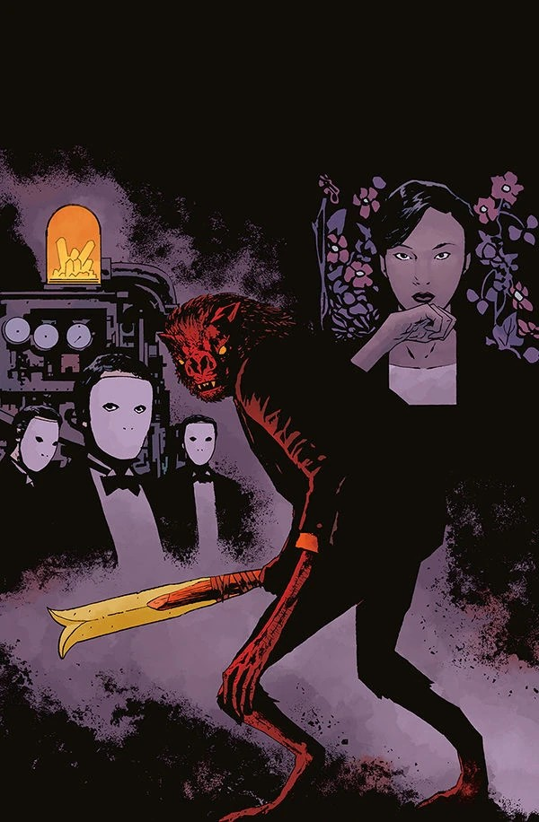
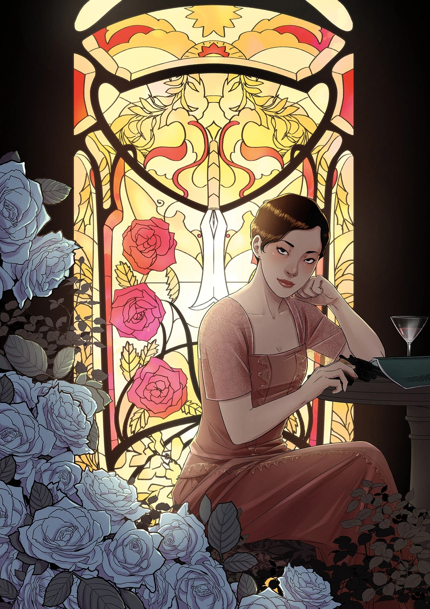
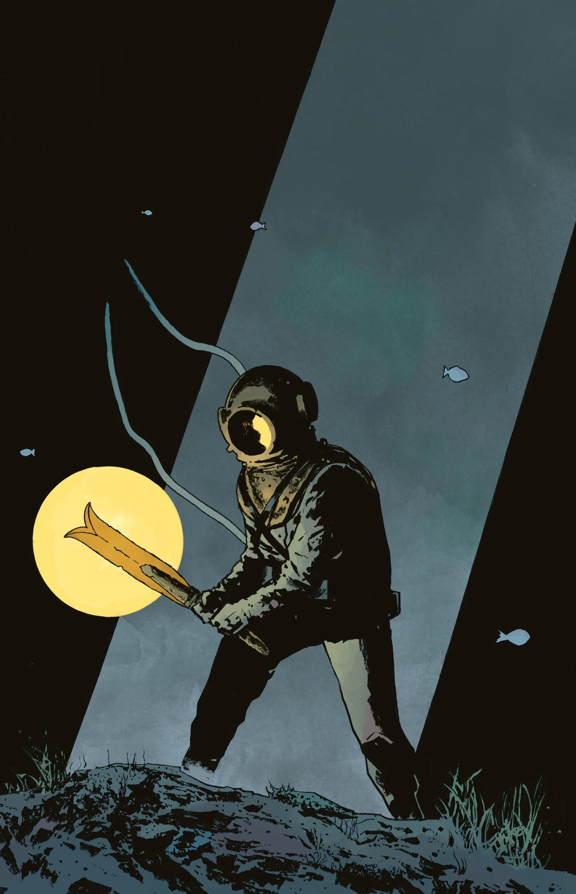
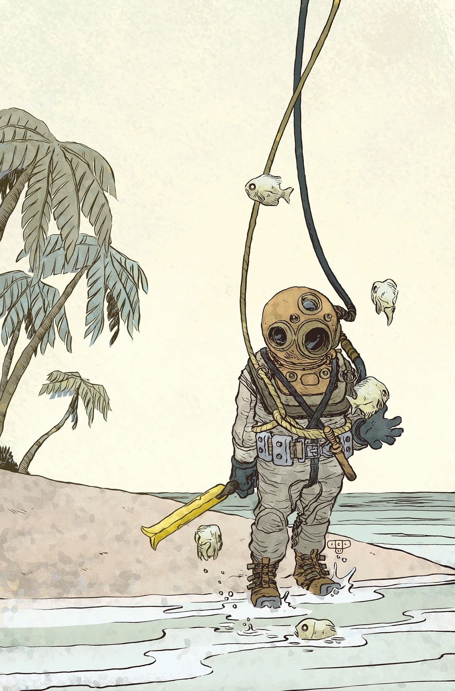
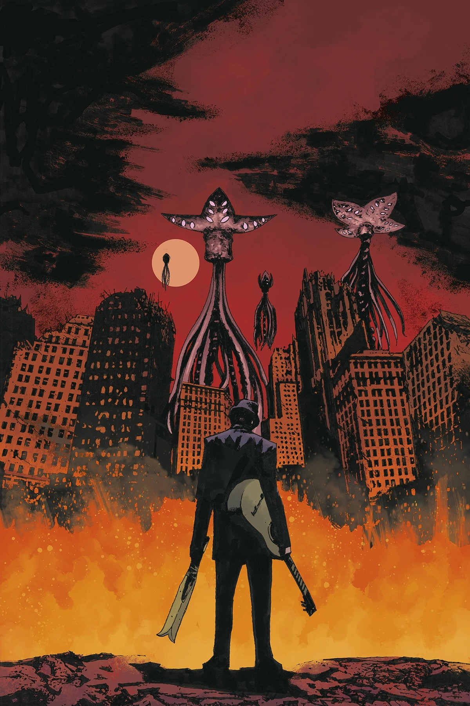
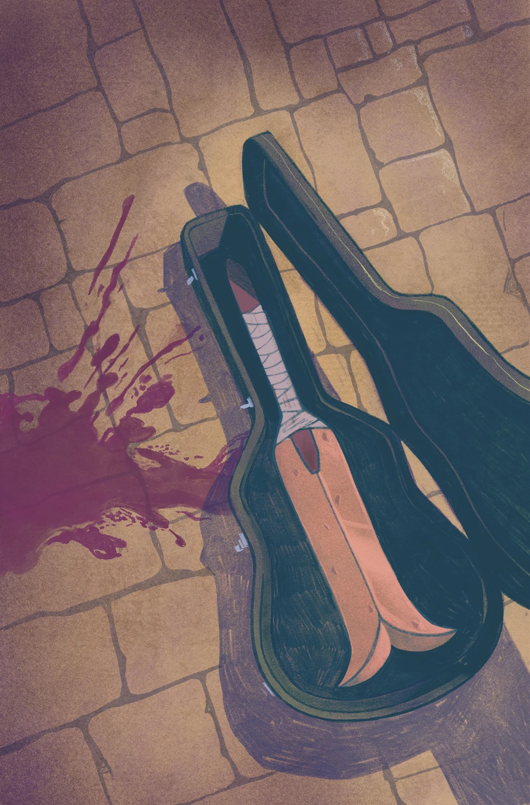

***The Sword of Hyperborea*** is four-issue miniseries written by [Mike Mignola](/entry/Mike_Mignola) and [Rob Williams](/entry/Rob_Williams), drawn by [Laurence Campbell](/entry/Laurence_Campbell).

## Synopsis

### Part One

From the ancient warrior Gall Dennar, to Sir Edward Grey, to the B.P.R.D.’s Agent Howards, the iconic Hyperborean sword from the world of Hellboy has landed in many influential hands. And this has been no accident. Trace the sword’s path through the adventures and encounters that finally brought it to Ragna Rok, at the end of the world, and witness the sword’s journey through history.

### Part Two

The Sword of Hyperborea continues its trek through history, blessing the chosen ones who wield it with incredible power. When it appears at a pivotal moment during WWI, will the blade be used for good or for evil? Spies, supernatural creatures, and secret societies collide in this fast-paced continuation of the sword’s saga!

### Part Three

An expert diver is faced with the extreme dangers of the supernatural and the real when he’s forced to retrieve a mysterious artifact from a crashed zeppelin in the English Channel. How many second chances is one man allowed to have, even when wielding the sword of Hyperborea?

### Part Four

The Sword of Hyperborea appears in the unlikely possession of an up-and-coming blues musician in Chicago, 1952. Even for a talented musician, Elijah Bone is a little different, and the strange voice that whispers to him has its own plans for him to fulfill. Delta blues, supernatural creatures, and secret societies collide in the conclusion of this Mignolaverse saga!

## Gallery

All covers by [Laurence Campbell](/entry/Laurence_Campbell) and [Dave Stewart](/entry/Dave_Stewart) unless otherwise stated.

Issue \#1

Issue \#1 variant cover  
by [Christopher Mitten](/entry/Christopher_Mitten)

Issue \#2 variant cover  
by [Yishan Li](/entry/Yishan_Li)

Issue \#3 variant cover  
by Jesse Lonergan

Issue \#4 variant cover  
by Victor Bizar Gómez

|Issue #1 variant cover by Christopher Mitten

|Issue #2

|Issue #2 variant cover by Yishan Li

|Issue #3

|Issue #3 variant cover by Jesse Lonergan

|Issue #4

|Issue #4 variant cover by Victor Bizar Gómez
