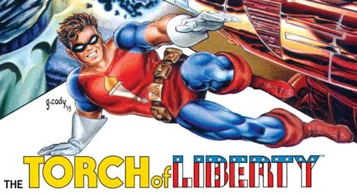
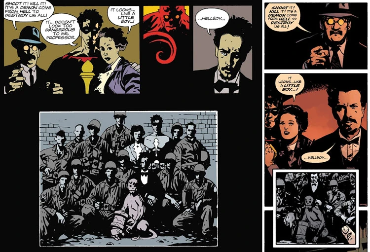

The **Torch of Liberty** was an American costumed hero who fought Nazi forces during World War II. He appears briefly in *[Hellboy](/entry/Hellboy_%28series%29): [Seed of Destruction](/entry/Seed_of_Destruction)*.

The Torch is one of the few characters in the *Hellboy* series that was not created by [Mike Mignola](/entry/Mike_Mignola) – rather, he was created by [John Byrne](/entry/John_Byrne), who scripted *Seed of Destruction* from Mignola's story. His inclusion was part of an aborted early effort to cross over multiple Dark Horse comic series. As of the completion of *Seed of Destruction*, he has not reappeared or even been mentioned again in *Hellboy*.

## Character History

The Torch of Liberty was a costumed hero. During World War II, he served his country by battling Nazis in exploits that were presented in newsreels.

In late December 1944, the Torch of Liberty joined forces with the US Army and the British Paranormal Society in a joint attempt to stop the Nazi "[Project Ragna Rok](/entry/Project_Ragna_Rok)". On December 23rd, a ritual orchestrated by the Nazis and performed by [Grigori Rasputin](/entry/Grigori_Rasputin) resulted in the summoning of [a childlike red creature](/entry/Hellboy_%28character%29) near the Allied forces. The Torch remarked that the creature did not appear to be dangerous, and his compatriot [Trevor Bruttenholm](/entry/Trevor_Bruttenholm) dubbed the half-demon "[Hellboy](/entry/Hellboy_%28character%29)"; this night was later referred to as the "[Hellboy Incident](/entry/Seed_of_Destruction)".[1]

Later, the Torch gave Hellboy [a large single-shot pistol](/entry/Hellboy%27s_gun).[2] He described Hellboy as the worst shot he had ever trained.[3]

## Publication History

### John Byrne

 Torch of Liberty was created by [John Byrne](/entry/John_Byrne) and featured in the backup story to *Danger Unlimited* \#1–4 (February–May 1994); he (along with Hellboy) makes a cameo appearance in the fourth issue. The Torch was also featured in the self-titled *Torch of Liberty Special* (January 1995).

Born in Illinois in 1915, Paul Gibney adopted the mantle of the Torch of Liberty in 1941.[4] The comic stories reveal his origin as a soldier in World War II Europe, brought to great heights through trauma in combat.

### *Hellboy*

The Torch of Liberty appears in *Seed of Destruction* \#1 (March 1994) and is mentioned in later issues of the miniseries.

#### "Legend" crossovers

See also: [Dark Horse Comics § Legend](/entry/Dark_Horse_Comics)

In the days of [Dark Horse Comics](/entry/Dark_Horse_Comics)' Legend imprint, [John Byrne](/entry/John_Byrne) (*Next Men*/*Danger Unlimited*), Art Adams (*Monkeyman and O'Brien*), and [Mike Mignola](/entry/Mike_Mignola) (*Hellboy*) planned for their creations to partially exist in a shared universe. One result of this was the Torch of Liberty's appearance in *Hellboy: Seed of Destruction*. However, Mignola recalls that the trio realized early on that this was a problematic idea, too difficult to coordinate between the three of them, and it was better that they each manage their own series independently.[5]

Comparison of the Torch's prominent presence in <em>[Seed of Destruction](/entry/Seed_of_Destruction)</em> #1 (left) and his minimized depiction in <em>[Hellboy and the B.P.R.D.](/entry/Hellboy_and_the_B.P.R.D.): [1952](/entry/1952)</em> #1 (right)

The Torch's appearance in *Seed of Destruction* is an artifact of these abandoned shared universe plans; he has not made a notable reappearance in the series since. Later depictions of the Hellboy Incident tend to minimize or wholly omit his presence at the event. The Torch also goes unmentioned in supplemental materials such as *[Hellboy: The Companion](/entry/Hellboy__The_Companion)*.

#### Potential Future Appearances

Because the character is owned by Byrne, it is extremely unlikely that he will ever show up in a *Hellboy* story again. In 2007, Byrne joked that Mignola was welcome to use the Torch again "if he asked politely."[6]

As explained by editor [Scott Allie](/entry/Scott_Allie):

> The Torch of Liberty is the property of John Byrne, not Mike or Dark Horse, so, in order to keep these books all owned by Mike, we use characters he made up. John's busy elsewhere, so the Torch is gone if not forgotten.''[7]

Discussing the decision to use the Torch in *Seed of Destruction*, Mignola recalled:

> I thought it was cool to have one superhero guy—kind of a throwback to my Marvel Comics stuff, little World War II Captain America hanging out with GIs. I always wanted to have that. And since John had created this Captain America-ish character, I thought, “Well, this is just perfect.” But now, I never want to go back and take it out, and John never told me to take it out. We acknowledge it’s there, but we just don’t talk about it too much.[8]

Mignola added that if he had thought of [Lobster Johnson](/entry/The_Lobster) back then, he would've used him to fill that niche in the opening of *Seed of Destruction*.[9]

## References

<references/>

[pt-br:Tocha da Liberdade](/entry/pt-br%3ATocha_da_Liberdade)

[1] *[Seed of Destruction](/entry/Seed_of_Destruction)* \#1

[2]

[3] *[Seed of Destruction](/entry/Seed_of_Destruction)* \#3 (HELLBOY: "The Torch of Liberty said I was the worst shot he ever tried to train...")

[4]

[5]

[6] Byrne, John. ["Q for JB-Hellboy and Torch of Liberty", *Byrne Robotics* forum](https://byrnerobotics.com/forum/forum_posts.asp?TID=18384).

[7] Hellmail, *[War on Frogs](/entry/War_on_Frogs)* \#4 (Dec 2006)

[8]

[9] Pinchuk, Tom. ["Hellboy Creator Mike Mignola Reflects on All Eras of His Comics Career". *Nerdist* (via *Geek & Sundry*).](https://nerdist.com/article/hellboy-creator-mike-mignola-reflects-on-all-eras-of-his-comics-career/) 2 May 2018.
