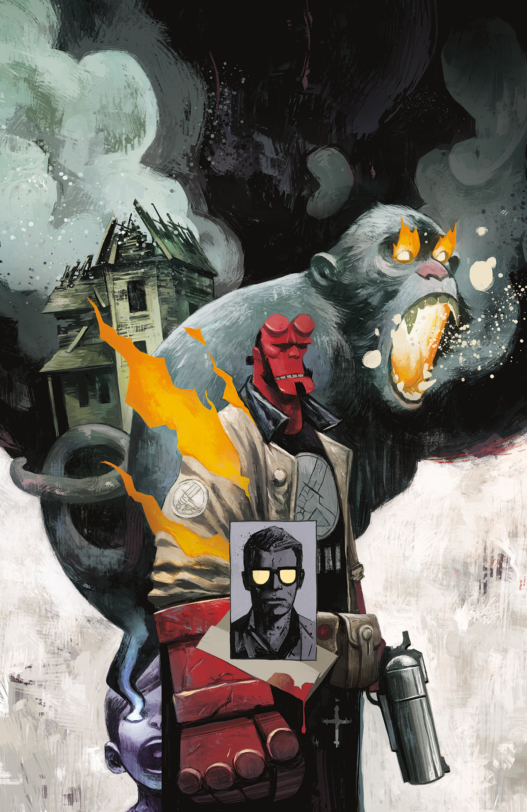

***The Unreasoning Beast*** is a one-shot arc of *[Hellboy and the B.P.R.D.](/entry/Hellboy_and_the_B.P.R.D.): 1954* written by Mike Mignola and Chris Roberson, and illustrated by Patric Reynolds.

## Synopsis

An unusual ghost hunt leads Hellboy to a spectral monkey with a message for a grieving family.

## Gallery

Cover by [Mike Huddleston](/entry/Mike_Huddleston).

|*The Unreasoning Beast*
