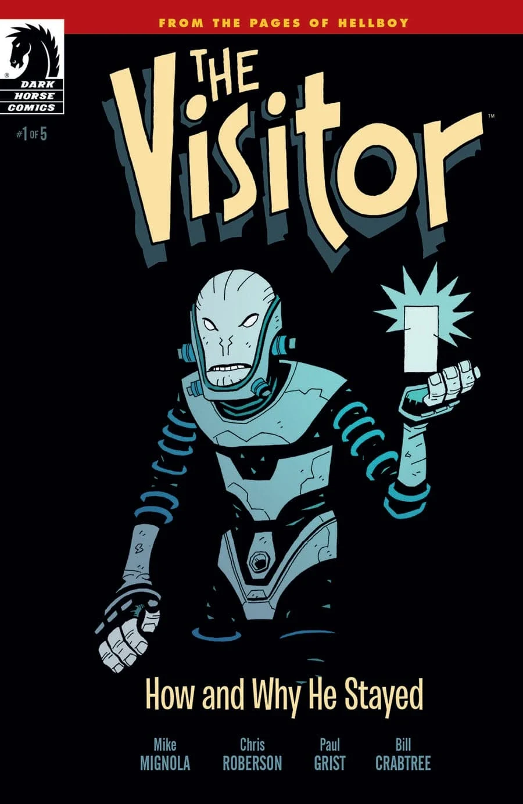
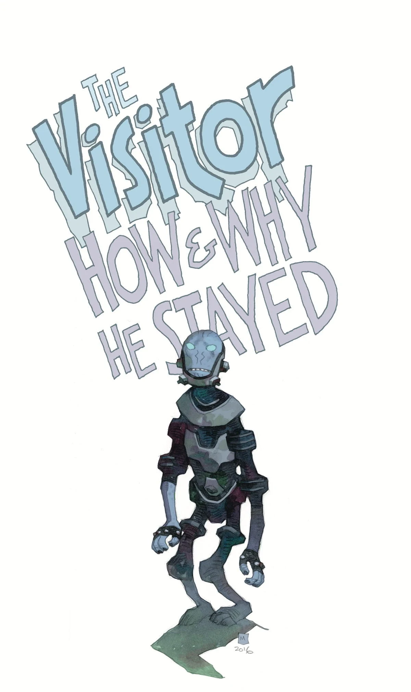
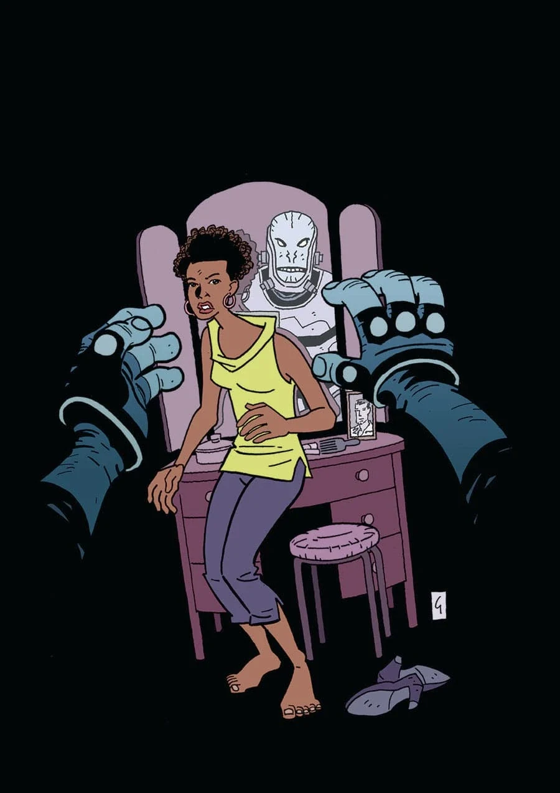

***The Visitor: How & Why He Stayed*** is a five-issue miniseries written by Mike Mignola and Chris Roberson with art by Paul Grist.

## Synopsis

### Part One

In 1944 Hellboy was conjured in a ceremony meant to give Hitler the ultimate occult weapon. Fortunately, Professor Trevor Bruttenholm was there to witness, and to guide Hellboy to become the greatest paranormal detective in the world. But Bruttenholm wasn’t the only witness to Hellboy’s arrival. A visitor was there, sent to kill the Beast that had been prophesied to kill us all. What the visitor saw, and why he stayed his hand, leads to the most mysterious Hellboy spinoff yet…

### Part Two

The Visitor continues to monitor Hellboy from afar while attempting to navigate American society as an alien in the 1960s.

### Part Three

The resurgence of a dangerous woman believed to have been killed long ago by the BPRD leads the Visitor to a cult’s compound in the Southwest.

### Part Four

The Visitor alerts the BPRD as increasing numbers of Ogdru Hem attack, and the challenges of being an alien on Earth take a toll.

### Part Five

After decades of living as a man the Visitor has a chance to return to his people in space, but must deliver a message to Hellboy first.

## Gallery

 \#1

 \#1
ComicsPRO variant

 \#2

 \#3

 \#4

 \#5
