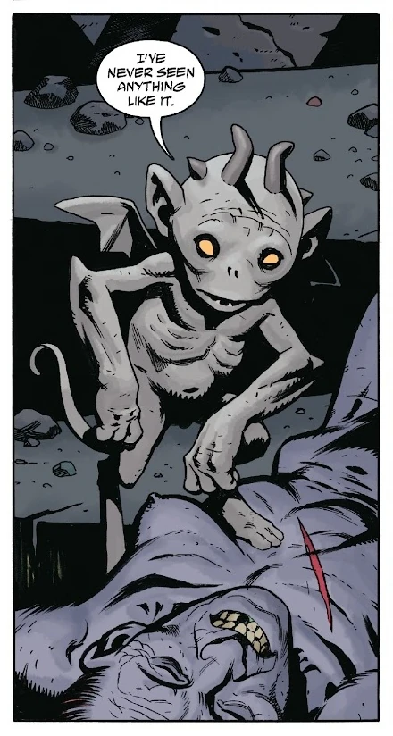
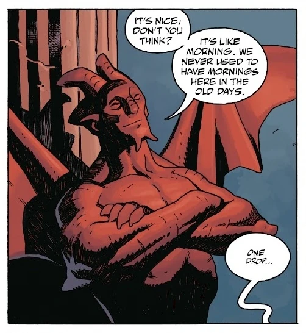

Of unnamed identity, this Demon is the last member of his race still walking the now-flourishing Hell. He is found by [Koshchei the Deathless](/entry/Koshchei_(character)), inside a bottle hanging from the neck, of Ida Boguet's corpse.

He promises his finder help eliminating the last remaining [Witches](/entry/Witches), now followers of [Pluto](/entry/Pluto), in exchange o a single drop of Blood.

After a violent and exhausting fight, which he helped produce, the last Demon in Hell takes advantage of Koshchei's tiredness, and sucks him dry. Thanks to the stolen blood, he gains stature, muscles, red coloring and a nose. Content in his new state, he throws Koshchei, now dry as a corpse, in to the dark and deep waters of Hell
