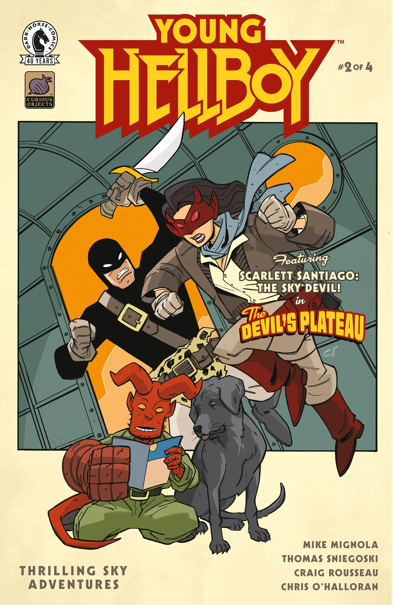
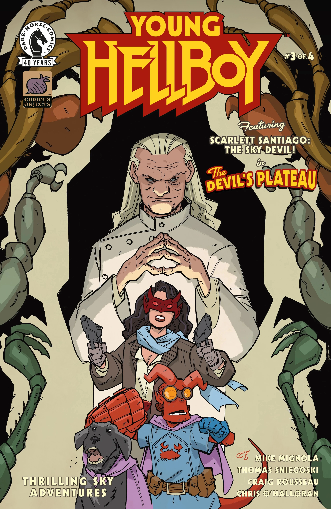
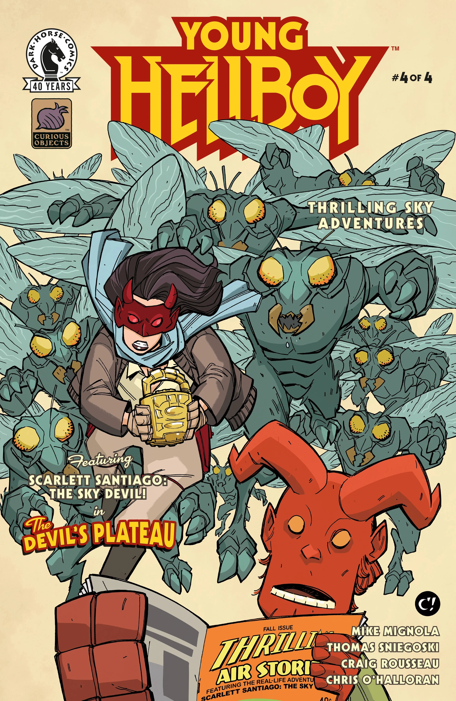
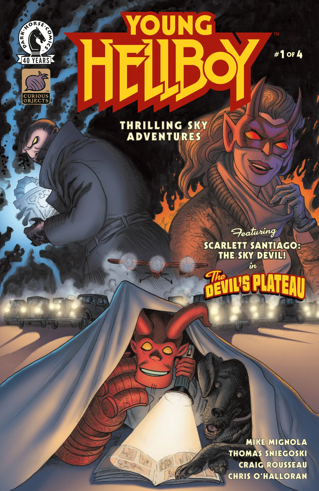
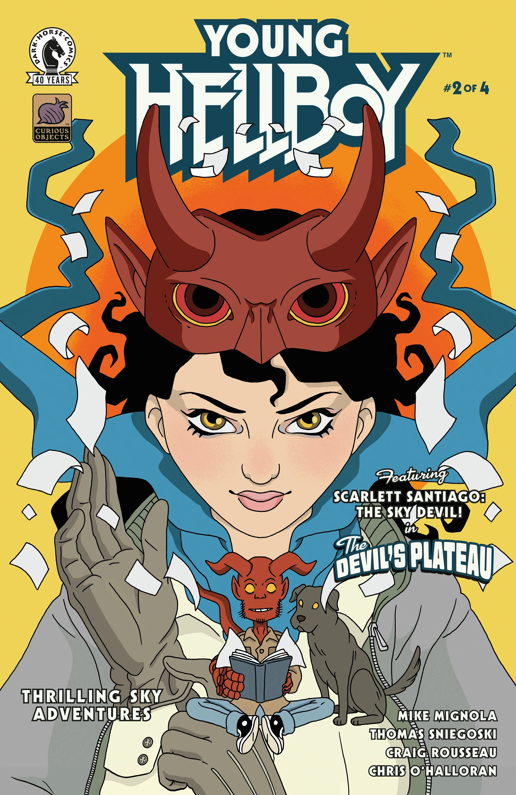
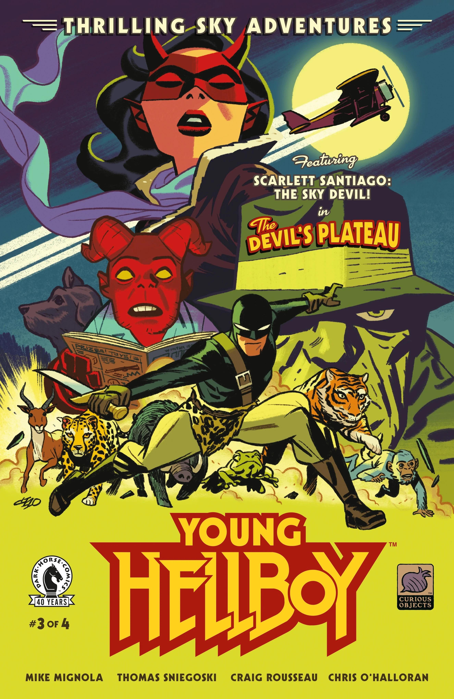
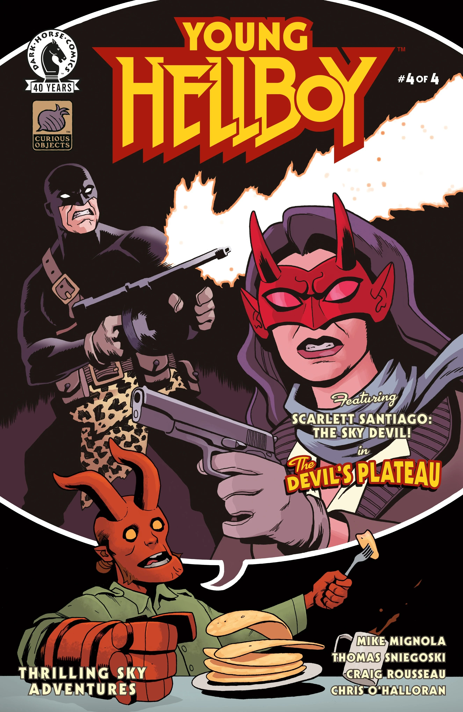

***Thrilling Sky Adventures*** is a four-issue miniseries written by [Mike Mignola](/entry/Mike_Mignola) and Tom Sniegoski with art by [Craig Rousseau](/entry/Craig_Rousseau). It is the third story in the *[Young Hellboy](/entry/Young_Hellboy)* series.

## Synopsis

### Part One

In a comic adventure within a comic adventure, Scarlett Santiago may have beaten too many villains to keep a low profile on the streets anymore. To keep herself safe and defeat the bad guys who are after her, she may need to team up with a mysterious, feline figure who has similar goals.

### Part Two

Scarlett jets off on another mission with a man aboard who needs her help, but a stowaway may sully her plans when they try to stop her. Scarlett can navigate the turbulent motion of her plane, but can she navigate the conflicting stories between her passenger and her stowaway and find out who she can really trust?

### Part Three

Scarlett and passengers land at the infamous Devil’s Plateau, which at first appearance seems anything but devilish. But something dark and nefarious could be just around the corner, and the Sky Devil isn’t going to leave any stone unturned in her search for the truth behind the Devil’s Plateau.

### Part Four

The mystery behind the Devil’s Plateau becomes clear when Scarlett discovers that what is lurking there is less perilous than what the team—including Scarlett herself—could become. Another Young Hellboy series concludes in this rollicking action-adventure finale!

## Gallery

Main covers by [Craig Rousseau](/entry/Craig_Rousseau).

Issue \#1

|Issue #2

|Issue #3

|Issue #4

|Issue #1 by David Hitchcock

|Issue #2 by Alice Darrow

|Issue #3 by Michael Cho

|Issue #4 by Ben Stenbeck
### Variant Covers

Issue \#1  
by David Hitchcock

Issue \#2  
by Alice Darrow

Issue \#3  
by Michael Cho

Issue \#4  
by [Ben Stenbeck](/entry/Ben_Stenbeck)
