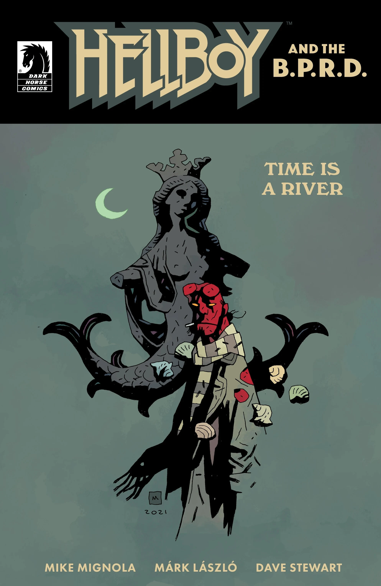
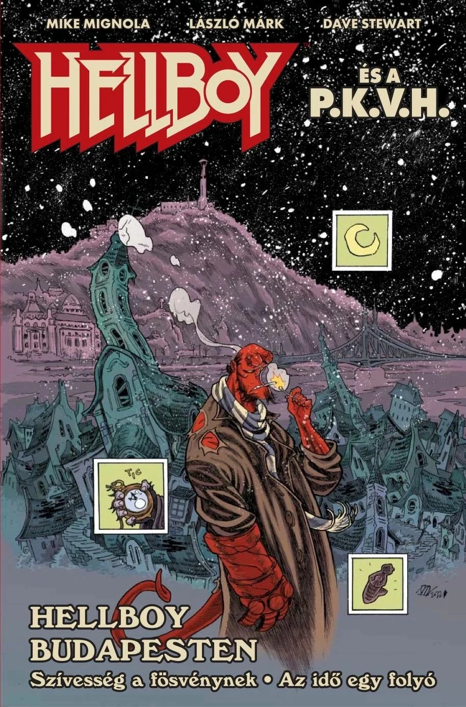

***Time Is a River*** is a one-shot arc of *[Hellboy and the B.P.R.D.](/entry/Hellboy_and_the_B.P.R.D.)* written by Mike Mignola and illustrated by Márk László. It is a sequel to the short story *[The Miser's Gift](/entry/The_Miser's_Gift)*.

## Publishing History

On October 9, 2022, Hungarian publisher Vad Virágok release "*Hellboy Budapesten*," a double length issue featuring *[The Miser's Gift](/entry/The_Miser's_Gift)* and *Time Is a River*, with a new cover by Márk László and a 14-page sketchbook.

## Synopsis

When [Hellboy](/entry/Hellboy_(character)) accidentally left eclectic academic Lajos in a ghostly version of Budapest in “The Miser’s Gift,” he didn’t realize how far-reaching the consequences would be! As timelines get crossed, reality starts to crumble and Hellboy must return to the ghostly city to recover Lajos before it’s too late.

## Gallery

*Hellboy and the B.P.R.D.:  
Time Is a River*  
by Márk László

*Hellboy and the B.P.R.D.:  
Time Is a River*  
by Mike Mignola and Dave Stewart

*Hellboy es a P.K.V.H.:  
Hellboy Budapesten*  
(special Hungarian edition)  
by Márk László

|Hellboy and the B.P.R.D.: Time Is a River by Mike Mignola and Dave Stewart

|Hellboy es a P.K.V.H.: Hellboy Budapesten (special Hungarian edition) by Márk László
