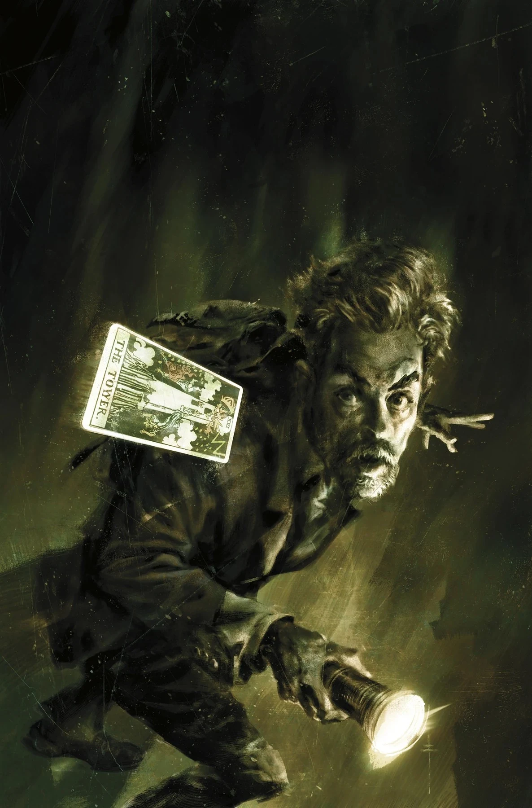
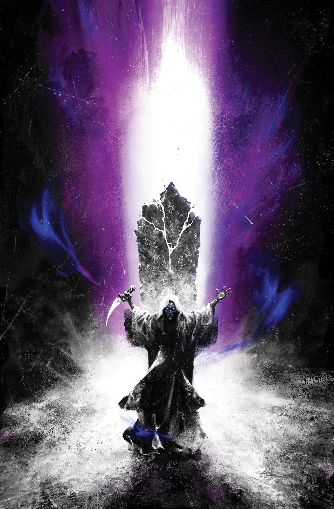
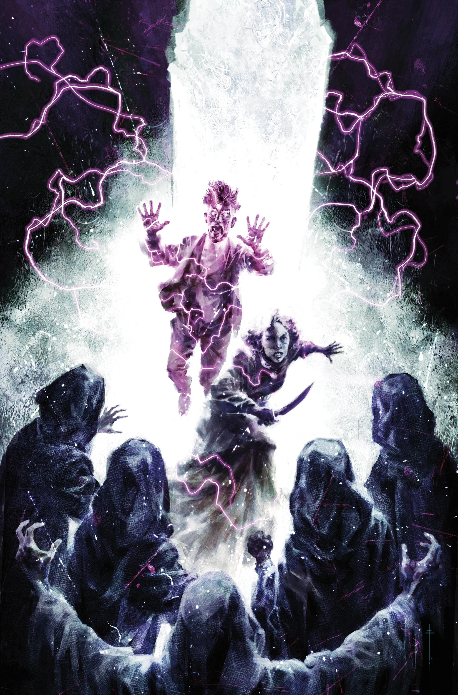

***Time Out of Mind*** is a four-issue *[The British Paranormal Society](/entry/The_British_Paranormal_Society_(series))* arc written by [Mike Mignola](/entry/Mike_Mignola) and [Chris Roberson](/entry/Chris_Roberson), drawn by [Andrea Mutti](/entry/Andrea_Mutti) with colors by [Lee Loughridge](/entry/Lee_Loughridge).

## Synopsis

### Part One

British Paranormal Society members Simon Bruttenholm and Honora Grant arrive at Noxton together, but with separate goals: Honora hopes to uncover information on the town’s strange traditions, while Simon is searching for his missing assistant. But their separate investigations lead down the same twisted path that hides a dark secret behind Noxton’s innocent façade!

### Part Two

After Simon is accosted by a strange creature near the village of Noxton's mysterious standing stones, he and Honora hatch a plan to pry some information out of the tight-lipped townsfolk.

### Part Three

Honora and Simon are pulled more deeply still into the mysteries of Noxton! Once Simon discovers the identify of his attacker, time is of the essence to figure out what happened to his missing researcher and how it connects to the strange town.

### Part Four

Simon and Honora discover first-hand the otherworldly nature of Noxton’s standing stones and their tragic history. As they unravel the mystery, a local secret bred from otherworldly influence giving way to misguided faith—and the horror it’s resulted in—becomes clear.

## Gallery

All covers by [Sebastián Fiumara](/entry/Sebasti%C3%A1n_Fiumara).

Issue \#1

|Issue #2

|Issue #3

|Issue #4
