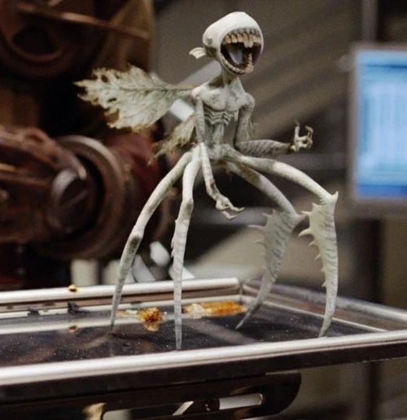

*"All these things do is eat, eat, then poop, then eat again"*

\-[Abe Sapien](/entry/Abe_Sapien) on the tooth fairies.

**Tooth Fairies** (*Carcharodon calcarea*) are ravenous, multi-legged winged creatures appearing in *[Hellboy II: The Golden Army](/entry/Hellboy_II__The_Golden_Army)*.

The tooth fairies hail from the Black Forest, Germany. They feed largely on calcium (flesh, bones, organs and other tissues), and due to its higher concentrations of the aforementioned mineral, they prefer the teeth (hence their name). When attacking live prey, they target a victim's teeth, though they will eat their prey until nothing remains but droppings. They swarm in great numbers and are capable of overwhelming a humanoid target; stripping them of flesh in seconds. Despite their savage behavior, they are sentient and capable of communication, though not in human languages. They were considered contraband, likely for their destructive nature.

The tooth fairies were illegally purchased by Prince Nuada at the Troll Market, starved, and then released into an auction house, killing over 70 people. Later, agents of the [BPRD](/entry/Bureau_for_Paranormal_Research_and_Defense) investigated the disturbance. Among them were [Hellboy](/entry/Hellboy_(character)), [Abe](/entry/Abe_Sapien) and Liz. After a vicious fight which claimed the lives of two human BPRD agents, Liz uses her pyrokinesis to blast through the auction house, roasting the fairies alive and sending Hellboy flying out of a window and into the public view. Later, [Johann Kraus](/entry/Johann_Kraus) uses teleplasty to reanimate a fairy killed when Liz unleashed her powers. It was able to communicate that it was purchased in the Troll Market before it expired again.
