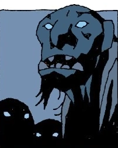

**Trolls** are a mythical creature that appears in both Hellboy comics and [Hellboy II: The Golden Army](/entry/Hellboy_II__The_Golden_Army).

## In the Comics

Trolls are a species of large, brutish humanoids, Trolls are hinted at being particularly violent. They are unable to go out during the day, as sunlight will turn a troll to stone. The trolls of Norway are said to dwell in Troll-heim, but it is unknown how many other countries suffer from the threat of trolls. In Norway many trolls seem to have a fear and/or weakness towards the wooden spoon used to kill their kind by the [Troll Witch](/entry/The_Troll_Witch).  [Hellboy](/entry/Hellboy_(character)) is given this wooden spoon by the Troll Witch herself to trap a band of marauding trolls outside their cave. They are so afraid of the memory of the weapon that they dare not cross it. They turn to stone in the sunlight instead of daring to cross over the spoon. The Troll Witch resembles a troll, although it is uncertain if she is one or just appears as one.  In the Hellboy story: [The Wild Hunt](/entry/The_Wild_Hunt) a reference is made to the Nordic trolls by the [Daoine Sidhe](/entry/Daoine_Sidhe), so they appear to have some sort of relationship.

## Hellboy II: The Golden Army

**Trolls** are a type of magical creature featured in *[Hellboy II: The Golden Army](/entry/Hellboy_II__The_Golden_Army)*. There are many types of trolls with a variety of languages. Specific types include [Cave Trolls](/entry/Cave_Troll) (like [Mr. Wink](/entry/Mr._Wink)), Cronie Trolls and [Fragglewumps](/entry/Fragglewump). Trolls fought in the original war against the [Humans](/entry/Human). Some trolls shopped in [the Troll Market](/entry/The_Troll_Market), which was located under Brooklyn Bridge and was kept secret from others.

## Gallery
