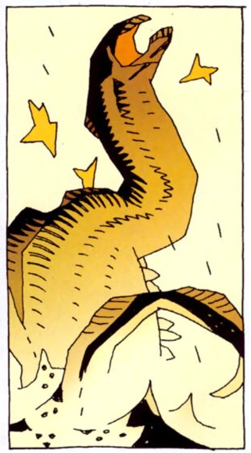
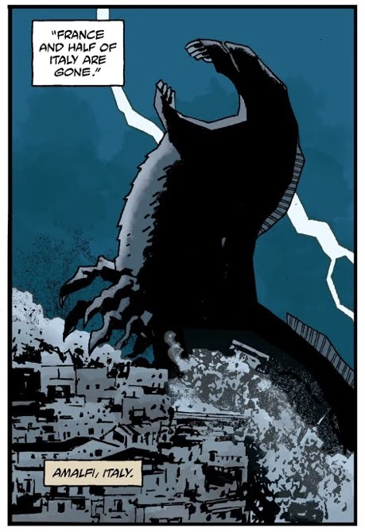

**Urgo-Hem** was one of the 369 [Ogdru Hem](/entry/Ogdru_Hem), the children of the [Ogdru Jahad](/entry/Ogdru_Jahad) who served as the main antagonist in *Hellboy: The Island*.

### [The Island](/entry/The_Island)

Urgo-Hem was freed from imprisonment through the blood of a 16th century Spanish priest. The priest had spent time in Tenochtitlan before it burned and had learned the history of the Ogdru Hem there. After being persecuted by the inquisition for his knowledge, the priest was eventually squirrelled away by a secret order dedicated to preserving treasures of the ancient world.

When [Hellboy](/entry/Hellboy_%28character%29) stumbled across him, the priest's blood released Urgo-Hem. Apparently, an aquatic beast, this child of the Ogdru Jahad resembled an eyeless serpent with sharp crustacean legs lining its pale underbelly. After a bloody conflict, Urgo Hem impaled itself on the mast of a nearby shipwreck, and Hellboy escaped.

### [RagnaRok](/entry/Ragna_Rok)

Later, when [Rasputin](/entry/Rasputin) was brought back to the mortal plane and revived all of Earth's dormant Ogdru Hem, Urgo-Hem was seen towering over Amalfi, Italy in a much larger (but still recognizable) form.

## Appearance

Urgo-Hem is a large aquatic, eyeless serpent-like creature, with sharp crustacean legs lining its pale underbelly. When it was resurrected by Rasputin it was much larger than before.

## Gallery

 in *The Island*

 Hem in Ragna Rok

## First comic appearances

- [The Island](/entry/The_Island)
- [Ragna Rok ](/entry/Ragna_Rok_%28story_arc%29)

## Trivia

- An aquatic serpentine monster resembling Urgo-Hem appeared in *[Hellboy: Sword of Storms](/entry/Hellboy__Sword_of_Storms)*, which [Liz](/entry/Liz_Sherman) attempted to immolate during a prolonged battle, but eventually retreated after the defeat of its "brothers" Thunder and Lightning.

## External Links

- [Urgo-Hem](https://villains.fandom.com/wiki/Urgo-Hem) on the [Villains Wiki](https://villains.fandom.com/wiki/Main_Page)
