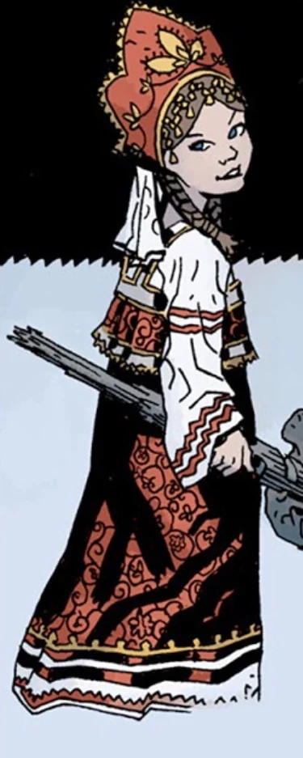

 **Vasilisa** was a handmaiden in [Morgan Le Fey](/entry/Morgan_Le_Fey)'s castle.

## History

Vasilisa first appeared in *[Darkness Calls](/entry/Darkness_Calls)*, rescuing [Hellboy](/entry/Hellboy_%28character%29) from [Koshchei the Deathless](/entry/Koshchei_the_Deathless) via a lamp from [the Baba Yaga](/entry/Baba_Yaga_%28character%29)'s house. Vasilisa explains that she gained the lantern when her stepmother sent her to the Baba Yaga, hoping the witch would kill her. Instead Baba Yaga let her go with the lantern, thanks to the aid of a magic doll. As she finishes her story, Koshchei shoots an arrow through her, killing her in Hellboy's arms. With her dying breath, she gives him a comb and a handkerchief, that were given to Vasilisa by her doll on her deathbed.

When Morgan urged Hellboy to seize [Excalibur](/entry/Excalibur) and embrace his legacy as the rightful King of England, Hellboy refused, haunted by his bloody rampage against the [giants](/entry/Giant) he had encountered earlier, as well as his unwanted legacy as [Azzael](/entry/Azzael)'s son and wielder of the [Right Hand of Doom](/entry/Right_Hand_of_Doom). But Vasilisa opined that he had been listening too much to [Astaroth](/entry/Astaroth), [Rasputin](/entry/Grigori_Rasputin), and all the others who had insisted on branding him as a monster and an instrument of evil. Vasilisa asked why he couldn't believe what [Alice Monaghan](/entry/Alice_Monaghan), and many others believed: that he was his own man, and able to use his powers for good.

During the final battle between Hellboy's army and the [Queen of Blood](/entry/Queen_of_Blood)'s, Vasilisa gave Hellboy an iron sword, forged from the raven on top of the Queen's helmet, which Hellboy used to kill the Queen.

## Trivia

- Vasilisa's name and appearance are very similar to [Varvara](/entry/Varvara), though no clear connection between the two has been established.

- She seems to be based on the fairy tale Vasilisa the beautiful.
