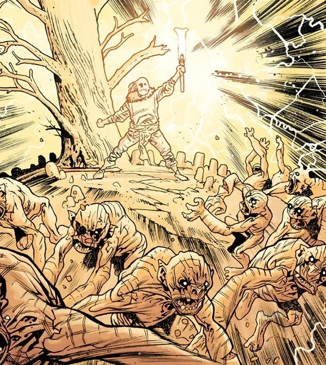

**Vril**, also known as *Flamma Reconditus*, **The Secret Fire**, was the power of [God](/entry/God) himself.

## Origins

Vril was used by the Watcher [Anum](/entry/Anum) to create the [Ogdru Jahad](/entry/Ogdru_Jahad) out of mud. The other Watchers put their seals upon the creature to bring it to life. But the monster did not live until nightfall, when darkness filled it, and gave birth to the 369 [Ogdru Hem](/entry/Ogdru_Hem), another race of vile monsters. The Watchers went to war against the Ogdru Hem, defeating them and banishing them from the Earth for a time. Anum then used the power of Vril again to seal the Ogdru Jahad in a crystal prison and cast them into the deep regions of space.

The [Hyperboreans](/entry/Hyperboreans) were able to harness the Vril power to make their civilization a paradise that ruled the Earth and last for thousands of millennia.

## V.E.S.

A scientist, Professor Gallaragas long sought to understand and wield the power of Vril after being inspired by tales of the ancient Hyperboreans. He created a device called Anum's Fork which was able to harness the Vril power. Then the professor and his daughter [Helena](/entry/Helena_Gallaragas) used Anum's Fork to power a metal suit, the [Vril Energy Suit](/entry/Vril_Energy_Suit), using failed baseball player [Jim Sacks](/entry/Jim_Sacks) as their test pilot. While wearing the V.E.S., Jim was able to wield the power of Vril with deadly effect. The original suit, the Iron Prometheus, was destroyed following an attempt by the sorcerer Memnan Saa to steal Anum's Fork. Although Jim and [Lobster Johnson](/entry/Lobster_Johnson) were able to prevent Vril from falling into Saa's hands, both Professor Gallaragas and Jim were killed in the struggle. However, while Jim was in the suit he was changed, the power of Vril transformed him into a "newly evolved superbeing". Upon his death he was seeing the secret workings of the universe.

Helena survived the attack by Memnan Saa and was able to create a second version of the V.E.S.  Employed by the U.S. government, Project Epimetheus, also called [Sledgehammer](/entry/Sledgehammer_44_(series)), was put to use during the Second World War in order to fight against the Nazis.

## [Elizabeth Sherman](/entry/Elizabeth_Sherman)

An agent for the [Bureau for Paranormal Research and Defense](/entry/Bureau_for_Paranormal_Research_and_Defense), [Liz Sherman](/entry/Elizabeth_Sherman) developed into a pyrokinetic as a young girl; a firestarter. For much of her life she has had limited control over her abilities. She has a strong connection to this fire inside her, seen in the Hellboy story: [Almost Colossus](/entry/Almost_Colossus), when she almost died after she was drained of it. Memnaa Saa believed that Liz was the living embodiment of Vril power and this is what gave her power over fire.

## Frankenstein's Monster

A creation of [Victor Frankenstein](/entry/Victor_Frankenstein), the creature was brought to life by a strange bolt of lightning. It was revealed by a scientist of the [Heliopic Brotherhood of Ra](/entry/Heliopic_Brotherhood_of_Ra) that Frankenstein's Monster contained Vril within. A thousand years into the future, Frankenstein has displayed mastery over Vril, using it in combat and also reviving the dead.

## Icthyo Sapien

[Icthyo Sapien](/entry/Frog_monster) like [Abe Sapien](/entry/Abe_Sapien) were believed to be vessels for Vril like Liz, but could not use it like Liz could. However, after his death at the hands of [Grigori Rasputin](/entry/Grigori_Rasputin), eggs spilled out of Abe's body, hatching a new race to rule the surface now that humanity had been driven underground.

All living things have [Shakti](/entry/Shakti), the opposite of Vril, inside them. Therefore, it is likely that Icthyo Sapiens had Vril instead of Shakti.
