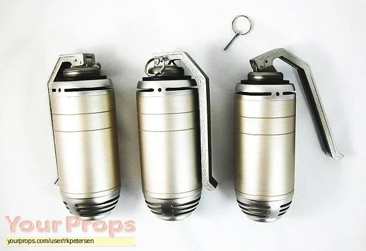

**Vulcan Grenades** are oversized grenades depicted in the film *[Hellboy](/entry/Hellboy_(2004_film))* (2004).

These specialized explosives were developed by the [Bureau for Paranormal Research and Defense](/entry/Bureau_for_Paranormal_Research_and_Defense) to kill large monsters.

## Description

The grenades have the size of a large soda bottle and possess explosive far superior to C4 explosives. [Hellboy](/entry/Hellboy_(2004%E2%80%932008_film_character)) uses them to destroy the [Behemoth](/entry/Behemoth_(Ogdru_Hem)), arming a bandolier of the grenades and allowing himself to be swallowed in order to destroy it from the inside out.
