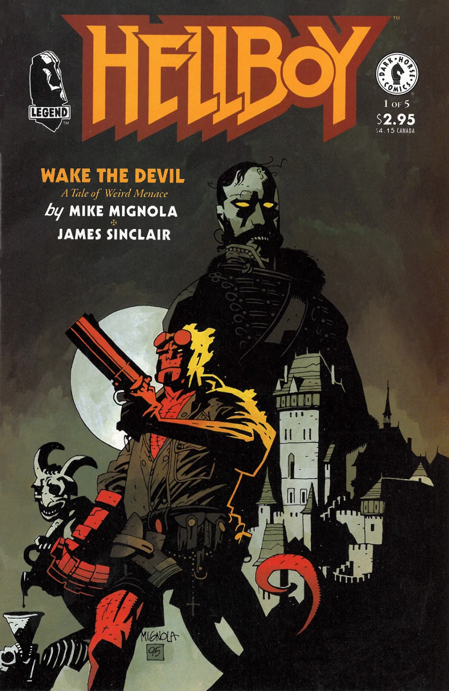
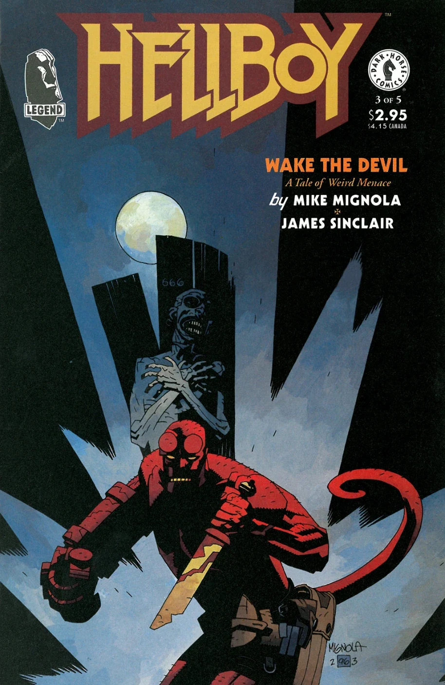
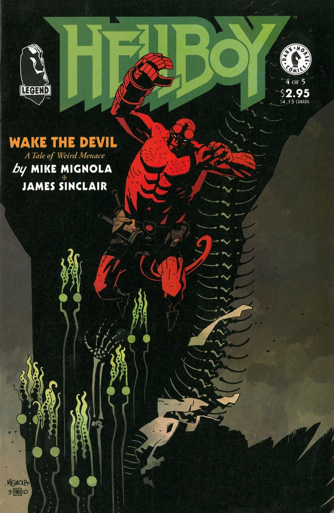
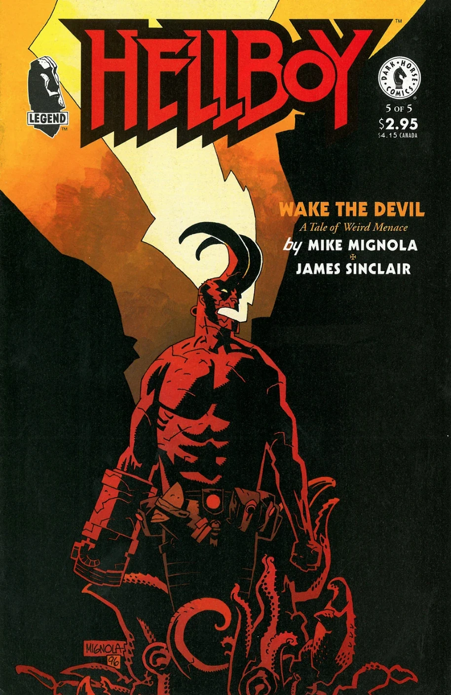

***Wake the Devil*** was the second *[Hellboy](/entry/Hellboy_%28series%29)* miniseries. It picks up where *[Seed of Destruction](/entry/Seed_of_Destruction)* left off, at a castle in Norway. The story follows the continuing plans of the Nazi occultists as they attempt to resurrect a [vampire](/entry/Vampire_%28creature%29). It introduced readers to [Vladimir Giurescu](/entry/Vladimir_Giurescu), [the Baba Yaga](/entry/Baba_Yaga_%28character%29), [Hecate](/entry/Hecate), future [B.P.R.D.](/entry/Bureau_for_Paranormal_Research_and_Defense) member [Roger](/entry/Roger) and (very briefly) [Sir Edward Grey](/entry/Sir_Edward_Grey).

## Publication History

This story was first published as the five-issue miniseries *Hellboy: Wake the Devil* \#1-5 (Jun-Oct '96). These issues also contained the back up story featuring the [MonsterMen](/entry/MonsterMen) in *Silent as the Grave* by Gary Gianni. It was reprinted with a new five-page epilogue in *[Hellboy: vol. 2 Wake the Devil](/entry/TPB)* (May '97).

## Synopsis

### Part One

The comic opens on the northern coast of Norway, inside the Arctic Circle, where a [Zinco](/entry/Roderick_Zinco) helicopter is landing in front of the castle that was seen as the end of [Seed of Destruction](/entry/Seed_of_Destruction). The head of the company, [Roderick Zinco](/entry/Roderick_Zinco), breaks into the castle and is confronted by [Karl Kroenen](/entry/Kroenen), [Ilsa Haupstein](/entry/Ilsa_Haupstein) and [Leopold Kurtz](/entry/Leopold_Kurtz) but Zinco explains that he saw [Grigori Rasputin](/entry/Grigori_Rasputin), and promises them use everything he has.

One year later, in SoHo, New York City the Nazis kill the curator of a wax museum, Howard Steinman, otherwise known as [Hans Ubler](/entry/Hans_Ubler). At the [B.P.R.D.](/entry/B.P.R.D.) Headquarters in Fairfield, Connecticut, [Tom Manning](/entry/Tom_Manning) and [Kate Corrigan](/entry/Kate_Corrigan) brief the agents about the life of [Vladimir Giurescu](/entry/Vladimir_Giurescu) and the fact that he could never die because when the full moon shines down on him at Castle Giurescu he heals himself. In 1944, [Heinrich Himmler](/entry/Heinrich_Himmler) proposed project [Vampir Sturm](/entry/Vampir_Sturm) and a Nazi delegation, led by Ilsa Haupstein was sent to recruit Giurescu. After meeting with Giurescu, Hitler ordered the arrest, execution and destruction of the Giurescu family. However, it is possible that reveal the museum curator, could have smuggled Giurescu's body out of Germany before his corpse was burnt. The [B.P.R.D.](/entry/B.P.R.D.) is concerned that someone might try to re-animate Giurescu in his Castle. However, there are three possibilities as to where Castle Giurescu is, so [Tom Manning](/entry/Tom_Manning) splits the agents into three groups; Hellboy on his own, [Abe Sapien](/entry/Abe_Sapien) with [Mr. Clark](/entry/Clark), and [Liz Sherman](/entry/Liz_Sherman) with [Bud Waller](/entry/Bud_Waller) and [Sidney Leach](/entry/Sidney_Leach).

In Romania, [Ilsa Haupstein](/entry/Ilsa_Haupstein) opens the stolen box with Giurescu's corpse and orders the soldiers to take it to a specific room. Meanwile, in Norway, Kurtz and Kroenen watch Ilsa and it is revealed that they are manufacturing their own army. Back in Romania, The agents are all on a plane where Abe Sapien talks to Hellboy about the involvement of [Project Ragna Rok](/entry/Project_Ragna_Rok) because he thinks it's worrying Hellboy. Hellboy jumps out of the plane and his jetpack explodes, crashing Hellboy into Castle Giurescu.

### Part Two

Ilsa orders [Unmensch](/entry/Unmensch), a cyborg Nazi, to kill Hellboy and they fight until they both fall through the floor. A flashback to Tarmagant Island, 1944 shows Rasputin ordering Ilsa, Kroenen and Kurtz to go to Norway. In the present, Rasputin appears and tells her to leave the castle and that the next time she sees Giurescu that he will be young again. In the castle, Hellboy wakes up with the Nazi gone, leaving behind only his metal arm.

In a near-by village, an old man tells his daughter to leave with her children and to never come back and that it is "too late" for him to leave.

Hellboy follows a trace of blood and finds a man eating the Nazi's leg, who reveals that he is [Vladimir Giurescu](/entry/Vladimir_Giurescu)'s father, and that it is the goddess [Hecate](/entry/Hecate) who brings Giurescu back to life. When Hellboy asks where Giurescu is, the man refuses to tell him and Hellboy burns him to death. When Hellboy leaves the room he remembers the old man said something about a moon door and sees a door with a moon shape on it, and inside is the box with the corpse and the three soldier's heads in front. But he is surrounded by ravens who turn into the Women of Thessaly and start attacking him.

### Part Three

At Castle Giurescu, Hellboy shoots the Women of Thessaly until Giurescu comes out of his box. When Hellboy tries to kill him, Giurescu turns into a raven and Hellboy stabs him. Giurescu falls into a stone coffin and ends up underground. When Hellboy gets there Giurescu is on the floor with the knife in his chest but then he turns into snakes and gets away. After Hellboy leaves the tomb, Hecate brings Giurescu back to life. Rasputin tells Isla about his life and offers Ilsa Haupstein to be reborn, like he was.

In the ruins of Czege Castle, Romania, [Liz Sherman](/entry/Liz_Sherman), [Bud Waller](/entry/Bud_Waller) and [Sidney Leach](/entry/Sidney_Leach) find a door which leads to a huge room with a lifeless [homunculus](/entry/Roger) inside. Liz touches a hole in his chest but she can't let go and the homunculus comes to life as Liz is transferring her energy into him. Bud shoots her arm to get her free. The homunculus panics, snaps Bud Wallers neck and escapes.

In Norway, Roderick Zinco brings [Kroenen](/entry/Kroenen) the head of Professor [Herman von Klempt](/entry/Herman_von_Klempt), so that Kroenen can include von Klempt in their plans. In Romania, at The Monastery of St. Bartholomew, Stephen, the old man from part 2 tells his brother, a priest, that the town will go back to its "old ways" because he can sense Giurescu but his brother doesn't believe him. Back at Castle Giurescu, Hellboy finds a room full of explosives and sets a timer for them to go off in one hour.

### Part Four

As Hellboy leaves the castle, he is confronted by [Hecate](/entry/Hecate) in snake form, who tries to get Hellboy to go back to his "old kind" and tells him that he lost himself in humanity. Hellboy and Hecate start fighting as she tells him that he will bring the end of the world and that he cannot escape his own destiny. Hellboy spears her and they both smash through the wall and her skin and flesh burn in the daylight just as the explosives go off and the Castle blows up with Hellboy just outside.

[Abe Sapien](/entry/Abe_Sapien) and Clark report back to [B.P.R.D.](/entry/B.P.R.D.) HQ, from the ruins of Szentes Castle. They found nothing but see a pillar of smoke from Hellboy's location, and are told to go and find Hellboy.

In Romania, [the Baba Yaga](/entry/Baba_Yaga_%28character%29)'s servant, [Koku](/entry/Koku), brings Rasputin an Iron Maiden to initiate Ilsa Hapustein's rebirth, she goes into it and is immediately killed. Rasputin tells Koku that he will be back to see Baba Yaga.

Stephen and two other men find Hellboy's body outside the ruins of Castle Giurescu to drive him to the crossroads.

In Norway, von Klempt tempts Kroenen to join him instead of going along with Rasputin's plans but Kurtz gets angry and tries to kill Von Klempt. Kroenen tries to stop Kurtz and ends up stabbing and killing him.

In Romania, Hellboy is chained to a thick wooden pole. Rasputin tells him that he is there to rot.

### Part Five

Abe Sapien and Clark land in the Romanian village where everyone's house is boarded up, with crosses painted on the doors and windows. They enter the church and see Stephen's brother standing with Hellboy's signal belt in hand. He is unresponsive and when Cark touches his shoulder, the priest's head falls off and the pair fall through the floor. Clark is impaled on a spike, but Abe survives the fall. Rasputin confronts Abe, and threatens that just as Abe once speared him (in *[Seed of Destruction](/entry/Seed_of_Destruction)*) so too would he one day spear Abe. The Priest's decapitated head says "Abraham Sapien. Do you hear... sunken bells are tolling for thee. Out of [ caverns of Num-Yabisc](/entry/Caverns_of_Num-Yabisc), dark and terrible deep, the ocean is calling her children home."

At the crossroads, Hellboy is still chained to a thick wooden pole and is confronted by a fully re-animated [Vladimir Giurescu](/entry/Vladimir_Giurescu) on horseback. Hellboy cracks the pole and hits the horse with it, the horse and Giurescu instantly turn into bones. The Iron Maiden turns into snake-like like [Hecate](/entry/Hecate) and tells Hellboy that he cannot escape his destiny. She swollows him, his horns fully re-grow and he sees the Ogdru-Jahad before he refuses to help end the world and snaps off his horns. He appears back at the crossroads where [Kate Corrigan](/entry/Kate_Corrigan) finds him.

In Norway, Rasputin confronts von Klempt, Kroenen and Zinco and temporarily blinds Zinco who accidentally presses a button that blows up the whole castle. In a helicopter above Romania, Hellboy is told that there was no sign of the iron maiden. At the end of the issue, it is revealed that the skeleton of [Vladimir Giurescu](/entry/Vladimir_Giurescu) was in the process of being moved to \[B.P.R.D.\] HQ, but while it was temporarily placed in storage at the Bucharest airport it disappeared and has never been recovered. It is also revealed that the head of Father Nicholas Budenz never spoke again but continued to be the focus of poltergeist activities, including sudden temperature drops and the levitation of objects, for weeks.

### Epilogue

At the World Tree, Yggdrasil, [the Baba Yaga](/entry/Baba_Yaga_%28character%29) tells Rasputin that he cannot be a god and that he has failed. She asks Rasputin to stay with her but he decides to go on trying to make himself a god.

## Story Chronology

Though not explicit, *Wake the Devil* seems to take place in 1997;[1] *[Hellboy: The Companion](/entry/Hellboy__The_Companion)* places the story's events in March of '97. The story takes place some time after *[The Chained Coffin](/entry/The_Chained_Coffin)* (1994), and 8 days before *[Almost Colossus](/entry/Almost_Colossus)*.[2]

## Content

### Characters

#### [B.P.R.D.](/entry/Bureau_for_Paranormal_Research_and_Defense)

- [Thomas Manning](/entry/Thomas_Manning)
- [Izar Hoffman](/entry/Izar_Hoffman)
- [Katherine Corrigan](/entry/%E5%87%AF%E7%89%B9%C2%B7%E8%80%83%E7%91%9E%E6%A0%B9))
- Assigned to Giurescu Castle
  - [Hellboy](/entry/Hellboy_%28character%29)
- Assigned to Szentes Castle
  - [Abraham Sapien](/entry/Abraham_Sapien)
  - [Scott Clark](/entry/Scott_Clark)
- Assigned to Czege Castle
  - [Bud Waller](/entry/Bud_Waller)
  - [Sidney Leach](/entry/Sidney_Leach)
  - [Elizabeth Sherman](/entry/Elizabeth_Sherman)
- Unnamed employees

#### [Nazis](/entry/%3ACategory%3ANazi) & [Project Ragna Rok](/entry/Project_Ragna_Rok)

- [Zinco Corporation](/entry/Zinco_Corporation)
  - [Roderick Zinco](/entry/Roderick_Zinco)
  - Helicopter Pilot
- [Project Ragna Rok](/entry/Project_Ragna_Rok)
  - [Leopold Kurtz](/entry/Leopold_Kurtz)
  - [Karl Ruprect Kroenen](/entry/Karl_Ruprect_Kroenen)
  - [Ilsa Haupstein](/entry/Ilsa_Haupstein)
  - [Grigori Rasputin](/entry/Grigori_Rasputin)
  - [Unmensch](/entry/Unmensch)
  - [Ogdru Jahad](/entry/Ogdru_Jahad)
- [Hans Ubler](/entry/Hans_Ubler) (A.K.A. Howard Steinman)
- [Heinrich Himmler](/entry/Heinrich_Himmler) (Mentioned)
- [Klaus Werner von Krupt](/entry/Klaus_Werner_von_Krupt) (Flashback)
- [Herman von Klempt](/entry/Herman_von_Klempt)
- Unnamed Ragnarok/Nazi soldiers
- Undead Nazi soldiers

#### Giurescu Family

- [Vladimir Giurescu](/entry/Vladimir_Giurescu)
- Mihail Giurescu
- [Vladimir Giurescu's](/entry/Vladimir_Giurescu) lovers (Voica, Irina, Caroline, Mary, Catherine and Anna) (Paintings/Mentioned)

#### [Witches](/entry/Witches) & their allies

- [Witches](/entry/Witches)
  - [Hecate](/entry/Hecate)
  - [Baba Yaga](/entry/Baba_Yaga_%28character%29)
- Women of Thessaly
- [Koku](/entry/Koku)

#### Other

- Romanian Villagers (Maria, Stephen, Nicholas, several unnamed ones)
- [Roger](/entry/Roger) (Unnamed)
- [Hyperboreans](/entry/Hyperboreans)
  - Priest and citizens
  - [Thoth](/entry/Thoth) (Mentioned)
- Russian Royal Family
  - [Prince Felix Yusupov](https://en.wikipedia.org/wiki/Felix_Yusupov) (Flashback)
  - Other members (Flashback)
- [Daoine Sidhe](/entry/Daoine_Sidhe)
  - [Dagda](/entry/Dagda)
- [Edward Grey](/entry/Edward_Grey)[3]

### Locations

- Norway
  - [Project Ragna Rok's](/entry/Project_Ragna_Rok) Castle
- Caribbean
  - Zinco-owned island (Flashback)
- U.S.A.
  - [Hans Ubler's](/entry/Hans_Ubler) Wax Museum (Soho, New York)
  - [B.P.R.D.](/entry/Bureau_for_Paranormal_Research_and_Defense) Headquarters (Farfield, CT)
- Romania
  - [Giurescu](/entry/Vladimir_Giurescu) Castle
  - St. Bartholomew
    - Monastery
    - Crossroads
  - Ruins of Czege Castle
    - [Edel Mischrasse's](/entry/Edel_Mischrasse) workshop
  - Szentes Castle
- Scotland (Flashback)
  - Tarmagant Island (Flashback)
- [Hell](/entry/Hell)
  - [The Abyss](/entry/Abyss) (Flashback)
- [Hyperborea](/entry/Hyperboreans) (Flashback)
- Russia (Flashback)
- [Yggdrasil](/entry/Yggdrasil)

### Noteworthy artifacts

- [B.P.R.D.](/entry/Bureau_for_Paranormal_Research_and_Defense) Jetpacks
- [Baba Yaga's](/entry/Baba_Yaga_%28character%29) Mortar and Pestle
- [Hecate's](/entry/Hecate) Iron Maiden
- [Baba Yaga's](/entry/Baba_Yaga_%28character%29) Chicken-Leg House

## Gallery

Covers by [Mike Mignola](/entry/Mike_Mignola).

 \#1

 \#2

 \#3

 \#4

 \#5

## Notes

<references/>

[1] In issue \#1 Hellboy is 52 years old; 1944+52=1996, but his 'birthday' is in December, so 1997. Then in issue \#3 [Liz](/entry/Elizabeth_Sherman) states she has been in the [B.P.R.D.](/entry/Bureau_for_Paranormal_Research_and_Defense) for 23 years. In *[Seed of Destruction](/entry/Seed_of_Destruction)* \#1 we read that Liz was made a ward of the B.P.R.D. in 1974. So 1974+23=1997.

[2] *Almost Colossus* \#1

[3] He was mentioned and also appeared as a masked figure, but both characters are not yet revealed to be one in the same
