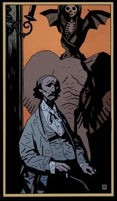

**Walter Edmond Heap** is an artist and writer. He is mainly remembered for his three prose works about [a small mechanical head](/entry/The_Amazing_Screw-On_Head). He is the artist that painted ["Death Riding an Elephant"](/entry/Death_Riding_an_Elephant_%28painting%29), a painting that [Sir Edward Grey](/entry/Edward_Grey) is rather fond of.

Heap died in 1911 while travelling in India. He was in a railway accident and eaten by a tiger shortly after. A short biography about Heap appeared in [*Hellboy in Hell – Volume 1: The Descent*](/entry/Trade_Paperback_Collections) and was then later collected in the appropriate [library edition](/entry/Hellboy_Library_Editions) and [omnibus edition](/entry/Omnibus_Editions).
