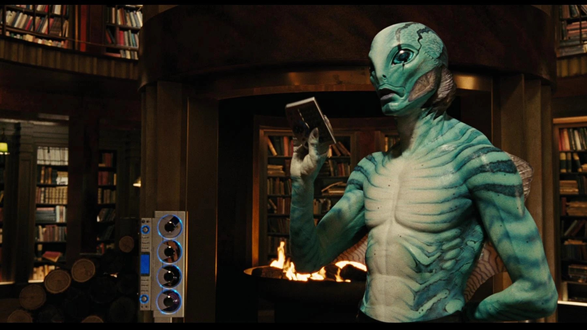
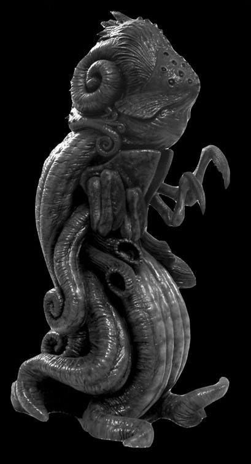
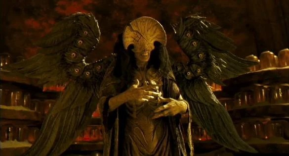

**Wayne Douglas Barlowe** (born January 6, 1958) is an American science fiction and fantasy writer and painter, who worked as a visual designer on both [Hellboy](/entry/Hellboy_(2004_film)) and [Hellboy II: The Golden Army](/entry/Hellboy_II%3A_The_Golden_Army). He notably desgined most the creatures in the movies, such as [Abraham Sapien](/entry/Abraham_Sapien), [Ogdru Jahad](/entry/Ogdru_Jahad), [Sammael](/entry/Sammael) and the [Angel of Death](/entry/Angel_of_Death).

## Work on Hellboy

Barlowe's Abe Sapien

Barlowe's Ogdru Jahad

Sammael

The Angel of Death

## Other work

- *Galaxy Quest *
- *Blade II *
- *Harry Potter and the Prisoner of Azkaban *
- *Harry Potter and the Goblet of Fire *
- *The Day the Earth Stood Still*
- *Avatar *
- *John Carter*
- * Pacific Rim *
- *Pete's Dragon*
- *Aquaman*
- *Nightflyers *
- *Black Mirror: Bandersnatch *

## Gallery

|Barlowe's Abe Sapien

|Barlowe's Ogdru Jahad

|The Angel of Death
