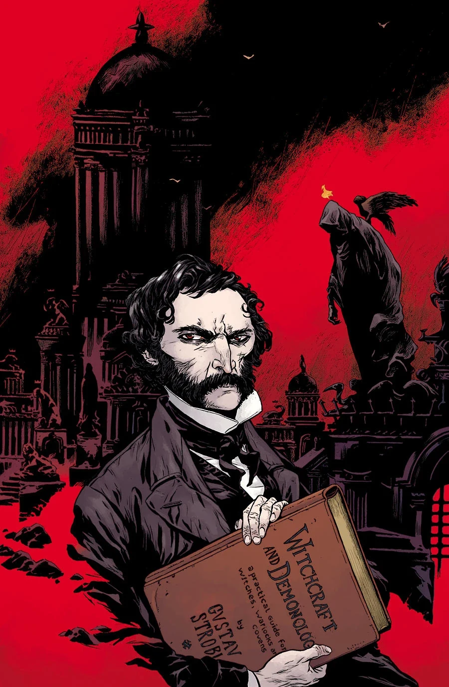

***Witchcraft & Demonology*** is a flashback story about [Gustav Strobl](/entry/Gustav_Strobl).

## Synopsis

Gallery artist [Santiago Caruso](/entry/Santiago_Caruso) presents the history of Western occultism as seen through the life story of a nineteenth-century necromancer who’s been to Hell and back and is possessed of a single goal—ensuring his place at the end of the world, standing side by side with the devil himself.

## Gallery

