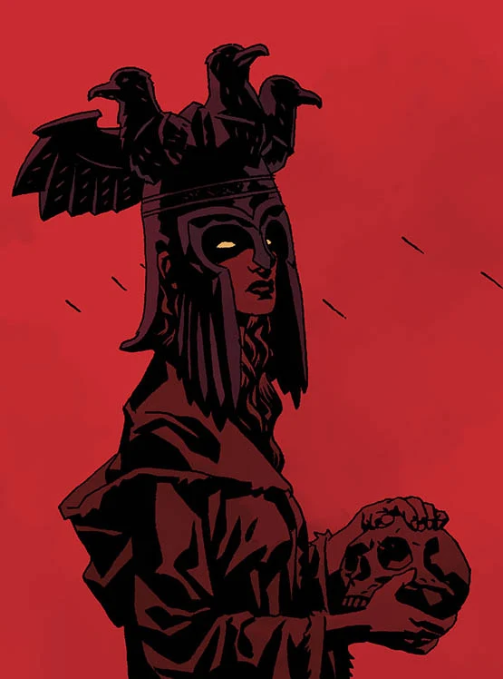

*This article is a stub. You can help Hellboy Wiki by expanding it.*

**Witches**, or **wizard**, are humans who have learned how to use [magic](/entry/Magic). Some gain it from demons, others seem to have it naturally, and are related to [fairies](/entry/Fairies). This second type appears to worship Hecate, and their power has faded in recent times, like the power (and fertility) of the fairies. It is possible that some witches have power from sheer knowledge.

## Notable witches & wizards

- [Hecate](/entry/Hecate)/[Kali](/entry/Kali)/Ereshkigal - Magic deity, Queen of Witches
- [Sarah Hughes](/entry/Sarah_Hughes) - English witch
- [Baba Yaga](/entry/Baba_Yaga_(character)) - Russian witch
- [Nimue](/entry/Nimue) - English witch, Queen of Witches
- [Morgan Le Fay](/entry/Morgan_Le_Fay) - English witch
- [Merlin](/entry/Merlin) - English wizard
- [Yumiko Daimio](/entry/Yumiko_Daimio) - Japanese witch
- [Effie Kolb](/entry/Effie_Kolb_(character)) - American witch
- [Bog Roosh](/entry/Bog_Roosh) - African sea-witch
- Memnan Saa - English wizard
- [Erzsebet Ondrushko](/entry/Erzsebet_Ondrushko) - Hungarian wizard
- [Troll Witch](/entry/Troll_Witch) - Norwegian witch
- Erichtho - Queen of Witches
- Herodias - Queen of Witches
- Circe - Queen of Witches
- Medea - Queen of Witches
