This article is about the series of twelve variant covers by [Mike Mignola](/entry/Mike_Mignola) in 2012.

## Conception

After [*Hellboy: The Fury*](/entry/The_Fury) concluded, it was announced that Mike Mignola would return as artist to the ongoing *Hellboy* stories in *[Hellboy in Hell](/entry/Hellboy_in_Hell_%28series%29)*. However, this workload would mean he would no longer be able to do as many covers as he had in the past. Aside from the covers for *Hellboy in Hell* or other *Hellboy* comics, Mike Mignola would no longer be doing any covers for singles.

As a farewell to covers, the "Year of Monsters" cover variants were created, with one cover released for every month of the year 2012. These variants feature characters created by Mignola pitted against a famous monster of some sort. The covers have no relation to the story contained within the issue.

The following year, 2013, [Mignola's convention sketchbook](/entry/Sketchbooks), *[A Year of Monsters](/entry/A_Year_of_Monsters)*, highlighted his uncolored art from the series of variant covers.

## Gallery

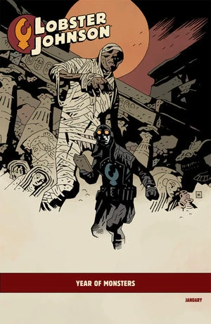

 Issue:
[*Lobster Johnson: The Burning Hand* \#1](/entry/The_Burning_Hand)

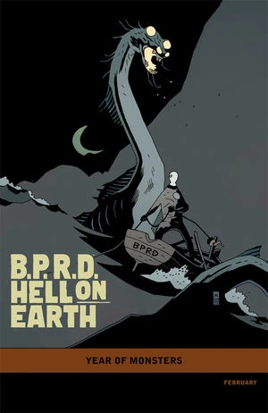

 Issue:
[*B.P.R.D.: Hell on Earth—The Long Death* \#1](/entry/The_Long_Death)

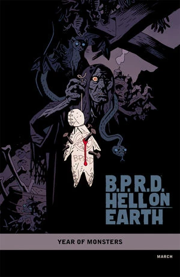

[*B.P.R.D.: Hell on Earth—The Pickens County Horror* \#1](/entry/The_Pickens_County_Horror)

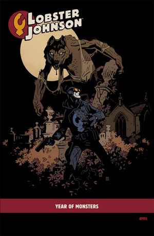

 Issue:
[*Lobster Johnson: The Burning Hand* \#4](/entry/The_Burning_Hand)

 Issue:
[*B.P.R.D.: Hell on Earth—The Transformation of J.H. O'Donnell*](/entry/The_Transformation_of_J.H._O%27Donnell)

 -
*Baltimore: Doctor Leskovar's Remedy* \#1
(Not a Hellboy Universe title)

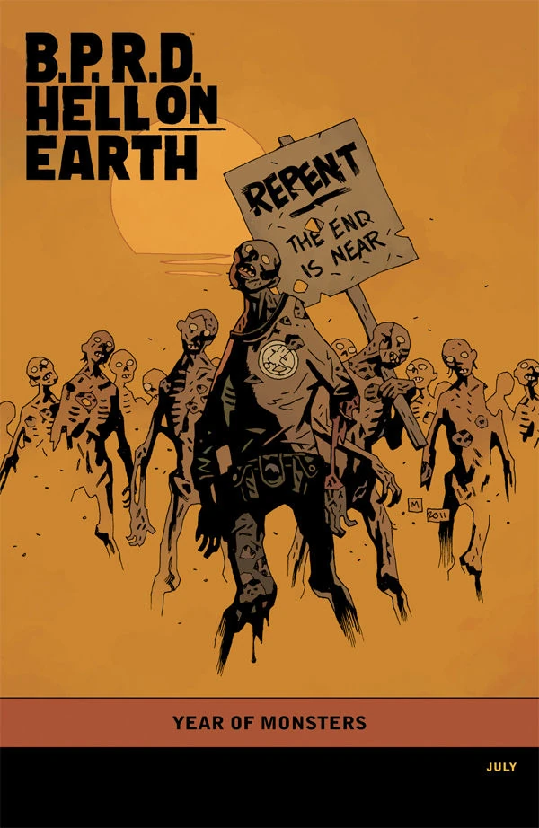

 Issue:
[*B.P.R.D.: Hell on Earth—The Devil's Engine* \#3](/entry/The_Devil%27s_Engine)

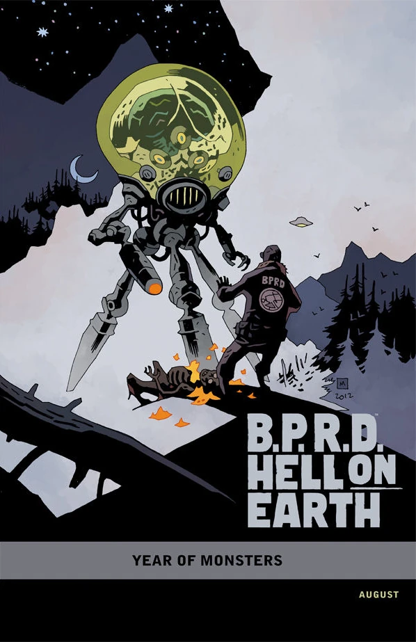

 Issue:
[*B.P.R.D.: Hell on Earth—The Return of the Master* \#1](/entry/The_Return_of_the_Master)

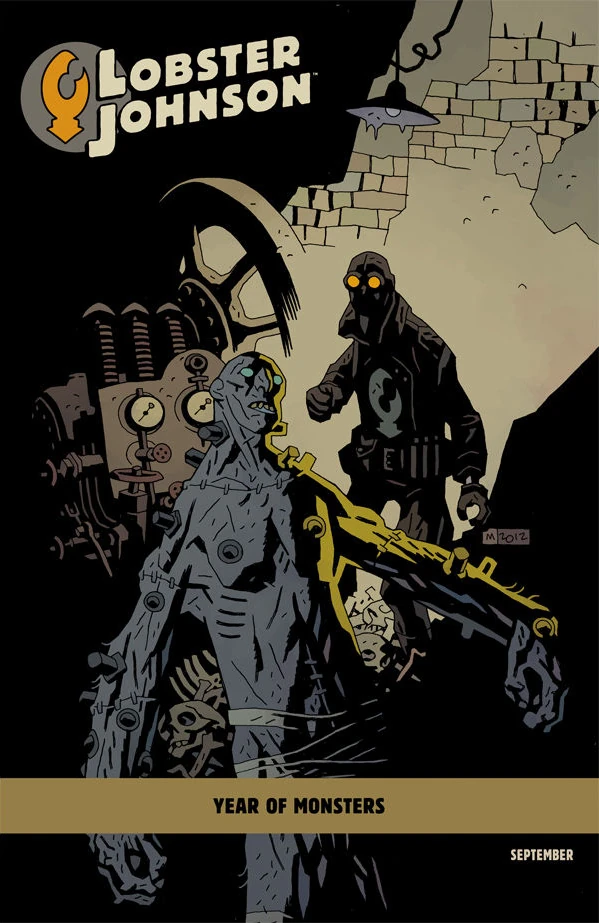

[*Lobster Johnson: Caput Mortuum*](/entry/Caput_Mortuum)

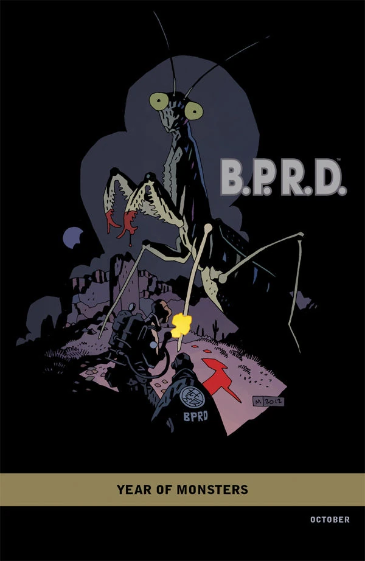

[*B.P.R.D.: 1948* \#1](/entry/1948)

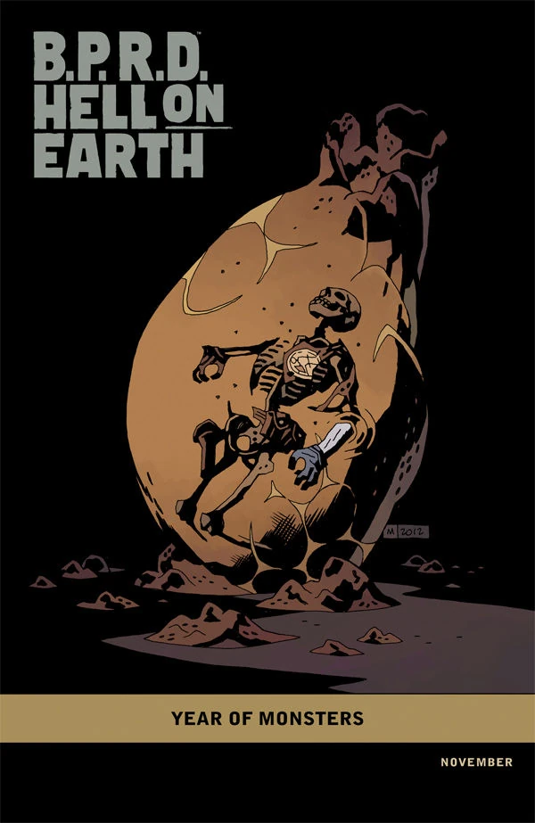

 Issue:
[*B.P.R.D.: Hell on Earth—The Return of the Master \#4*](/entry/The_Return_of_the_Master)

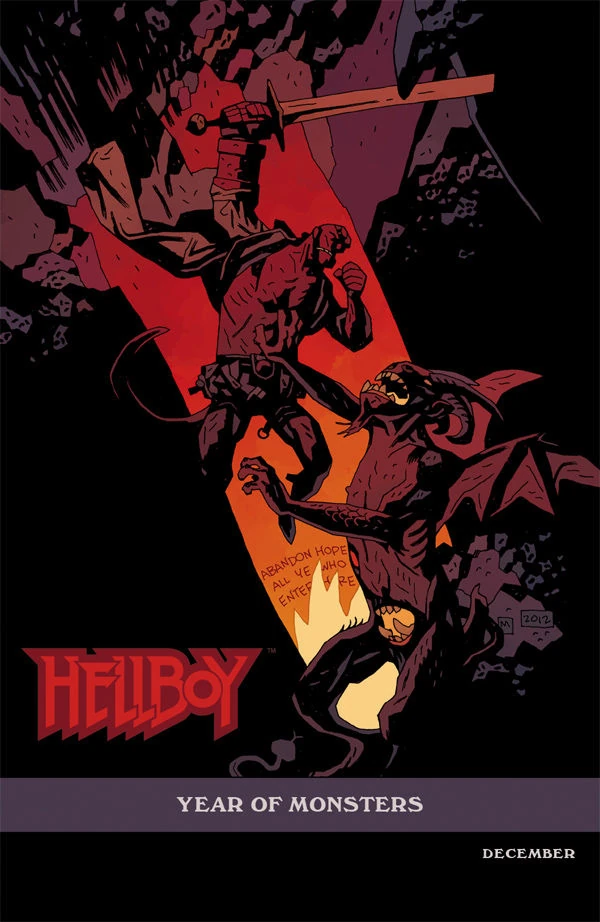

 Issue:
[*Hellboy in Hell* \#1](/entry/Hellboy_in_Hell_%28first_story_arc%29)

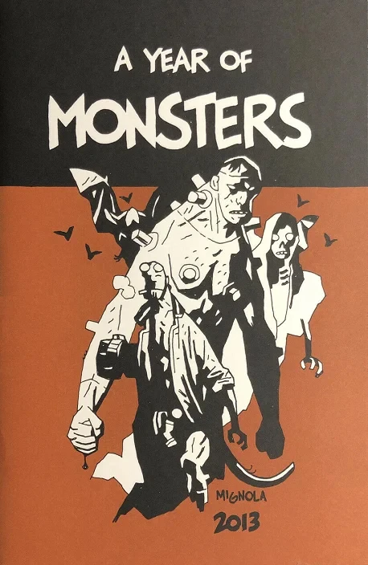

[A Year of Monsters](/entry/A_Year_of_Monsters)
