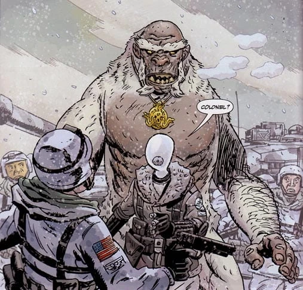

The **Yeti** are a race that live in the northern regions of the world.

## Background

The yeti are actually the descendants of one of the great cities of the [Hyperboreans](/entry/Hyperboreans), Thadrethes. From their culture they appear to be followers of [Hecate](/entry/Hecate). After the fall of Hyperborea, and the ensuing Ice Age that destroyed their cities, they became a race that could shape change into large white furred humanoids. They once wandered the world teaching the new races of man, but have since dwindled in number over the millennia.

In the 18th century, after the death of his creator, Frankenstein's Monster encountered one during his exile in the Arctic Circle. He attacked it after it killed a polar bear cub he considered to be his friend. Frankenstein was beaten into unconsciousness and dragged away by the monster. Later when he awoke he met an old man Arobas who nursed him back to health. However he soon realized that the old man was the yeti who he attacked. Though the flesh golem wanted revenge on Arobas for the death of the cub, he reluctantly stayed his hand as the old man had the opportunity to kill him. Arobas guided Frankenstein to his village and asked discussed about his view on his humanity and told him of a great city of golden spires nearby where he kind originated from. The next day, Frankenstein awoke to find a skeleton of Arobas in the hut he shared and that the village he had seen to be nowhere to be found, making him wonder if his experience was real.

Several yeti have been shown to be loyal followers of [Martin Gilfryd](/entry/Martin_Gilfryd), who he sent out to pursue his agenda to rule the world and bring back the Golden Age of Man.

## Known Yeti

- Arobas
