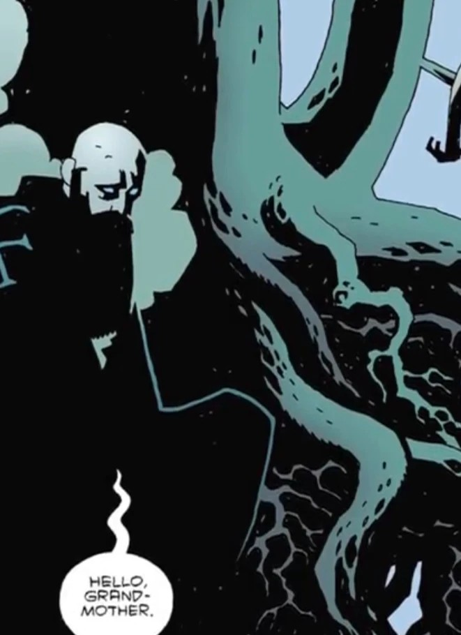

The **World Tree**, also known as **Yggdrasil**, in various world religions represents the structure that supports the heavens and whose roots burrow into [underworld](/entry/Hell).

In [Hellboy](/entry/Hellboy_(series)), the tree is a real structure which the fading faeries frequent. King Dagda, Sir Edward Grey and others tend to watch Hellboy's exploits from this vantage point. [Baba Yaga](/entry/Baba_Yaga_(character)) uses to save [Rasputin's](/entry/Grigori_Rasputin) spirit and hide [Koshchei](/entry/Koshchei_(character))'s soul.

## Gallery

|Rasputin at the World Tree.
## Trivia

- During Ragnarök, the norse version of the End Times, the World Tree would finally fall with the destruction of the world, but out of its ashes a new world would rise. This is also a recurring motive in Hellboy's arc, believing that the wicked world must be destroyed so a better one can replace it.
