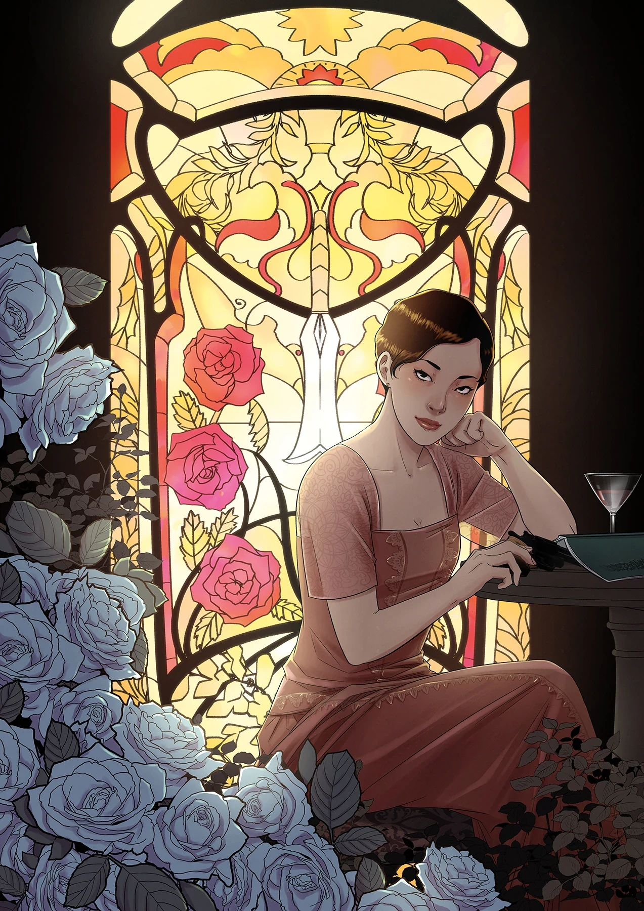

**Yishan Li** is a comics artist. She made her Hellboy Universe debut as one of three artists on *[Hellboy and the B.P.R.D.: 1956](/entry/1956)* in November 2018.

## Interior Art

- *[Hellboy and the B.P.R.D.: 1956](/entry/1956)* (with [Mike Norton](/entry/Mike_Norton) and [Michael Avon Oeming](/entry/Michael_Avon_Oeming))

## Cover Art

|[The Sword of Hyperborea](/entry/The_Sword_of_Hyperborea_%28story%29) \#2 (Variant)

## External Links

- [**Comic Book DB:** Yishan Li](http://comicbookdb.com/creator.php?ID=32142)
- [**Website:** Yishan Li](http://www.liyishan.com/)
