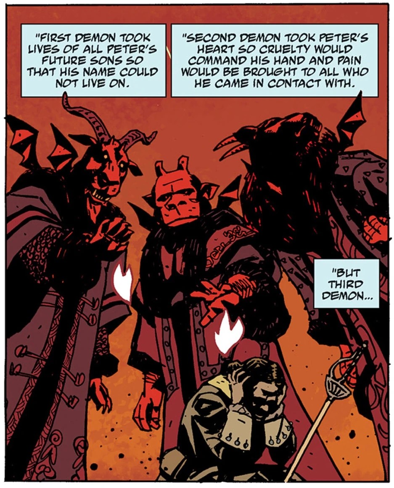
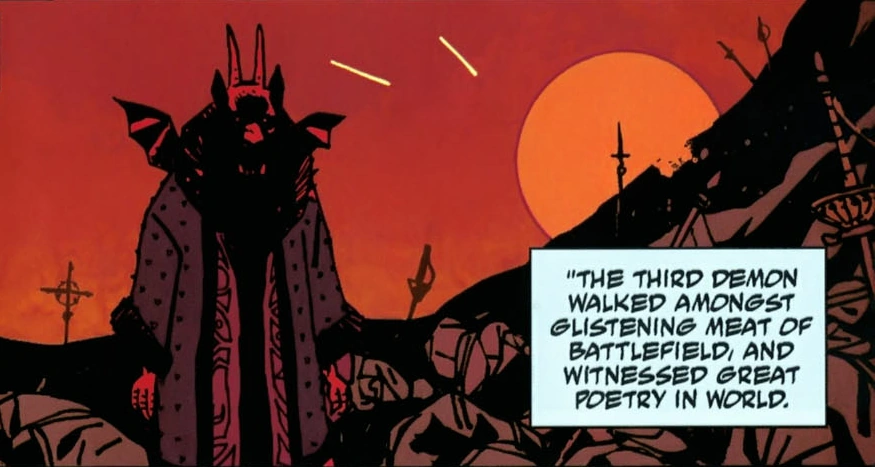

**Yomyael** (also known as **Varvara**) is Bearer of the Grand Cross of the Order of the Fly, Seventh under Satan, and commands 6,000 legions of demons. He was summoned to Earth to grant Peter the Great victory in the Great Northern War. Deciding to forgo returning to Hell, Yomyael stayed on Earth and possessed a number of hosts, the latest being [Varvara](/entry/Varvara). In Varvara's guise, she is the former director of the [Special Sciences Service](/entry/Special_Sciences_Service).

## History

Yomyael was part of a trinity of demons (also including [Beleth](/entry/Beleth) and [Sytry](/entry/Sytry)) that had aided the Asiatic people in battle "for as long as men had placed faith in the dark behind stars." The trinity was discovered and summoned by Peter the Great's advisors to help him turn the tides against the Swedes in the Great Northern War. The demons granted Peter's wishes, but they came with a price. The first demon would take the lives of all of Peter's future sons, so that his name would not live on; the second demon would take his heart, so he would be filled with cruelty and bring only pain to anyone he came in contact with; and the third demon, Yomyael, would take his soul. As the first two demons took what Peter owed, Yomyael walked through the battlefield and was so captivated by the brutality brought out by humans, he decided to stay in the mortal world, thus abandoning Peter's soul, which was also his passage home.

Yomyael wandered the earth for centuries, possessing different hosts, and in time he came to an understanding of humanity. In 1913, the demon possessed [Varvara](/entry/Varvara) after finding her alone with the body of her dead mother. Taking on her identity, Yomyael eventually aligned himself with the Soviet Union and become head of the Russian Special Sciences Service.

### Allying with Trevor Bruttenholm

In 1946, Varvara was stationed in Soviet-occupied Berlin, gathering occult objects and keeping secret prisoners affiliated with the Nazi paranormal experiments for questioning. It was then that Varvara first encountered Professor Trevor Bruttenholm, who sought for any information related to the "[Hellboy](/entry/Hellboy_(character)) Incident". Varvara was already aware that the demon (Hellboy) was under the professor's care. However, Varvara declined to share any information until she and her organization had made a truce with Bruttenholm that would be related to their common goal regarding [Project Vampir Sturm](/entry/Project_Vampir_Sturm). Their alliance led to the successful foiling of an attempt by Herman von Klempt to launch a rocket loaded with vampires at the United States. In the aftermath, Varvara was impressed by Bruttenholm and has since then she considered him her favorite human.

In 1947, Varvara appeared at the New Mexico Air Force base where the B.P.R.D. was then stationed to discuss the recent killings of ex-Nazis with Professor Bruttenholm, which they both knew to be the work of Baron Konig.

In 1952, Varvara approached [Malcolm Frost](/entry/Malcolm_Frost), who was planning to kill Professor Bruttenholm in order to gain access to eliminating Hellboy, and threatened him from ever harming Bruttenholm after she murdered Frost's underling [Robert Amsel](/entry/Robert_Amsel) via spontaneous combustion.

### Imprisonment

After Varvara's multiple meetings with Professor Bruttenholm regarding the vampire activity in Europe, most of the members of the Special Sciences Service began to plot a coup against her. Tired of working in constant fear of her explosive temper and violent way of handling things, the S.S.S. conspirators carefully planned a ritual that will incapacitate Varvara.

In 1956, after months of planning, they brought a medium to a radio station outpost where she recorded a carefully researched incantation done hundreds of miles away from Varvara and then broadcast it to her, weakening her and allowing [Father Malakim](/entry/Father_Malakim) to conduct an orthodox prayer that imprisoned Varvara in a glass case. For the next half of a century, Varvara remained contained and placed in the office of the new Director of the S.S.S., [Iosif Nichayko](/entry/Iosif_Nichayko).

By the events of [*Hell on Earth*](/entry/Hell_on_Earth_(story_cycle)), Varvara attempted to make a deal with a group of lesser demons who had escaped from Hell, but so far their attempts to free her have been unsuccessful.

### *B.P.R.D.: Hell on Earth*

After the arrival of [Nunn-Jahad](/entry/Nunn-Jahad), seeing the situation hopeless, Iosif reluctantly frees Varvara with the hopes that the demon would turn her attention on the dragon, though at the cost of his life.

Varvara, however, invites Iosif on a journey to Hell. There she takes him to the abandoned city of Pandemonium where the corpse of [Satan](/entry/Satan) lies. Taking the dagger that killed the former King of Hell, Varvara releases the seal to free the imprisoned [Watchers](/entry/Watchers) that supported the great city of Hell.

Back on Earth, she and Iosif watched in awe as several Watchers erupt from the Earth and battle the Ogdru Jahad. Though Iosif is hopeful that the fallen angels might defeat the monster, Varvara informs him that the Watchers may not have the power they previously possessed before they were imprisoned and whoever wins will not bode well for the world. Turning her attention to her former captor, she stabs the undead Russian, shattering his soul to pieces and making him less of a ghost and unable to die.

After the Watchers are defeated by the dragon, she watched in amusement of [Johann Kraus's](/entry/Johann_Kraus) efforts to fight the creature. Much to her surprise, the [Vril](/entry/Vril)-empowered medium destroyed the Ogdru Jahad, ending its threat to the Earth.

Varvara's last appearance during *Hell on Earth* was in the old headquarters of the B.P.R.D. in Connecticut. She mused to herself that her efforts to stall the apocalypse were useless and how one small little ghost had turned the tide when she had failed. She lamented that she misses Professor Trevor Bruttenholm, stating he was always her favorite, and wondered to herself who will entertain her now.

### *B.P.R.D.: The Devil You Know*

With most of demon-lords being dead, and having acquired the ring of Duke of Hell [Amdusias](/entry/Amdusias), Yomyael decided to to rebuild [Pandemonium](/entry/Pandemonium_(location)) in New York. The demon recruited the two last demon-lords, [Balam](/entry/Balam) and [Bifrons](/entry/Bifrons), and manages to re-enslave the minor demons.

The demon also worked with [Karl Ruprect Kroenen](/entry/Karl_Ruprect_Kroenen) and [Herman von Klempt](/entry/Herman_von_Klempt), though Kroenen was killed by Yomayel after he doubted the plan.

The forces of the [B.P.R.D.](/entry/Bureau_for_Paranormal_Research_and_Defense) attacked the remaining forces of Hell, during which Yomayel killed [Agent Devon](/entry/Andrew_Devon). Both [Balam](/entry/Balam) and [Bifrons](/entry/Bifrons) were killed by [Hellboy](/entry/Hellboy_(character)) and Liz Sherman. [Ashley Strode](/entry/Ashley_Strode) cast Yomayel out of Varvara with an exorcism, and while she was initially intimidated by the demon, Hellboy attacked him and brought him to his knees. Yomyael claimed he was trying to hold Varvara back, but was decapitated by Strode before he could finish.

## Gallery

|Yomyael, alongside Beleth and Sytry

|
