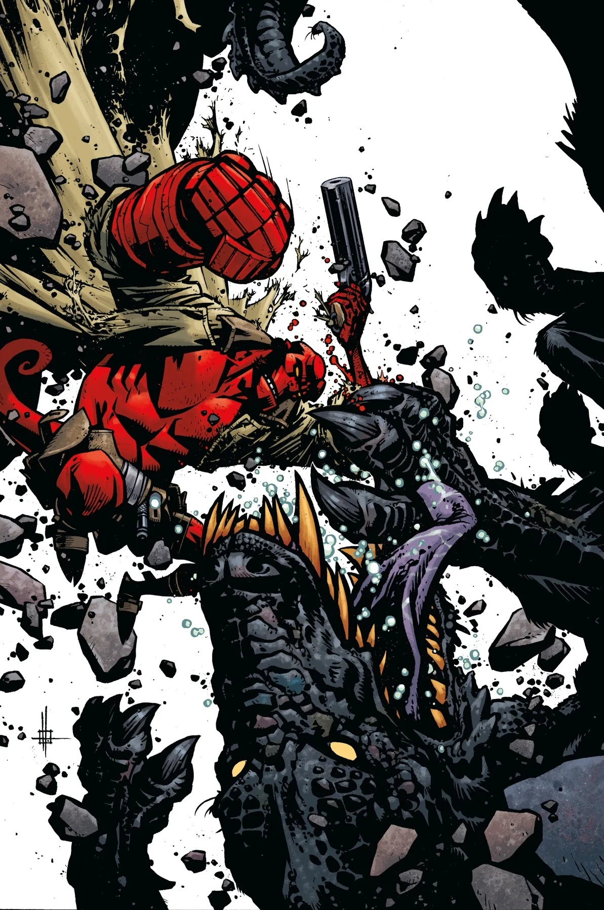

*This article is a stub. You can help Hellboy Wiki by expanding it.*

**Zach Howard** is a comic book illustrator.

## Interior Art

- *[The Kabandha](/entry/The_Kabandha)* (out-of-continuity)
- *[Hellboy and the B.P.R.D.: The Return of Effie Kolb](/entry/The_Return_of_Effie_Kolb)*

## Interior and Cover Art

[*Hellboy and the B.P.R.D.: The Return of Effie Kolb* \#1](/entry/The_Return_of_Effie_Kolb)

*Hellboy and the B.P.R.D.: The Return of Effie Kolb* \#2

## Gallery

![Hellboy and the B.P.R.D.: The Return of Effie Kolb #1]]](/content/images/Return%20of%20Effie%20Kolb%201.webp)

|Hellboy and the B.P.R.D.: The Return of Effie Kolb #1]]

|Hellboy and the B.P.R.D.: The Return of Effie Kolb #2
