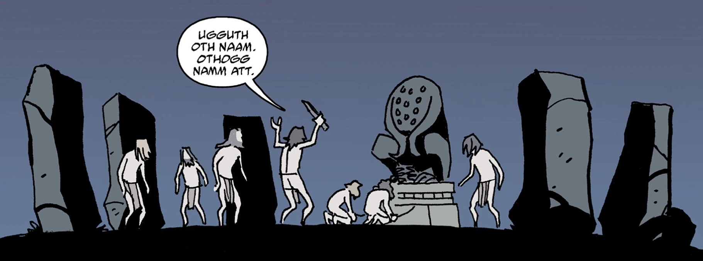

**Zara-Hem** was one of the [Ogdru Hem](/entry/Ogdru_Hem), spawn of the [Ogdru Jahad](/entry/Ogdru_Jahad).

## Background

In the ancient past, millennia before the Europeans came to North America, Zara-Hem was worshipped in Arizona.

A group of primitive humans attempted to summon Zara-Hem using a couple as a sacrifice. The [Visitor](/entry/The_Visitor), who was stationed on Earth at the time, used the Prism to banish Zara-Hem away incapacitating its followers. He then freed the couple before departing from the area.

A statue of Zara-Hem was stolen by an ape cultist prior to the events of [Beware the Ape](/entry/Beware_the_Ape).

In (/entry/1952), a Portuguese statue of Zara-Hem which had been feeding on the pain in the fortress came into contact with a zombie created by [Herman von Klempt](/entry/Herman_von_Klempt). The zombie (possibly possessed by Zara-Hem) mutated and grew, attacking Von Klempt and Hellboy above. The body was killed by a gas explosion, leaving Zara-Hem bodiless once more.

In 1978, the Visitor encountered another religious cult led by Ana Mireya Fierro at the O.H.M. Institute attempting to summon Zara-Hem again. He put a stop to it by himself, though lamented that the psychic feedback resulted in the deaths of many of the cultists. Their deaths though were attributed to mass suicide by the cult.

## Gallery

|
