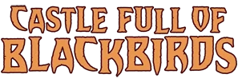

[Mike Mignola](/entry/Mike_Mignola)'s *Hellboy* series was first introduced, along with [Hellboy](/entry/Hellboy_%28character%29) himself, in [*San Diego Comic Con Comics* \#2](/entry/World%27s_Greatest_Paranormal_Investigator_%28SDCC%29), published August 1993. As the series has progressed, it has grown to include numerous spin-offs all sharing continuity within the Hellboy Universe.

## Publication Lines

*see also: [List of **Hellboy Universe** stories](/entry/%3ACategory%3AStory)*

*see also: **[Trade Paperback Collections](/entry/Trade_Paperback_Collections)***

### ***[Hellboy](/entry/Hellboy_%28series%29)***

Front_Page_-_Hellboy.png

*see also: [List of **Hellboy** stories](/entry/%3ACategory%3AHellboy_story)*

The first title, *Hellboy*, originally followed [Hellboy's](/entry/Hellboy_%28character%29) career as a part of the [B.P.R.D.](/entry/B.P.R.D.), then later Hellboy's solo adventures following the events of *[Conqueror Worm](/entry/Conqueror_Worm_%28story%29)*. The stories increasingly focused on mythological themes and Hellboy's destiny within the supernatural world. Interspersed in the ongoing narrative were flashback stories, usually set before the events of *[Seed of Destruction](/entry/Seed_of_Destruction)* in May 1994, which mostly functioned as standalone tales.

#### ***[Hellboy in Hell](/entry/Hellboy_in_Hell_%28series%29)***

Front_Page_-_Hellboy_in_Hell.png

*see also: [List of **Hellboy in Hell** stories](/entry/%3ACategory%3AHellboy_in_Hell_story)*

*[Hellboy in Hell](/entry/Hellboy_in_Hell_%28series%29)* was a departure for the *Hellboy* comics in that it was not a miniseries or one-shot, but rather an ongoing comic with irregular release dates starting its numbering at \#1. It has its own trade paperback line much like *[B.P.R.D.: Hell on Earth](/entry/BPRD%3F%E4%BA%BA%E9%97%B4%E5%9C%B0%E7%8B%B1))* does, but it was a direct continuation of *Hellboy* and was collected in omnibus format under the *Hellboy* banner.

### ***[Abe Sapien](/entry/Abe_Sapien_%28series%29)***

Front_Page_-_Abe_Sapien.png

*see also: [List of **Abe Sapien** stories](/entry/%3ACategory%3AAbe_Sapien_story)*

This series follows [Abe Sapien's](/entry/Abraham_Sapien) solo adventures. The earliest *Abe Sapien* stories have been collected in the first volume of the [B.P.R.D.](/entry/TPB) trades.

Beginning with *[The Drowning](/entry/The_Drowning)*, the series was released in its [own line of trade paperbacks](/entry/TPB). Volumes 3 to 8 cover the [*Dark and Terrible* cycle](/entry/Dark_and_Terrible_%28story_cycle%29), which runs parallel to the events of [*B.P.R.D.: Hell on Earth*](/entry/BPRD%3F%E4%BA%BA%E9%97%B4%E5%9C%B0%E7%8B%B1)).

### ***[Lobster Johnson](/entry/Lobster_Johnson_%28series%29)***

Front_Page_-_Lobster_Johnson.png

*see also: [List of **Lobster Johnson** stories](/entry/%3ACategory%3ALobster_Johnson_story)*

*Lobster Johnson* focuses the pulp adventures of [the Lobster](/entry/Lobster_Johnson) and his crew as they fight against mad scientists, Nazis and supernatural foes in the 1930s. The series originally debuted with a [short back-up story](/entry/The_Killer_in_My_Skull) in [*Hellboy: Box Full of Evil* \#1](/entry/Box_Full_of_Evil) in 1999, though it didn't properly become a series until 2007's *[The Iron Prometheus](/entry/The_Iron_Prometheus)*.

### ***[B.P.R.D](/entry/B.P.R.D._%28series%29)***

Front_Page_-_BPRD.png

*see also: [List of **B.P.R.D.** stories](/entry/%3ACategory%3AB.P.R.D._story)*

Following [Hellboy's](/entry/Hellboy_%28character%29) departure from the [Bureau](/entry/B.P.R.D.) at the end of *[Conqueror Worm](/entry/Conqueror_Worm_%28story%29)*, *B.P.R.D.* was spun-off into its own line of comics. *B.P.R.D.* continued to follow the adventures of established characters like [Abe Sapien](/entry/Abe_Sapien), [Liz Sherman](/entry/Liz_Sherman), [Roger](/entry/Roger) and [Kate Corrigan](/entry/Kate_Corrigan), but has also introduced new characters like [Johann Kraus](/entry/Johann_Kraus), [Ben Daimio](/entry/Ben_Daimio) and [Panya](/entry/Panya_%28character%29), and even delves into the B.P.R.D.'s past. The series is largely divided into three cycles: *[Plague of Frogs](/entry/Plague_of_Frogs_%28story_cycle%29)*, *[Hell on Earth](/entry/BPRD%3F%E4%BA%BA%E9%97%B4%E5%9C%B0%E7%8B%B1))*, and *[The Devil You Know](/entry/The_Devil_You_Know_%28story_cycle%29)*.

#### ***[B.P.R.D.: Hell on Earth](/entry/BPRD%3F%E4%BA%BA%E9%97%B4%E5%9C%B0%E7%8B%B1))***

Front_Page_-_BPRD_Hell_on_Earth.png

*see also: [List of **B.P.R.D.: Hell on Earth** stories](/entry/%3ACategory%3AB.P.R.D.%3A_Hell_on_Earth_story)*

A direct continuation of the *[Plague of Frogs](/entry/Plague_of_Frogs_%28story_cycle%29)* story cycle in *B.P.R.D.*, this was released as its own distinct series.

#### ***[B.P.R.D.: The Devil You Know](/entry/The_Devil_You_Know_%28story_cycle%29)***

FrontPage-BPRD-TheDevilYouKnow.png

*see also: [List of **B.P.R.D.: The Devil You Know** stories](/entry/%3ACategory%3AB.P.R.D.%3A_The_Devil_You_Know_story)*

A direct continuation of *[B.P.R.D.: Hell on Earth](/entry/BPRD%3F%E4%BA%BA%E9%97%B4%E5%9C%B0%E7%8B%B1))*, this was released as its own distinct series and serves as a conclusion not only to *B.P.R.D.*, but also *Hellboy* and *Abe Sapien*.

### ***[Sir Edward Grey: Witchfinder](/entry/Witchfinder)***

Front_Page_-_Witchfinder.png

*see also: [List of **Witchfinder** stories](/entry/%3ACategory%3AWitchfinder_story)*

*Witchfinder* depicts the adventures of occult detective and agent for Queen Victoria, [Sir Edward Grey](/entry/Sir_Edward_Grey).

### ***[Hellboy and the B.P.R.D.](/entry/Hellboy_and_the_B.P.R.D.)***

FrontPage-HellboyBPRD.png

*see also: [List of **Hellboy and the B.P.R.D.** stories](/entry/%3ACategory%3AHellboy_and_the_B.P.R.D._story)*

Kicking off in 1952, this series originally followed Hellboy's career at the [B.P.R.D.](/entry/B.P.R.D.) chronologically. As the series progressed, it introduced more stories that jumped around the timeline.

### ***[Frankenstein](/entry/Frankenstein_%28series%29)***

FrontPage-Frankenstein.png

*see also: [List of **Frankenstein** stories](/entry/%3ACategory%3AFrankenstein_story)*

This series began with the *[Frankenstein Underground](/entry/Frankenstein_Underground)* miniseries, with the Frankenstein Monster as he appeared in *[Hellboy: House of the Living Dead](/entry/House_of_the_Living_Dead)* as he journeyed into the Hollow Earth in the 1950s. The miniseries canonizes Mary Shelley's 1818 novel *[Frankenstein; or, The Modern Prometheus](/entry/Frankenstein%3B_or%2C_The_Modern_Prometheus)*.

#### ***[Frankenstein: New World](/entry/New_World_%28Frankenstein_story_cycle%29)***

*see also: [List of **Frankenstein: New World** stories](/entry/%3ACategory%3AFrankenstein%3A_New_World_story)*

This series picks up thousands of years after the end of *[B.P.R.D.: The Devil You Know—Ragna Rok](/entry/Ragna_Rok_%28story_arc%29)*.

### ***[Koshchei](/entry/Koshchei_%28series%29)***

FrontPage-Koshchei.png

*see also: [List of **Koshchei** stories](/entry/%3ACategory%3AKoshchei_story)*

In *[Koshchei the Deathless](/entry/Koshchei_the_Deathless_%28story%29)*, [Koshchei](/entry/Koshchei_%28character%29) finds [Hellboy](/entry/Hellboy_%28character%29) in Hell, and tells him his tale. [Ben Stenbeck](/entry/Ben_Stenbeck) has said this was originally a trilogy that became a single book. He also hinted that additional books may appear in the *Koshchei* series. *[Koshchei in Hell](/entry/Koshchei_in_Hell)* was announced for 2022 in the back of *[Sir Edward Grey: Acheron](/entry/Acheron_%28story%29)*.

### ***[Young Hellboy](/entry/Young_Hellboy)***

Front_Page_-_Young_Hellboy.png

*see also: [List of **Young Hellboy** stories](/entry/%3ACategory%3AYoung_Hellboy_story)*

This series launched in 2021 with the miniseries *[The Hidden Land](/entry/The_Hidden_Land)*. It focuses on Hellboy's adventures with [Professor Bruttenholm](/entry/Trevor_Bruttenholm) during the late 1940s.

### ***[The Sarah Jewell Mysteries](/entry/The_Sarah_Jewell_Mysteries)***

Front_Page_-_Sarah_Jewell.png

*see also: [List of **The Sarah Jewell Mysteries**](/entry/%3ACategory%3AThe_Sarah_Jewell_Mysteries)*

This series began with *[The Longest Night](/entry/The_Longest_Night)*, a short story in the [*Hellboy Winter Special* (2019)](/entry/Hellboy_Winter_Special_%282019%29) before getting a full miniseries in 2021, *[The House of Lost Horizons](/entry/The_House_of_Lost_Horizons)*.

### ***[The British Paranormal Society](/entry/The_British_Paranormal_Society_%28series%29)***

Front_Page_-_British_Paranormal_Society.png

*see also: [List of **The British Paranormal Society** stories](/entry/%3ACategory%3ABritish_Paranormal_Society_story)*

This series began with *[Time Out of Mind](/entry/Time_Out_of_Mind)*, a four-issue miniseries.

## One-shot Miniseries

Rather than being fully fledged series, these titles are limited to a single trade.

### ***[Sledgehammer 44](/entry/Sledgehammer_44_%28series%29)***

Front_Page_-_Sledgehammer_44.png

*see also: [List of **Sledgehammer 44** stories](/entry/%3ACategory%3ASledgehammer_44_story)*

Beginning in 1944, *Sledgehammer 44* follows the story of the second Vril Energy Suit, Epimetheus, and its various pilots. This was originally intended to span multiple trades (as evidenced by the "1" on the book's spine), but as the story developed, it worked better as a single book and flashback elements in the *B.P.R.D.: Hell on Earth* series.

### ***[Rise of the Black Flame](/entry/Rise_of_the_Black_Flame)***

 Set in May, 1923, *Rise of the Black Flame* shows how the first [Black Flame](/entry/The_Black_Flame_%28character%29) came to be. It also introduces [Sarah Jewell](/entry/Sarah_Jewell), a member of [The Silver Lantern Club](/entry/Silver_Lantern_Club_%28organization%29) and friend of [Sir Edward Grey](/entry/Edward_Grey).

### ***[The Visitor: How & Why He Stayed](/entry/The_Visitor__How_%26_Why_He_Stayed)***

 This five-issue miniseries explores the story of the alien Hellboy met in *[Conqueror Worm](/entry/Conqueror_Worm_%28story%29)* from 1944 to 2001.

### ***[Rasputin: The Voice of the Dragon](/entry/Rasputin__The_Voice_of_the_Dragon)***

 Focused on [Trevor Bruttenholm](/entry/Trevor_Bruttenholm) and [Rasputin](/entry/Rasputin) during World War II, this five-issue miniseries takes a closer look at "The Master." Mike Mignola and Chris Roberson have discussed the possibility that this may be the first in a series, but it was designed as a one-shot miniseries.

### ***[Crimson Lotus](/entry/Crimson_Lotus_%28story%29)***

 Agents [Dai Jieh](/entry/Dai_Jieh), [Shengli](/entry/Shengli), and [Baolu](/entry/Baolu) are pursued by the [Crimson Lotus](/entry/Yumiko_Daimio) in 1930s China.

### ***[The Sword of Hyperborea](/entry/The_Sword_of_Hyperborea_%28story%29)***

A miniseries that explores some of the people that have carried [Ted Howards's](/entry/Ted_Howards) Hyperborean Blade.

### ***[Castle Full of Blackbirds](/entry/Castle_Full_of_Blackbirds)***

 Following the events of *[Hellboy and the B.P.R.D.: The Return of Effie Kolb](/entry/The_Return_of_Effie_Kolb)*. [Sara May Blackburn](/entry/Sara_May_Blackburn) attends the Linton School for Girls.

## Publication Timeline

Due to the growing scope of this section, [it has been relocated](/entry/Story_Publication_Timeline).

## Notes

<references />
