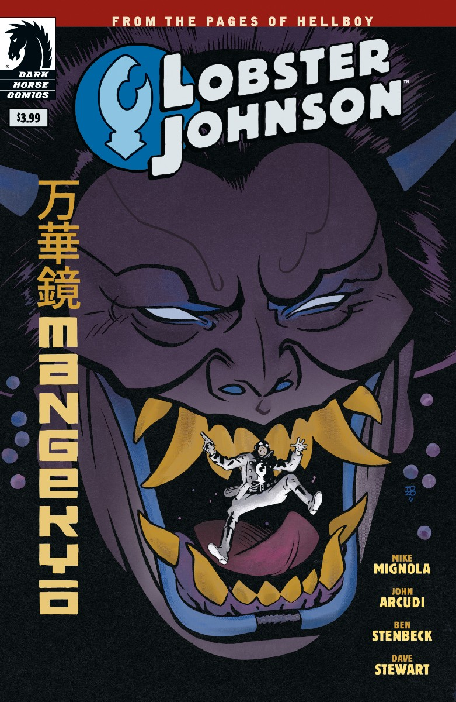

***Mangekyō*** is a one-shot *[Lobster Johnson](/entry/Lobster_Johnson_%28series%29)* story written by John Arcudi and Mike Mignola with art by Ben Stenbeck. It takes place in the middle of [the Lobster's](/entry/The_Lobster) career as a crime fighter in the 1930s.

## Synopsis

The Lobster foils an attempted prison break, but must answer to the person behind it—the assassin, witch, and longtime enemy the Crimson Lotus, one of the most enigmatic villains of the Hellboy world.

## Gallery

