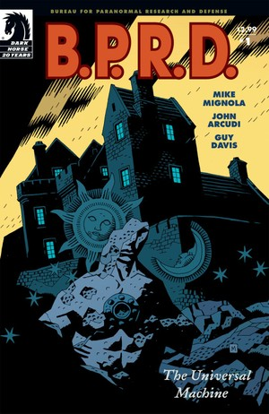
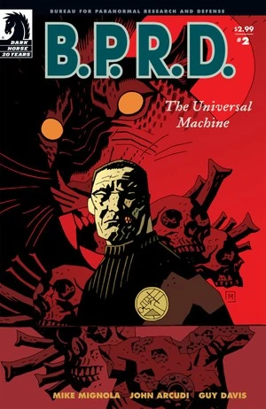
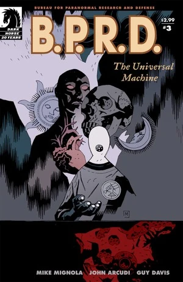
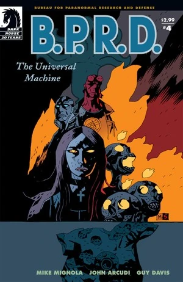
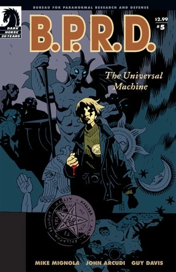

In ***The Universal Machine***, [Dr. Kate Corrigan](/entry/%E5%87%AF%E7%89%B9%C2%B7%E8%80%83%E7%91%9E%E6%A0%B9)) travels to rural France in search of an ancient text that might undo the death of [Roger](/entry/Roger). Back at the [B.P.R.D. headquarters](/entry/Bureau_for_Paranormal_Research_and_Defense), Captain [Daimio](/entry/Benjamin_Daimio) tells the story of his own death, [Johann Kraus](/entry/Johann_Kraus) confesses a bizarre love triangle arising from one of his séances, [Abe](/entry/Abraham_Sapien) recalls a mission with [Hellboy](/entry/Hellboy_%28character%29) during his early days at the B.P.R.D., and [Liz](/entry/Elizabeth_Sherman) reveals a weird tale of the family members she killed while discovering her firestarter powers.

## Publication History

The five issue mini-series was published from April to August 2006. The story was collected in the trade paperback *[B.P.R.D.: The Universal Machine](/entry/Trade_Collections)* in January 2007. Mike Mignola drew the final pages of issue 5.

## Synopsis

### Part One

Abe Sapien and Captain Daimo oversee the bombing of the Katha-Hem disaster site in Nebraska from *[The Black Flame](/entry/The_Black_Flame_%28story%29)*. Despite the 1,700 dead from the attack, Daimio can only think about Roger who died in the attack.

Kate secretly meets with [Andrew Devon](/entry/Andrew_Devon) who gives her information on '[Flama Reconditus](/entry/Vril)' (The Secret Fire); which he believes would be the only book with a formula for regrowing [homunculus](/entry/homunculus) tissue and therefore undoing Roger's death. The two travel to Ableben, France to meet with the collector and negotiate for the book. In 1491, the villagers of the town once destroyed the castle of [Marquis de Fabre](/entry/Adoet_de_Fabre) for feeding their young to his 'monsters.'

The pair meet with Thierry, the collector, who has a wide collection in his shop which he quizes Kate on, while he insists Devon uses the phone box outside. As they search for the book Kate begins to grow wary of the increasingly odd objects and knows she is in danger. While Devon is on the phone to B.P.R.D. HQ he sees a 'closed' sign in the shop window and breaks the door down to get back in, where he finds an empty shop apart from a painting of a castle.

A discussion at B.P.R.D. Headquarters between Daimio, Johann and Liz Sherman about Roger leads to Daimio agreeing to reveal the truth about his death.

### Part Two

Captain Daimio tells the B.P.R.D. the story of his own death in the jungles of Bolivia. Meanwhile, Dr. Kate Corrigan, searching rural France for a clandestine text with the secret to bringing Roger back to life, finds herself a guest in a strange shop on the site of a castle that was destroyed over half a century ago.

### Part Three

While searching for an arcane text that could hold the secret to bringing Roger back to life, Dr. Kate Corrigan is trapped in a mysterious French village where a collector of occult objects has terrible plans for one of the B.P.R.D.'s most valuable assets.

### Part Four

Hellboy and Abe Sapien take center stage in a flashback story set during Abe's early days at the Bureau for Paranormal Research and Defense, and Liz Sherman reveals weird tales of the family members that she killed while discovering her firestarter powers. And in Europe, Doctor Kate Corrigan bargains with an ancient evil over the fate of her dead friend, Roger.

### Part Five

As Kate's devilish adventure in a haunted French village concludes, Roger's fate is resolved in an otherworldly confrontation, and each member of the Bureau for Paranormal Research and Defenses confronts the truth of their own deaths-which each has had to face alone.

## Content

### Characters

#### [B.P.R.D.](/entry/Bureau_for_Paranormal_Research_and_Defense)

- [Abraham Sapien](/entry/Abraham_Sapien)
- [Benjamin Daimio](/entry/Benjamin_Daimio)
- [Katherine Corrigan](/entry/%E5%87%AF%E7%89%B9%C2%B7%E8%80%83%E7%91%9E%E6%A0%B9))
- [Elizabeth Sherman](/entry/Elizabeth_Sherman)
- [Johann Kraus](/entry/Johann_Kraus)
- [Andrew Devon](/entry/Andrew_Devon)
- [Roger](/entry/Roger)
- [Thomas Manning](/entry/Thomas_Manning)
- Other Agents and Personnel

#### Ableben Plot

- [Adoet de Fabre](/entry/Adoet_de_Fabre)
- Ableben Residents (Turned to Wolves)
- [Vampires](/entry/Vampire_%28creature%29)
  - Boden
- Lagerk ([Homunculus](/entry/Homunculus))
- [Edel Mischrasse](/entry/Edel_Mischrasse) (Flashback)
- [Roger's Brother](/entry/Roger%27s_brother) (Mentioned)
- Oannes (Illustration)
- [Demons](/entry/Demon)
  - [Marchosias](/entry/Marchosias)
  - [Iblifika](/entry/Iblifika)

#### Headquarters Stories

- Damio's Story (Flashback)
  - Soldiers
    - Bennett
    - Carillo
    - Manuel Antonio Chaves
    - Harmon
    - Landham
    - Ramirez
  - Members of the Jaguar Cult
  - Jaguar Beast
  - [Noh Monkey](/entry/Noh_monkey)
  - Jaguar God (Dream)
- Johan's Story (Flashback)
  - Pavao Delic
  - Eva (Johan's Assistant)
  - Senka Delic
- Liz's Story (Flashback)
  - Jenny (Nanny)
  - Will (Dream)
  - Bruno (Dog) (Dream)
  - Mrs. Sherman (Dream)
  - Mr. Sherman (Dream)
- Abe's Flashbacks
  - [Oannes Society](/entry/Oannes_Society) Members
  - Edith Howard
  - [Water Spirit](/entry/Water_Spirit)
- Abe's Story (Flashback)
  - [Hellboy](/entry/Hellboy_%28character%29)
  - Detective
  - [Daryl Tynon](/entry/Daryl_Tynon) ([Wendigo](/entry/Wendigo))
  - Tynon Family (Photograph)

### Locations

- U.S.A.
  - Lincoln, Nebraska
  - [B.P.R.D.](/entry/Bureau_for_Paranormal_Research_and_Defense) Headquarters (Colorado)
  - Sherman Residence (Kansas City, KA) (Dream)
  - Former [B.P.R.D.](/entry/Bureau_for_Paranormal_Research_and_Defense) Headquarters (Farfield, CT) (Flashback)
  - St. Trinian's Hospital (Washington D.C.) (Flashback)
    - [Oannes Society](/entry/Oannes_Society) Meeting Place (Flashback)
  - Caul Residence (Littleport, RI) (Flashback)
- France
  - Ableben (Previously "The Duchy of Fabre")
- Bolivian Jungle (Flashback)
- Romania (Flashback)
  - [Edel Mischrasse's](/entry/Edel_Mischrasse) workshop under Czege Castle (Fălticeni) (Flashback)
- Germany (Flashback)
  - Kraus Residence (Munich) (Flashback)
- Atlantic Ocean (Flashback)
  - Caverns of Num-Yabisc (Flashback)
- Canada (Flashback)
  - Anonta (Ontario) (Flashback)

### Noteworthy Artifacts

- [The Secret Fire](/entry/The_Secret_Fire)
- Various [Homunculi](/entry/Homunculus) Corpses
- One of King Solomon's Nine Rings
- Statue of [Cloacina](/entry/Cloacina) (Roger's dream)

## Trivia

- The Vampires and the Marquis were originally sketched wearing 17th-century fashion by [Guy Davis](/entry/Guy_Davis), but were later changed to 18th-century designs because [Mike Mignola](/entry/Mike_Mignola) wanted to homage one of his favourite movies, [The Fearless Vampire Killers](https://en.wikipedia.org/wiki/The_Fearless_Vampire_Killers)

## Gallery

 \#1

 \#2

 \#3

 \#4

 \#5
