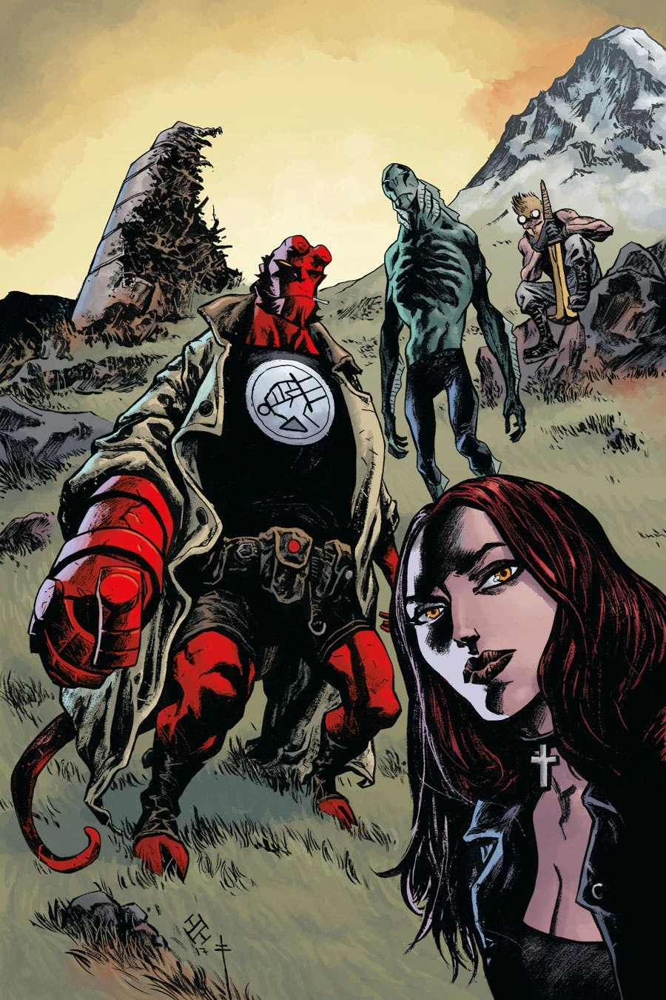
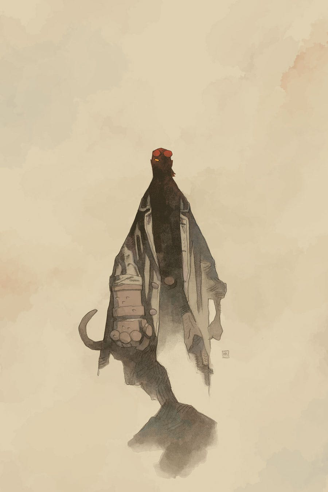
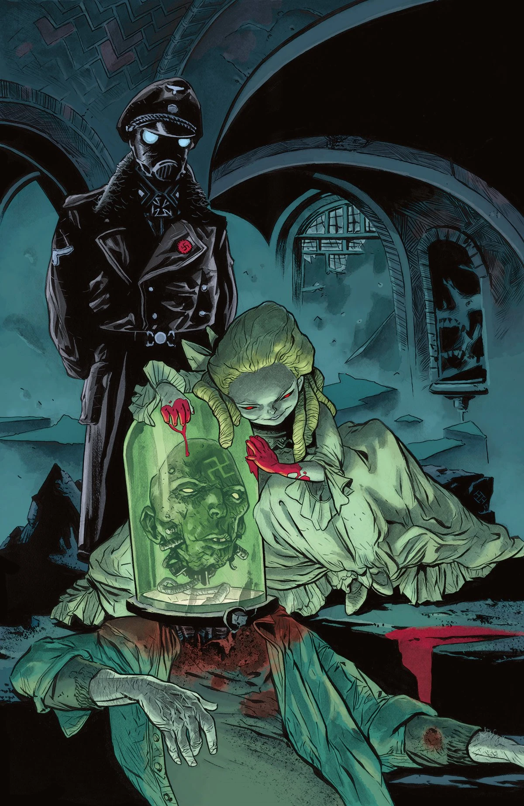
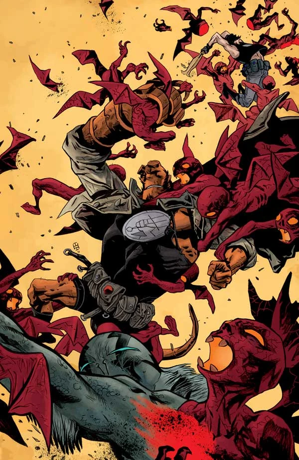
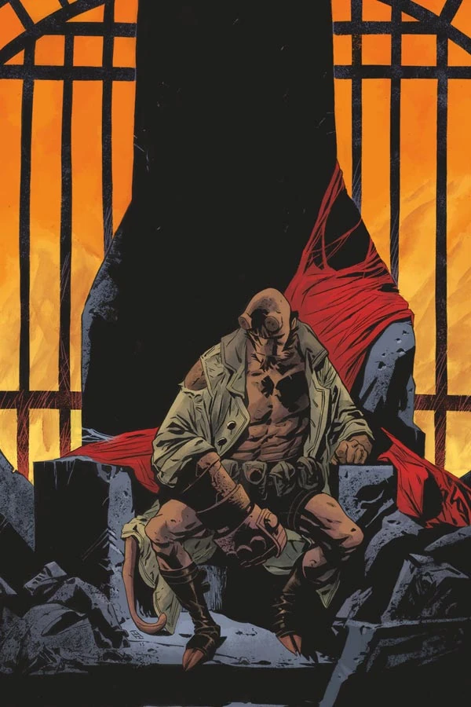

***Pandemonium*** is the second arc of [*The Devil You Know* story cycle](/entry/The_Devil_You_Know_%28story_cycle%29).

## Publication History

After the final issue of the *[Messiah](/entry/Messiah)* arc, Dark Horse held off on releasing the next issue of *[The Devil You Know](/entry/The_Devil_You_Know_%28story_cycle%29)* until after the release of the [*Messiah* trade paperback](/entry/Trade_Paperback_Collections).

[Hellboy](/entry/Hellboy_%28character%29) reunites with [Abe Sapien](/entry/Abraham_Sapien) as demons gather in New York to enslave all that remains of mankind.

## Synopsis

### Part One

Hellboy is back on earth, and the [B.P.R.D.](/entry/Bureau_for_Paranormal_Research_and_Defense) struggles to understand his unwillingness to hunt the demon threatening to turn the earth in to a literal [Hell](/entry/Hell).

### Part Two

Hellboy reunites with Abe Sapien as demons gather in New York to enslave all that remains of mankind.

This issue is the first appearance of Agent Casper Morrow in the comics. He previously appeared in the prose short story [*The Promised Smile*](/entry/Hellboy%3A_An_Assortment_of_Horrors).

### Part Three

One agent’s confession brings the B.P.R.D. closer to finding the cult leader enslaving followers from across the country, and dissent within [Varvara’s](/entry/Varvara) ranks leaves cracks in her plans for a new [Pandemonium](/entry/Pandemonium_%28location%29).

### Part Four

The B.P.R.D. arrive in New York to an immediate attack by cultists-turned-zombies and familiar demons.

### Part Five

The B.P.R.D. tries to regain traction after a devastating blow, while Varvara plans to attack the agency from the inside.

## Gallery

Covers by [Max](/entry/Max_Fiumara) and [Sebastián Fiumara](/entry/Sebasti%C3%A1n_Fiumara) unless otherwise stated.

 \#1

 \#1 variant
by [Mike Mignola](/entry/Mike_Mignola)

 \#2

 \#3

 \#4

 \#5
