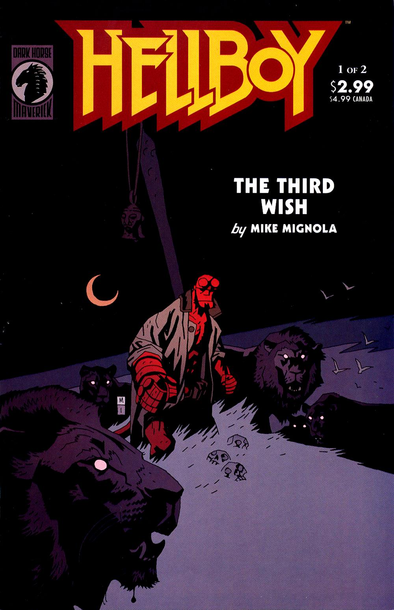

***The Third Wish***, is a two-issue miniseries in which [Hellboy](/entry/Hellboy_%28character%29) travels to Africa, but ends up trapped under the ocean by the [Bog Roosh](/entry/Bog_Roosh).

## Publication History

*The Third Wish* was originally published as a two-issue miniseries from July to August 2002. The story was reprinted with *[The Island](/entry/The_Island)* in [*Hellboy – Volume 6: Strange Places*](/entry/Trade_Collections) in August 2006.

## Synopsis

### Part One

Three mermaid sisters ask the [Bog Roosh](/entry/Bog_Roosh), an undersea witch, to grant them three favors. In return she asks them to hammer a special nail into the head of her 'enemy.'

[Hellboy](/entry/Hellboy_%28character%29), who traveled to Africa after *[Conqueror Worm](/entry/Conqueror_Worm_%28story%29)*, joins [Mohlomi](/entry/Mohlomi), a “great witch-doctor” long dead, at his fireside. Mohlomi explains that Kwaku [Ananse](/entry/Ananse), the spider and the bats told him that Hellboy would come, and Hellboy explains why he was three days late in arriving. At Mohlomi's prompting, Hellboy falls asleep and dreams...

Hellboy stands in the middle of a pride of lions, they speak his name. The lions tell him that this is the last night he will spend in Africa, and that he is never to return. A ringing bell wakes him.

Hellboy wakes up on the coast, and Mohlomi takes him to hear the sea call his name. The man gives Hellboy the bell from off his staff. Hellboy puts his head to the water to hear his name. A huge wave rises up, washing Hellboy into the sea.

The three mermaids grab him, and although he fights back, they manage to hammer the nail into one of his filed horns. He passes out.

Hellboy wakes up in an underwater ruin bound in chains. The Bog Roosh tells him he will never be able to escape as long as the nail and chains stay in place. She explains that the chains are fashioned from the bones of a man once hunted by Hellboy. The man's intense hatred for Hellboy grants them their power over him.

Their task completed, the sisters come to collect their favors from the Bog Roosh. The eldest asks for her lost lover to return. Her lover long dead returns and kills her, so that they are forever united in death. The second loves a man from the surface, and wants to become a human so she can be with him. She transforms into a human and drowns under the sea. The third tells that her father died long ago and a shrine was built in his name. Once his spear was housed there, but the spear was lost. She asks that the spear be returned. The spear rises from the depths of the ocean, she takes it and swims away, taking one last look back at the bound Hellboy.

The Bog Roosh now turns her attention back to Hellboy. She plans to kill and dismember him. He asks why, to which she responds “nothing less than the salvation of the world.”

### Part Two

The youngest mermaid returns to her father's shrine, and tells her dead father that his other daughters have died “by their own desires.” She tells him that his long lost blade is returned. The ghost of her father appears. He says that it was wrong to attack Hellboy, as he never did her any harm. He says that the honor of a dead man is not “in broken tools and old bones,” but rather “in the deeds of our children.” By her action she has doomed him to burn in Hell.

The Bog Roosh again tells Hellboy that he must die so the world may live. Hellboy retorts that for fifty years he has fought monsters which makes him the good guy. She responds that she is haunted by a vision of the future. She sees Hellboy dead and his right hand taken. She sees the hand used to set free the dragon, [Ogdru Jahad](/entry/Ogdru_Jahad), and the world destroyed.

The Bog Roosh plans to cut Hellboy into pieces and send them to the witches he has harmed, send [the Baba Yaga](/entry/Baba_Yaga_%28character%29) his left eye, and send [Hecate](/entry/Hecate) his empty skin. She will eat his heart and drink his blood, and feed his right hand to a certain whale, the oldest living creature on earth, and when the whale dies he will drop into the Pit of Urr, gone forever.

Hellboy's image sits motionless in a shallow pool surrounded by fairies. King [Dagda](/entry/Dagda) states Hellboy is fairly caught, and that he cannot free him. [Gruagach](/entry/Gruagach), last seen in *[The Corpse](/entry/The_Corpse)*, asks why Hellboy should be saved at all. Another fairy responds that a new world will rise after this one falls. Gruagach replies that the fairies will end when this world ends, but that with Hellboy gone perhaps the fairies can reclaim the world. A fairy asks [Sir Edward](/entry/Sir_Edward_Grey) his opinion. Sir Edward replies that Hellboy's story is not yet written, and if it was one written that he is rewriting it. He accuses Gruagach of speaking out of personal grudge. Gruagach tells of the wrong done to him (in *[The Corpse](/entry/The_Corpse)*) and that he will have revenge. Gruagach hits the still image of Hellboy.

Under the ocean, Hellboy flies back as though hit, he does not understand what happened, but calls to the Bog Roosh to just kill him already. The mermaid sneaks up to Hellboy and using her father's blade, breaks the chains binding Hellboy. The Bog Roosh returns and curses Hellboy and the mermaid. The Mermaid begs Hellboy to flee, and he leaves her with the witch. The witch sends the two dead sisters to attack the living mermaid. Her father's ghost tells Hellboy that he has the power to leave, and that his daughter is receiving her just punishment. Hellboy refuses to believe that and using the blade destroys the dead sisters.

Hellboy and the mermaid enter a room filled with jars that have faces carved in their lids. The mermaid explains that these are the source of the Bog Roosh's power, the trapped souls of drowned sailors. He tries to free the souls, but she tells him they are trapped as long as the Bog Roosh lives. The Bog Roosh jumps at Hellboy impaling herself on the blade in his hand. The mermaid explains that she could not bear to live in the world of her visions. The spirits of the dead sailors fly away in the form of birds.

The mermaid becomes the new Bog Roosh, the old Bog Roosh's final revenge. She is bound to the cave forever. She pulls the nail out of Hellboy's head setting him free. Her power gone, she will sit alone awaiting the end when the Ogdru Jurhad will set her free. Her father responds that she will never be alone, he will stay with her “even to the end of time.”

Hellboy floats on through the ocean.

## Story Chronology

The exact date of this story is unknown. It takes place sometime after *[Hellboy: Conqueror Worm](/entry/Conqueror_Worm_%28story%29)* in 2000.

Chronologically Hellboy's next appearance after this story is in *[Hellboy: The Island](/entry/The_Island)*. This is said to be over two years after *The Third Wish*, but again no exact date is given.

After that comes *[Darkness Calls](/entry/Darkness_Calls)* which takes place sometime in 2006.

So *The Third Wish* then takes place sometime between 2000 and 2004. In *Conqueror Worm* Hellboy says Africa will be the first place he goes, so an earlier date is likely.

## Content

### Characters

#### General

- [Hellboy](/entry/Hellboy_%28character%29)
- [Mohlomi](/entry/Mohlomi)
- Emile Bertrand (Flashback)
- [Ogdru Jahad](/entry/Ogdru_Jahad) (Vision)
- [Edward Grey](/entry/Edward_Grey)

#### [Merfolk](/entry/Merfolk)

- [Bog Roosh](/entry/Bog_Roosh)
- Three sisters
- First sister's lover
- Father/Sea King

#### [African Folklore](/entry/%3ACategory%3AAfrican_Myth)

- [Ananse](/entry/Ananse)
- Python, Leopard, Fairy & Hornet (Flashback)
- Bat
- Kimyamkela (Flashback)
- Talking Lions (Dream)

#### [Witches](/entry/Witches)

- [Baba Yaga](/entry/Baba_Yaga_%28character%29) (Vision)
- [Hecate](/entry/Hecate) (Vision)

#### [Daoine Sidhe](/entry/Daoine_Sidhe)

- [Dagda](/entry/Dagda)
- [Gruagach](/entry/Gruagach)

### Locations

- [Bog Roosh's](/entry/Bog_Roosh) Lair
- Africa (Two unspecified locations)
- [Yggdrasil](/entry/Yggdrasil)

### Noteworthy artifacts

- [Mohlomi's](/entry/Mohlomi) Bell
- [Bog Roosh's](/entry/Bog_Roosh) Nail
- [Merfolk](/entry/Merfolk) Father's Spear
- [Right Hand of Doom](/entry/Right_Hand_of_Doom) (Separated from Hellboy) (Vision)

## Gallery

Covers by [Mike Mignola](/entry/Mike_Mignola).

 \#1

 \#2
