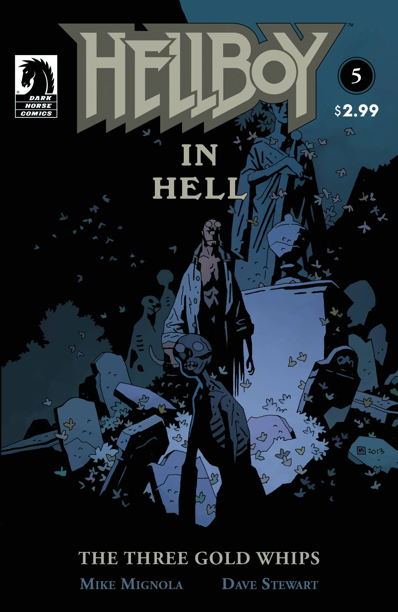
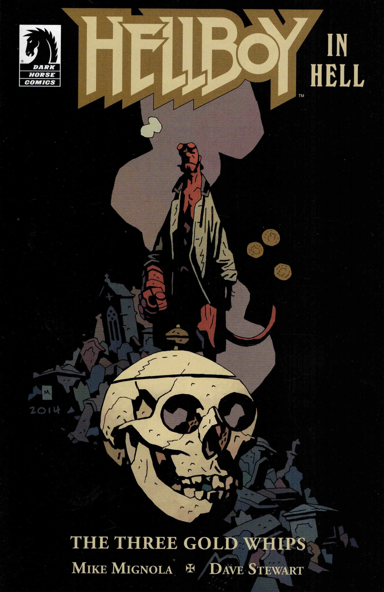

***The Three Gold Whips*** is a one-shot and the second arc in the [*Hellboy in Hell* series](/entry/Hellboy_in_Hell_%28series%29).

## Publication History

The story was published in December of 2013 and is based around the Grimm fairy tale *The Devil and His Grandmother*.

## Synopsis

Hellboy helps a confused man who sold his soul for a magic whip — a story inspired by one of the stranger Grimm’s fairy tales.

## Gallery

All covers by [Mike Mignola](/entry/Mike_Mignola)

 \#5: *The Three Gold Whips*

