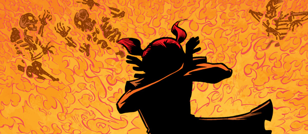
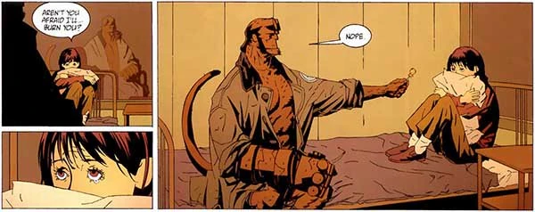
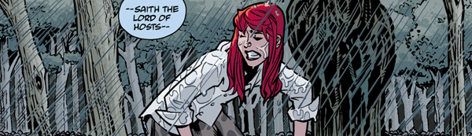
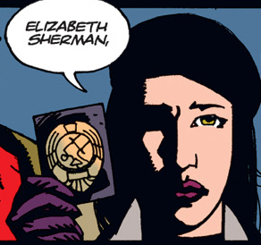
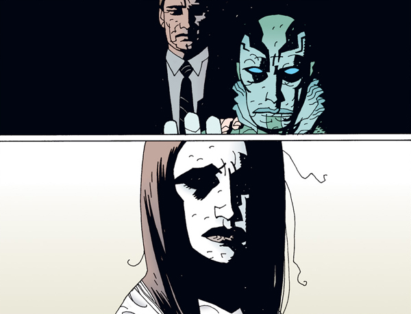
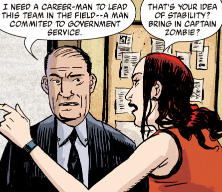
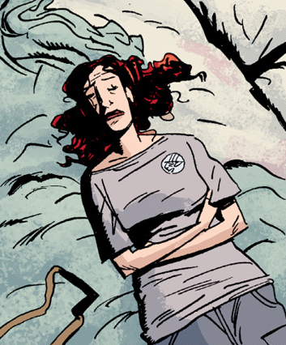
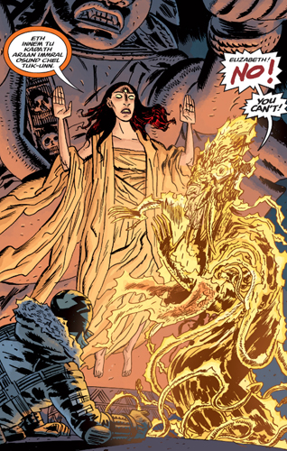
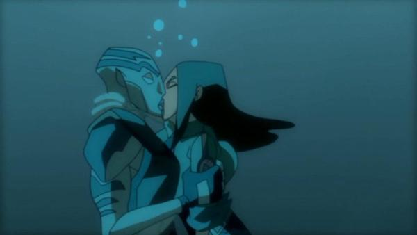

**Elizabeth "Liz" Sherman** is a pyrokinetic human woman, and a field agent of the [Bureau for Paranormal Research and Defense](/entry/Bureau_for_Paranormal_Research_and_Defense). At age eleven, she destroyed an entire city block, killing thirty-two people—including her parents and younger brother. Since then, she has been a ward of the Bureau, fighting evil forces and learning to live with her abilities.

## History

### Early Years

Born in Kansas City, Kansas, on April 15, 1962, Liz had a normal childhood until her pyrokinetic abilities began to manifest themselves when she was ten. Raised Catholic, Liz felt that the fires were a result of her sins, and for a short time managed to keep the fires under control by a combination of prayer and sheer force of will. Her parents occasionally found evidence of the fires, but seem to have been unsure how to approach it or didn't believe it was pyrokinesis.

In July 1973, Liz thought the problem had gone away. But at a neighborhood birthday party, a boy pulled hard on her ponytails, surprising the young girl. In the ensuing fire, an entire city block was destroyed. Thirty-two people were killed in the flames, including Liz's entire family and home. Firefighters discovered Liz, miraculously unharmed, standing in the middle of the smoldering rubble among the bodies.

The B.P.R.D. was called to the scene and wanted to take custody of Liz immediately, but the request was denied by Liz's family, who refused to believe that she was the cause. They soon learned otherwise as small fires began to flare up out of her control. Over the next ten months, Liz grew increasingly depressed as she was passed from relative to relative; her extended family became understandably afraid of her destructive powers, and finally rescinded custody to the Bureau in May 1974.

At B.P.R.D. headquarters, Liz was kept in a flame-proof room while the Bureau scientists studied her power. With no real comfort or physical contact—only doctors and scientists in bulky fire-proof suits were allowed into the room—Liz withdrew further and further into depression, believing herself to be a danger even to those in suits.

Her isolation was broken by [Hellboy](/entry/Hellboy_%28character%29), who came into the room with a lollipop as a way to break the ice. The large red demon eventually became her closest friend and older brother figure for most of her life. Hellboy helped Liz to come out of her shell and adjust to life at the Bureau. For the next six years, Liz and Hellboy remained extremely close; he traveled frequently on assignment but made sure to check on her regularly as she trained with the B.P.R.D. and slowly developed tenuous control of her abilities. During this time, her Catholic beliefs were strained, and for a time she no longer considered herself part of the faith.

 In 1976, Hellboy encouraged his own mentor, [Trevor Bruttenholm](/entry/Trevor_Bruttenholm), to let Liz outside the Bureau more often. Though unsure, Bruttenholm took her with him to investigate a minor haunting in Massachusetts by the ghost of a woman who had been executed for the accusation of witchcraft. Liz didn't believe that the woman had been a witch and attempted to pacify her with the help of a local boy, Teddy. But it was revealed that the woman had, in fact, been a witch who tried to possess Liz to get her revenge. Bruttenholm and a local priest were able to exorcise the spirit and rescue Liz and Teddy. Through this event, Liz got her first taste of the supernatural and what it means to be part of the Bureau. She put her cross back on, seeming to regain some of her faith in the event, and left Teddy with a kiss before returning to the Bureau.

In 1978, [Abe Sapien](/entry/Abe_Sapien) was brought to the Bureau. Much like Liz, Abe was kept in isolation for study until Hellboy convinced them that he was not a threat. Abe and Liz became fast friends, bonding over their shared 'freak' status and statuses as wards of the Bureau.

While Liz still had nightmares about the fire that killed her family, she gradually began to let go of her past. And while she was still far from in complete control of her powers, the number of accidental flare-ups began to decrease.

In 1980 when Liz reached legal adulthood, she decided to remain with the Bureau and became a full field agent. But in the field, Liz struggled with her pyrokinetic abilities and sometimes lost control when in stressful situations. As a result, she was often assigned to quieter cases. Frustrated with her lack of control and believing that the Bureau wasn't confident enough in her, Liz began a long tradition of quitting and returning to the Bureau; between 1980 and 1994, Liz quit twelve times. But she always returned; no matter how much she wanted to leave, she didn't trust herself in normal society.

### The Cavendish Hall Affair

 In May 1994, Abe, Liz, and Hellboy traveled to Cavendish Hall in upstate New York to investigate the murder of Director Bruttenholm by [frog-like creatures](/entry/frog_monster). During the investigation, the mad Russian monk [Rasputin](/entry/Rasputin) seized control of Liz's powers, funneling it through the creature [Sadu-Hem](/entry/Sadu-Hem) and "into the void" where he hoped it would free the [Ogdru Jahad](/entry/Ogdru_Jahad) from their ancient prison. Rasputin might have succeeded had Abe not killed him, spearing him through the chest with a harpoon. Liz, shocked out of her trance-like state when Rasputin died, was unable to control the fire the monk had unleashed. In the explosion that followed, she destroyed both Sadu-Hem and Cavendish Hall.

Liz was devastated by both the violation of being used by Rasputin and by her own loss of control, and she quit the B.P.R.D. for the thirteenth time in June 1994. But finding herself even less confident than ever in the outside world, she returned the following February.

#### The Giurescu Affair

In 1997, Liz joined agents [Bud Waller](/entry/Bud_Waller) and [Sidney Leach](/entry/Sidney_Leach) on a search for the body of the vampire [Vladimir Giurescu](/entry/Vladimir_Giurescu). In the course of their search, the group discovered a seemingly lifeless body of [a man-sized homunculus](/entry/Roger) in a castle in Romania. Liz was drawn to the homunculus and, sensing a way to be rid of her fire, put her finger in a metal opening in the body's chest. Instantly, her fire was drained into the creature, bringing it to life. Waller shot Liz in the arm in a desperate attempt to break the connection, causing the homunculus to break his neck before fleeing.

The price of the exchange was steeper than Liz could have anticipated: her fire was integral to her life, and without it she began to waste away despite medical assistance. Abe refused to leave her side, and Hellboy went in search of the homunculus to convince it to give the fire back. By the time Hellboy did return, with the newly named "Roger" at his side, Liz had been dead for minutes. But upon Roger returning her fire to her body, Liz woke up to perfect health. Liz returned to work, but death had taken a toll on her. Ironically, Liz and Roger would come to share a special bond over the next few years, making him one of her closest friends.

In February 2000, she left the Bureau once again, this time travelling to an Argathan monastery in Ural Mountains where she hoped to be able to achieve some semblance of balance and make peace with her power. As such, she was not present when Hellboy left the Bureau as well, and it's unknown if they ever said their goodbyes.

### Plague of Frogs

Though Liz never discussed the details of her experiences at the monastery, by mid-2002, she had finally achieved the equilibrium she sought -- and with it, full control of her abilities. Unfortunately, in September 2002, the monastery was attacked by descendants of a Hyperborean [slave race](/entry/Servants_of_the_Left_Hand) which had been living deep beneath the Earth. All of the monks were killed in the attack, and Liz's spirit was stolen out of her body, imprisoned inside a Hyperborean device to power ancient war machines in order to take over the surface. Liz's spirit appeared before Abe Sapien, who mobilized a rescue mission.

Liz was rescued, and her spirit was restored to her body. Though shaken by the experience, Liz retained her newfound balance and returned to the Bureau full-time, travelling with Abe, Roger, and new agent [Johann Kraus](/entry/Johann_Kraus) on other assignments.

One such mission involved a spore that B.P.R.D. had recovered from Cavendish Hall. The spore had grown into an earthly manifestation of Sadu-Hem and escaped lab; from there it had been taken by [Humbert T Jones](/entry/Humbert_T_Jones) to Crab Point, Michigan, where it had transformed the entire town into frog monsters. During the investigation, Liz was able to control her fire, using it to again destroy Sadu-Hem and most of the frog creatures. She was briefly panicked by the apparent death of Abe Sapien, and among the relieved when he came back to life less than an hour later.

 The Bureau began a full-on offensive against the frog creatures, relocating to a larger headquarters in Colorado and enlisting the help of former marine [Captain Benjamin Daimio](/entry/Benjamin_Daimio). Liz's stubborn personality and Ben's military stiffness caused the pair to clash for months; Liz was baffled as to why he was needed, and believed him to be a bad influence on the easily impressed Roger. But they quickly learned to work together, finding that their new headquarters were the site of a German scientist attempting to summon angels into the mortal realm. With Ben's leadership, they were able to beat the scientist and the freakish creature he called forth.

### Memnan Saa

Over the next few years, Liz and her teammates travelled all across the country trying to eradicate the frog creatures and seemed to be succeeding. After the B.P.R.D. destroyed a nest in Montanta, an old woman approached Liz and gave her a lotus blossom; the moment she touched the flower, Liz collapsed into a brief coma. While unconscious, Liz dreamt of a mysterious man who warned her that things were worse than what she believed. Liz woke up shortly after, coughing up a wadded piece of paper warning about a new threat: [Katha-Hem](/entry/Katha-Hem).

 Feeling an odd sense of danger, Liz demanded to know where Roger was. But it was too late; at the same time of Liz's awakening, Roger was murdered by the recent leader of the frogs, [the Black Flame](/entry/The_Black_Flame_%28character%29). Liz was crushed, and moved into his room as she dealt with her grief. In the weeks following, she was visited repeatedly by the man in her dreams who warned her that even worse events were coming, and that she needed to figure out who she could trust. She began to sleep less and less, and any sleep she did have was disturbed by the visitor.

Naturally unbelieving in the stranger, Liz ignored his warnings. But it did indeed seem that she had reason to worry about her teammates. Johann became estranged after regaining a new body, generally ignoring his own duties. Daimio became more and more aggravated, dealing with his own internal issues. Liz was also troubled by the increasing distance between herself and Abe; he had told only Kate about his past life as [Langdon Caul](/entry/Langdon_Everett_Caul), and his behavior became erratic with little explanation for Liz. However she did connect well with new Bureau ward, the ancient mummy Panya, who seemed to have insight into Liz's visions.

As well, her mistrust in Daimio proved sound when Daimio transformed into a jaguar-like monster, killing several people and attempting to kill her as well. Liz went into shock during the monster's rampage; it seemed that all the mysterious man's warnings about trust were justified. When Daimio retreated from the headquarters, Johann was possessed by the spectre of Lobster Johnson, who shot at Liz's body, somehow pushing back the control the visitor had gained over Liz's psyche. Almost immediately, Liz was healthy and functional again, expressing a desire to hunt down her tormentor "and kick his ass".

After a seance with Panya and investigation into Lobster Johnson's history with the man now identified as [Memnan Saa](/entry/Memnan_Saa), Liz led a team to a remote jungle temple. But the second Liz walked in, time seemed to freeze in place. She was confronted by Memnan Saa and vanished before the team's eyes.

 The Bureau was able to track down Memnan Saa to an ancient Hyperborean City of Thadrethes where an unconscious Liz hovered in the air in some sort of trance. Memnan Saa used her flames to summon firey dragons to fight off a coalition of the frogs and the subterranean race that had once kidnapped Liz's soul. Abe tried to force Memnan Saa to release her; Memnan Saa violently refused. His actions toward her friends seemed to pull Liz out of her state, who began speaking in an odd language as she burned Memnan Saa alive from the inside out. Moments later, Liz woke up out of the trance, having no memory of what had transpired since being abducted.

### Visions of the Future

,

Emboldened by the defeat of Memnan Saa, but concerned about the growing power of the frogs under the Black Flame's leadership having now allied with the underground people, Liz spearheaded a task force to confront them directly.

But when they descended beneath the monastery where she'd once studied to control her powers, Liz seemed to walk out of the caverns and into another realm completely... one where the B.P.R.D. had failed. The ghost of Memnan Saa appeared to her, saying that she is seeing the world she helped create. Liz refuted him, believing that it was just another trick, and drove him away before exploring the wreckage of a crashed Bureau plane.

Within, she found several old photos of what seems like a possible future: older versions of Kate and Devon, a mobile Panya, a more monstrous Abe, and even a returned Hellboy. She sees a vision of Hellboy and Hecate, the two figures imploring, "Do it." An unnamed shaman implored Liz to let go of her flame, and Liz did so, engulfing miles and miles in flame.

Back within the caverns, the team confronted the Black Flame and were rescued by the shaman mere moments before Liz's flame reached them as well, killing the Black Flame and the last of his army. Though Abe and his team were later recovered, Liz once again disappeared from the B.P.R.D. Unknown to the Bureau, she reappeared in Bangkok. She asked a pair of Frenchmen for a light, implying that she no longer had her power.

Liz returned to America some time later, going into hiding after discovering that her fire had not only burned the frog army but unleashed destruction all over the planet, including the entire destruction of the islands Borneo and Sulawesi. She took up residence in a trailer park, attempting to stay off the Bureau's radar. But her dreams were still restless as she faced visions of Professor Bruttenholm and her father, telling them that she was done because of her belief that Hellboy was coming back. She soon discovered that a cult had been brewing among the residents, who tried to kill Liz before she escaped once again.

### Return to the B.P.R.D.

After the events with the cult, Liz regained some of her self confidence. She eventually rejoined the B.P.R.D. and started accompanying teams in the field. During a mission in New York, she faced the Black Flame once again and used her powers against him, displaying a level of mastery and power never seen before. Following these events, she continued to do missions for the B.R.P.D., using her newfound abilities to fight and eliminate all types of monsters, her powers seemingly being the only effective weapon against the Odgru Hem.

## Powers and abilities

### Powers

**Pyrokinesis:**Sherman is capable of pyrokinesis (mental control over flames). She can mentally generate fire, projecting flames from her hands or having it surround her body in a protective cocoon. She has also, on rare occasions, been able to levitate with her fire, but this is a fairly uncommon occurrence.

Her powers are extremely volatile and are capable of a very wide radius and measure of destruction; when her powers first awoke as a child, she killed over a dozen people without effort.

Sherman's pyrokinesis appears to be something above and beyond "typical" pyrokinesis; more than once it has been hinted that her powers stem from some sort of entity or presence that dwells inside her, one that isn't necessarily based on fire but rather energy in general.

In *Hellboy: Seed of Destruction* Rasputin referred to Sherman's powers as a living thing, hinting that it might be separate from her in some way. If this is true, then it would seem the "entity" that gives Sherman her pyrokinesis shares a symbiotic relationship with her; removal of her powers has been shown to be extremely damaging and even lethal to her.

It is also possible that her powers stem from a portion of her soul instead of a separate being; in *B.P.R.D.: Hollow Earth* her energy is stolen away, leaving her body an empty husk. Her imprisoned powers are shown to look and act like her, insinuating that they are, in fact, her.

In either case, it is clear that Sherman's pyrokinesis is a vital part of her being, necessary for keeping her alive. Several characters have successfully used Sherman's power as a fuel or energy source, notably Rasputin and the [King of Fear](/entry/King_of_Fear_%28character%29), who used her to empower an Ogdru Hem and reactivate ancient machinery respectively. This further supports the suggestion that her powers are based around more than just simple fire.

Memnan Saa believed that she fully embodied the power and promise of [Vril](/entry/Vril), the ancient energy that formed the world and was once wielded by the ancient [Hyperboreans](/entry/Hyperboreans). After the events of *King of Fear*, she appeared to have lost her fire powers.

She later started using her powers again, controlling them using meditation techniques based on her time spent with monks. She has since demonstrated vast amounts of power, enabling her to seemingly become flames, to fly, and to project intense flames and fireballs from her body.

### Abilities

She is also an expert hand-to-hand combatant, having been a ward of the B.P.R.D. since age eleven and most likely began her physical training as an agent at a young age. She has been shown to be able to take down a single man with one kick.

## Allies and Enemies

### Allies

- **[Hellboy](/entry/Hellboy_%28character%29)**: A red-skinned demon with a right hand made of stone. An older brother figure and professional mentor to Liz, he was instrumental in helping her accept her paranormal status and inspired her to become a Bureau agent.
- **[Abraham Sapien](/entry/Abraham_Sapien)**: An amphibious humanoid of mysterious origin, this fellow agent can breath underwater thanks to a set of gills, can swim at high speeds, and is one of Liz’s closest and oldest friends in the B.P.R.D.
- **[Thomas Manning](/entry/Thomas_Manning)**: The head of the B.P.R.D., and thus Liz's boss. Tom does not always appear to be confident of Liz's control over her powers as he had the Bureau keep an eye on her while she was at the monastery. Liz in turn doesn't seem overly fond of him either, and believes that other than Kate Corrigan he is intimidated by or patronizing to female agents.
- **[Roger](/entry/Roger)**: A human-sized homunculus. Despite their rough beginnings, Liz and Roger shared a bond that few others could understand. Liz was particularly protective of him, and was crushed at his death.
- **[Kate Corrigan](/entry/Kate_Corrigan)**: The field director for the special talents team. Kate and Liz are good friends, with Kate taking a slightly motherly role to the younger woman.
- **[Johann Kraus](/entry/Johann_Kraus)**: A German psychic displaced from his body. The two shared a somewhat professional relationship, but did not seem to have much of a relationship outside of teammates.
- [Panya](/entry/Panya_%28character%29): An Egyptian mummy rescued from the Oannes Society. A recent friend of Liz's, helps her deal with Memnan Saa and appears to be quite fond of her.

### Enemies

- **[Grigori Rasputin](/entry/Grigori_Rasputin)**: Liz first encountered the sorcerer Grigori Rasputin during the Cavendish Hall case when he tried to use her powers to awaken the Ogdru Jahad.
- **[Memnan Saa](/entry/Memnan_Saa)**: Formerly known as Gilfryd, he repeatedly attempted to convert Liz to helping his cause, keeping her from sleeping by invading her dreams to warn her about the impending doom of humanity. When she refused to believe him, he abducted her and used her fire to fight the frogs without her consent. Ironically, this same fire was ultimately the cause of his death. In *B.P.R.D.: King of Fear*, his shade reappeared to Liz, claiming that by killing him she had damned the human race.

## Other Media:

### Live-action films

In *[Hellboy](/entry/Hellboy_%282004_film%29)* (2004), Elizabeth Sherman is a quiet, shy and introverted individual who suffers from deep guilt and lack of self-esteem over her rampant powers. She finds solace in her childhood friend [Hellboy](/entry/Hellboy_%282004%E2%80%932008_film_character%29), who holds a very strong romantic interest in her. In the films, she is much less confident in her powers, retreating to an asylum before [Rasputin](/entry/Grigori_Rasputin) manipulates her into destroying it. She is later kidnapped by the monk, attempting to use her as blackmail against Hellboy, before being rescued. The couple begin a romance at the end of the movie.

Biographic notes by [Guillermo del Toro](/entry/Guillermo_del_Toro) were included in prerelease promotional materials. Though some elements are readily apparent in the final film, it is unclear how much of this text is considered canon to the final films.

*GDT's Movie Bio: Liz*[1]

**LIZ**
**Elizabeth Sherman**
29 years old, 5" 5" Weight: 100 lbs. Hair: Raven black.

LIKES: "Sentimental Education," by Flaubert. George Tooker paintings. Some Thomas Cole landscapes. The Beatles' White Album. Cold, fresh sheets, a big pillow, almonds, pine nuts and pistachios, trail mix, washing her hands, bathing, long, hot showers, the smell of clean hair, flannel shirts, antique jewelry. Fire. Yup - unfortunately she does love fire. Big sweaters. Silent films. Especially Chaplin and especially *City Lights*, kids, watching them at play. Looking at the moon for long periods of time. Being alone with her eyes closed. Churches and cats - everything about them, except "the worship thing." Snow falling, fog. Really soggy cold cereal. Her big, tomboy leather boots, the smell of wet pavement, the aroma of pancakes and syrup, the promise and clarity of rain-washed sky. Watching the pavement as she walks (she finds a few pennies), keeping her hands in her pockets and her head covered by a hood. She loves to dissolve communion wafers in her mouth and thinks that it makes her purer - plus they taste real good.

DISLIKES: Crowds, parties, being recognized, surprise visits, gifts (giving them or receiving them), nightfall, sleepless nights. Enya, Michael Bolton, Kenny G. The smell of air fresheners, the scent of incense. Being looked in the eye by strangers.

BIOGRAPHY by Guillermo del Toro: There are a few things you should know about Liz: She grows real quiet when she's nervous, she can stare at the ceiling for hours and not be bored. She can throw snowballs like the best big-league pitcher. Every time she tastes vanilla ice cream she cries for hours. Just like that, for no good reason. And she likes it. Why? Because crying feels like a normal thing people do. And there are precious few things normal about her.

Robert and Diane Sherman got married three years after meeting while standing on line to see *The Godfather*. He was an efficiency expert and she was a chef. Liz was born when theaters were showing *The Godfather Pt. II*. Liz didn't speak a single word until she turned four. Her mom took her to see several specialists and they all concurred: mentally, all cylinders were firing. One evening, while out to dinner, Mom called the baby-sitter. She was informed that Liz was talking. "What is she saying," asked Mom. "Everything," was the succinct answer. And she was. Liz Sherman went from totally silence to full articulation in a single evening.

They moved around. Quite a bit. Her father streamlined processes (whatever that meant) for big companies like Lear or Lockheed. Kansas City, Chicago, D.C... Liz had trouble making friends. She was too intense, too intelligent and too aware. None of it jibed with the laid back late 70's. And then, there was the fire.

At the age of 7, Liz's bed and one of her Teddy Bears presented strange scorched patches. Round, perfectly delimited areas were burnt to a crisp, but nothing more. Her room was examined for short circuits. No answer was found. Liz, however, volunteered a small fact: she dreamt of fire that night. The occurrence repeated itself a few more times, always during her sleep, always in limited areas. Her parents started worrying. So did the principal at her school.

One morning after gym class, several volley balls exploded inexplicably. Liz was the only one around. The Catholic church was not much help, either, Father Jones had given Liz a small crucifix to wear around her neck. It didn't keep her safe for long. Her hands burst into flame when two girls chased her after school. Scared, Liz plunged them into a vat of water, but the fire raged on. A store owner called the paramedics and the fire department, but by the time they arrived all they found was a little girl crying on the street. Moving came in handy after that. New schools took a while to get records and - most of the time - the family was soon gone after that.

Liz' Mom and Dad fell out of love along the way and had terrible fights almost every day. They were careful at first, trying not to upset her, but - as these things go - they eventually didn't care enough to pretend things were OK. They separated and to their credit never blamed Liz. But she knew. She felt the guilt every time her Mother cried alone in the living room, TV at full blast. One Christmas, at age 10, she got a small Instamatic camera from her Dad and started photographing everything around her. "Things stay still in pictures," she thought. "Not in real life." From then on, her private albums filled up with mundane images that became beautiful as soon as they were pinned and mounted. She became quite good at taking pictures and even won a prize at school. Her mom was proud and so was she.

But then the world caught fire.

It is unfair that memories yield only sketchy details of some of our most tragic moments. Liz doesn't remember what she was wearing that day. Every time she dreams about it, the dress is different. She can't even pinpoint her exact position in the building's courtyard. Forensic investigators could, but not her. It was the day that changed everything. The day she burned a courtyard full of people and damaged property a quarter of a mile around. The day most car alarms went off in the outskirts of Detroit. The facts and speculations are in the public record, but the true cause, and the most intimate grief, lies within the heart of the sole survivor: Elizabeth Sherman.

The many "What ifs" and "What if nots" grow tenfold when your mother's death is the direct result of your actions. Now imagine that happening at the age of 11. Liz went from institution to institution, even managing to escape for a few years at a time. Living in the streets, learning the value of being alone and the tough code of self-reliance. And still, inside her, there was a basic need, a tragic void that burned away with an interrupted childhood and that became almost impossible to fill afterward.

Professor Broom met Liz at age 17 in a halfway house in Portland. Their interview was brief. In less than 30 minutes she agreed to join the BPRD. It would become apparent that she had dismissed his offer as pure baloney, and that her sole interest was to get out and make a run for the street. It was impressive then, when the fire-proof truck showed up, surrounded by FBI agents. The BPRD revealed to her that there were others - if not just like her - equally at odds with normality. Her pyrokinetic abilities seemed to line up with all sorts of empathic abilities needed in the paranormal field. By all accounts, Liz was soon quite the star at the Bureau. Yet, every night, once alone in the confines of her fire-proof quarters, she would inevitably feel that she was simply postponing her real task in life: to join the "Big Out There."

So, she quit about a dozen times and was wooed back just as often. You see? No matter where she went, the Federal government had to keep tabs on her. She was classified a National Security Threat and was the only walking weapon of mass destruction with the bruised ego of an 11 year old girl.

Through the years, Liz found solace in Hellboy. They loved the same silent movies, the same odd cartoons and could spend hours just watching that screen flicker in total silence. Many a night Liz would simply fall asleep by HB's couch, her head leaning on his massive chest. He always stood by her out in the field. And it is hard to feel unsafe when a 6'9" wall of red muscle walks by your side. Hellboy would die for her, and she knew that. And, as a matter of fact, many times, he almost did. But there was a primary obstacle, an impossible block that prevented her to articulate her feelings for him as anything more than friendship. To love is to abandon oneself and she was far from doing that for anyone. Not herself, not him. Not anyone.

And yet, maybe everything would have turned out kind of okay if it hadn't been for "The Pittsburgh Incident", that is...

2002, BRADDOCK TOWN, PA.
An abandoned steel town outside of Pittsburgh. Six BPRD agents enter the shell of a foundry. Demonic entities in the basement take possession of several of the agent's bodies. They fight back. So does Liz, but something is triggered inside her that cannot be contained. In spite of her warnings and the swift reaction of everybody around her, a mile wide explosion takes place. Only two survivors: Liz and Hellboy. Publicly, Liz is charged as an arson suspect. The cover works and the investigation is quickly buried. Nevertheless, Liz feels it is time to go. This time is harder. Both for her and Hellboy. This time she has him on her mind.

#### *Hellboy II: The Golden Army*

In the sequel, Liz and Hellboy began to suffer relationship problems, mainly with her fiery abilities and his tendency to be sloppy and ill-mannered. Abe Sapien discovers she is pregnant during the course of the film. When Hellboy was wounded with a spear shard in his chest, the team went to Bethmora in Northern Ireland to stop the awakening of [the Golden Army](/entry/the_Golden_Army), as well as to seek help from the [Angel of Death](/entry/Angel_of_Death). The Angel warned Liz that, if Hellboy lives, he will doom humanity and she will suffer greatly. Accepting the consequences, the Angel removed the shard and told Liz to give Hellboy a reason to live. She does so by revealing to Hellboy the revelation that he is going to be a father.

After defeating [Prince Nuada](/entry/Prince_Nuada), Liz melted the crown that controls the Golden Army. She, along with Hellboy, Abe and Johann Kraus then quit the B.P.R.D. As Hellboy contemplated the American Dream concerning his child, Liz corrected him by saying she was, in fact, expecting twins.

#### Animated Movies

 Liz Sherman also appeared in both of the *[Hellboy Animated](/entry/Hellboy_Animated)* films, *[Hellboy Animated: Sword of Storms](/entry/Hellboy_Animated%3A_Sword_of_Storms)* and *[Hellboy Animated: Blood & Iron](/entry/Hellboy_Animated%3A_Blood_%26_Iron)*. Selma Blair voices Sherman, as she had in the live-action film.

Though younger than her comics counterpart, she is otherwise closer to her comic origins than the live film character.

[1] ["GDT's Movie Bios: Liz"](https://web.archive.org/web/20040917233907/http://www.sonypictures.com/movies/hellboy/site/movie_bios/movie_bio_liz_main.html). *Sony Pictures.* 2004. (archive link)
