**Abraham "Abe" Sapien** (born **Langdon Everett Caul**) is a member of the [B.P.R.D.](/entry/B.P.R.D.). Abe is a humanoid amphibious man, discovered in a Washington, D.C. basement in November of 1978. Abe has been with the Bureau ever since, as he endeavors to discover the truth about his identity. First appearing in *[Seed of Destruction](/entry/Seed_of_Destruction)*, he is one of the longest running main characters alongside [Hellboy](/entry/Hellboy) and [Liz Sherman](/entry/Liz_Sherman), and has featured in several offshoot comics under his own name.

## History

### Discovery & Early Years

In 1978, a comatose, amphibious man was found inside a water-filled capsule within a long-lost chamber beneath the St. Trinian's Hospital. Found by a group of plumbers, the Bureau for Paranormal Research and Defense quickly intercepted the creature, and nicknamed it “Abraham Sapien,” in reference to the scrap of paper written on his tube: April 14th 1865 - the date of President Abraham Lincoln's assassination.

Unresponsive for weeks, it wasn't until B.P.R.D. scientists experimented with shocking him did he awake. However, it appears that Abe was at least somewhat aware of what was going on, as he has memories of overhearing one of the scientists debating whether or not to give up trying to revive him and just skip to dissection.

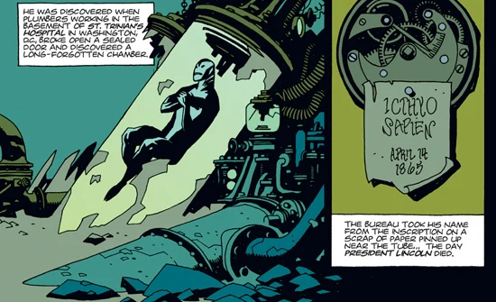
'Icthyo Sapien'

Abe's experience in the Bureau is "terrifying", and he still sometimes has nightmares of the event. Unsure what the creature in the tube was, he was held under scrutiny by the Bureau as scientists studied him. However, [Hellboy](/entry/Hellboy_%28character%29) felt sympathy for him, told the doctors to shut down the experiments, because "they never stop until someone says 'enough'". Abe came out of his tank healthy, if disoriented, and quickly responded to human contact. Despite no memory of a previous life, he was soon able to speak fluent English, apparently remembering the language rather than learning it.

Hellboy and other Bureau agents such as [Liz Sherman](/entry/Liz_Sherman) were both particularly fond of Abe, and the three of them formed a lasting friendship. Hellboy quickly convinced B.P.R.D. director [Trevor Bruttenholm](/entry/Trevor_Bruttenholm) to let Abe come along on minor field operations so that the fish-man could learn about the world outside the Bureau. Between April and June of 1979, Abe was Hellboy's constant companion.

Although Abe's existence was never officially top secret, his discovery in the basement was never publicly revealed, and he didn't become the public figure that Hellboy had. Nervous about his appearance, Abe insisted on wearing a disguise when outside the Bureau consisting of a trench coat, a hat, gloves, and sometimes sunglasses and a fake beard. But by Hellboy's departure in 2001, Abe appears to have gained enough self-confidence that he no longer uses the disguise at all.

In June 1979, a romance with archaeologist [Anastasia Bransfield](/entry/Anastasia_Bransfield) drew Hellboy away, leaving Abe largely stranded at headquarters. Liz and Abe developed a brother-sister relationship based on their mutual "freak" status as wards of the B.P.R.D.. But in 1980, Liz was made a full field agent, leaving Abe alone again as she began to travel more and more under assignment. Abe grew jealous of Liz's freedom -- she was able to become part of the world in ways Abe felt he never would.

In 1981, although still not an official agent, Abe joined a small group of agents on his first mission without Hellboy -- his first mission since Hellboy's departure in 1979. The seemingly simple assignment was to investigate a shipwreck off the coast of Spain, but the expedition was a disaster, resulting in three agents dead and many civilians before Abe was able to fend off the evil spirit that had emerged from the ship. But Abe proved himself in the eyes of Bruttenholm and was made a full field agent that March. (*[Abe Sapien: The Drowning](/entry/The_Drowning)*)

### The Cavendish Hall affair

In May 1994, Abe Sapien accompanied Hellboy and Liz Sherman to the haunted and ancient Cavendish Hall, to investigate the mysterious death of Hellboy’s mentor, Professor Trevor Bruttenholm, by an odd frog-like creature. They spoke with Mrs. Cavendish, who, unbeknownst to him and his companions, was being used as a pawn by the immortal monk [Grigori Rasputin](/entry/Grigori_Rasputin) to lure Hellboy into fulfilling his original purpose as the harbinger of the apocalypse.

After interrogating Mrs. Cavendish with not much success, Abe decided to investigate the surrounding area, now underwater due to centuries of the sinking of the land which the manor is built on. Abe dove out his guest bedroom window and into the murky, disgusting lake. After some time exploring, Abe came across the sight of two of the mutated Cavendish sons disappearing into the water with their deceased mother.

He warily stepped backwards, despite feeling an odd sense of kinship with the creatures, and accidentally stumbled upon an old room containing the body of the long dead patriarch of the manor, Elihu Cavendish. Suddenly, Abe was possessed by the dead man’s spirit, guiding his actions in order to exact vengeance on Rasputin for his family’s suffering.

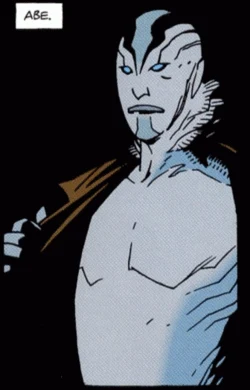
Abraham Sapien as he appears in [Seed of Destruction](/entry/Seed_of_Destruction).

Arriving in time to stop Rasputin from summoning the Seven Gods of Chaos and awakening the monstrous demonic entity Sadu-Hem, the possessed Abe harpooned Rasputin trough the chest, and dived into the air, snatching away the unleashed Liz, who began to utterly destroy the old ruins with her uncontrolled fire powers. Now back under his own mental self, Abe took Liz and helped her escape the ruins while Hellboy dealt with Rasputin personally.

Afterwards, Abe and Liz shared their odd experiences during the time that Hellboy was fighting Rasputin and the magically transformed Cavendish children. When Abe asks Hellboy about what happened during his brief moment with the dying Rasputin before escaping the exploding ruins, Hellboy stays silent, a grim look of unease in his eyes.

### The Giurescu affair

Sometime after the Cavendish Hall mission, Abe was summoned to a B.P.R.D. meeting along with agents Hellboy, Liz Sherman, [Bud Waller](/entry/Bud_Waller), [Sidney Leach](/entry/Sidney_Leach), and Kate Corrigan. Director Tom Manning explained the latest mission: to investigate three different sites; one of which may be the castle of [Vladimir Giurescu](/entry/Vladimir_Giurescu), a vampire with Nazi connections, whose body has recently been stolen by his followers and is to be resurrected the following night on the full moon. Abe is assigned with the first team consisting of him and agent [Clark](/entry/Clark), to investigate Site 2.

Aboard a B.P.R.D. airplane en route, Abe approached Hellboy, having noticed Hellboy’s disturbed reaction when Manning brought up the Nazi connection. He tried to comfort his friend, but Hellboy insisted he was fine, and was soon dropped out the cargo door via a (malfunctioning) rocket pack over Site 1.

After touching down on Szentes Castle, both Clark and Abe witnessed a massive explosion come from the distant Castle Guirescu. Abe merely responded with a dry, “Hellboy’s blowing things up again…” After confirming their site to be a dead end, both Abe and Clark set out to a nearby Romanian town to search for Hellboy, whose tracking belt signal was detected in that area. The two arrived at a decrepit church, following the belt’s signal, and when they entered the holy building they saw a reverend standing before them, stiff as a board and holding Hellboy’s stolen belt. Realizing too late that it was a set-up, both Clark and Abe fell through the collapsing floorboards and into a trap of massive stakes, which fatally impaled Clark and Abe barely managed to avoid the deadly spikes.

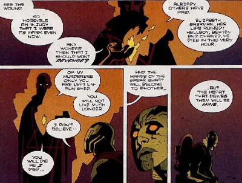
Abe confronted by Rasputin's vengeful spirit.

In the basement below the church, Abe was confronted by the ghost of Rasputin, who told him that he would be punished for Rasputin's murder, and that Abe would die as he had, concluding, "The hands on the spear shaft will belong to another -- but the heart that drives them will be mine." A moment later, the severed head of a local priest told Abe, "Sunken bells are tolling for thee. Out of the caverns of Num-Yabisc, dark and terrible and deep, the ocean is calling her children home."

Though Abe did not understand the declaration, it filled him with a sense of impending doom.

### Roger the Homunculus

Upon his rescue by the B.P.R.D. team, Abe learned his worry was not misplaced. Liz had encountered a homunculus during the mission to Romania, and was apparently dying after losing her pyrokinesis to the homunculus. Abe stayed with Liz at a Romanian hospital, refusing to leave her side until the moment of her death -- a much more crushing blow to Abe than Bruttenholm's death a few years earlier. Fortunately, Hellboy had tracked down the homunculus and compelled him to return the stolen fire to Liz. The creature, whom Hellboy had named [Roger](/entry/Roger), was able to return Liz's power, bringing her back to life instantly at the expense of his own.

A few months later, back at headquarters, scientists Cobb and Reed prepared to dissect the now-lifeless homunculus in the same way that they had dissected Abe. Abe overheard the conversation and recalled his own memories regarding the Bureau and experimentation. When the scientists stepped out of the room, Abe rerouted the building's electricity into Roger, causing serious damage to the headquarters but zapping Roger back to life, and ultimately bringing another major player to the B.P.R.D. team. With Liz healthy again and Roger joining the Bureau, Abe's sense of doom began to lift.

### The departure of Hellboy

In May 1999, Abe and Hellboy travelled to Lochmaben, Scotland to investigate the theft of a box and a set of tongs that had once belonged to Saint Dunstan. Abe was shot and tortured by a chimpanzee (formerly Count Guarino). He later made a full recovery but his sense of dread began to return as events darkened and his best friend Hellboy began to struggle with his identity. But following the example of Liz, he put on a brave face and continued to devote himself to his duties.

Abe's fears proved justified in 2000, when Liz left the Bureau again, this time to study at a monastery in the Ural Mountains to try and control her powers.

Things soon got worse when Hellboy quit the Bureau as well, just one year later in 2001; distressed over the Bureau's implanting a bomb in Roger and his own role in the apocalypse, Hellboy decided to travel, asking Kate Corrigan to say goodbye to Abe for him. Though Abe continued work as a field agent, he began to feel more and more isolated, and he and Roger considered leaving though neither could imagine where they could go.

*(note: from here, Abe no longer appears in the main Hellboy comics; from here on, all his appearances are in the B.P.R.D. spinoff comics)*

### Hollow Earth

Liz's spirit appeared to Abe in September 2002, pleading with him to help her. Abe, along with new agents Johann Kraus and Roger as well as field director [Kate Corrigan](/entry/Kate_Corrigan) , traveled to the monastery where they discovered Liz's lifeless body amid dozens of murdered monks. Abe stepped up (somewhat reluctantly) as the team's leader as they descended into the Earth and rescued Liz's spirit from a primitive race who'd captured it to power their machines. Afterward, Liz returned to the Bureau, and a new spirit of teamwork developed among the crew, with Abe and Liz's brother-sister relationship as its foundation. For the following two years, they worked together in investigations around the globe.

### Plague of Frogs

One night in July 2004, Abe dreamed of dead bodies falling into the sea. In the background of his dream, he once again heard the voice of the dead priest telling him that sunken bells were tolling for him, and that the ocean was "calling her children home."

At the same time, a strange fungal version of the Sadu-Hem creature that had been discovered in the ruins of

Cavendish Hall, escaped from a B.P.R.D. lab in New Jersey. Abe and team tracked the fungus to Crab Point, Michigan, where Humbert T Jones aka the West Virginia Miracle Boy, was using it to convert the townsfolk into frog creatures similar to those encountered ten years prior. Inside Jones's house, Abe discovered a shrine to Rasputin. Abe realized what was happening but too late to stop it; Jones impaled Abe with a spear, fulfilling Rasputin's prophecy. Johann appears on the scene to stop the bleeding but appears unable to stop Abe's death, with Abe's seemingly final words: "Too tired... Do you hear them? Sunken bells... they are tolling for me."

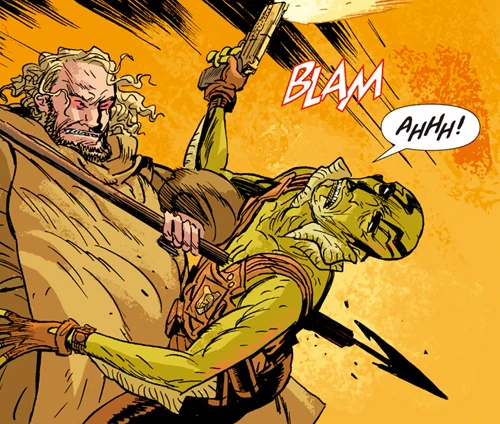
"The hands on the spear shaft will belong to another -- but the heart that drives them will be mine."

At the moment of Abe's death, his spirit travelled back in time to an ancient and beautiful undersea temple where he sees a mysterious alien sea creature. Watching as the centuries passed, Abe saw the temple fall into ruins, and observed the creature curling into itself into something resembling an egg. A man in a diving suit then removed then egg, taking it to a submarine. As if in a dream, Abe found himself walking through the halls of St. Trinian's Hospital in Washington -- in 1865. Outside, it rained frogs as Abe entered the secret Oannes Society laboratory in the basement of the building.

Inside, Langdon Everett Caul and other Society members performed a ritual with the egg, upon which it crumbled into dust in Caul's hands. Abe was invisible to all but Caul, who began to panic, believing that he was being visited by an evil spirit for "what he'd done". Abe's spirit was drawn into Caul's body, causing Caul to collapse and his eyes to turn white. Abe views Caul's last moments, hearing the concerned voices of the Society over time as they observe Caul's transformation and then their leaving him after the assassination of Abraham Lincoln, in which they appear to be involved. They seal the room, saying that when it's safe, they'll return for him.

Though he had lost a lot of blood and been declared dead by Johann, Abe suddenly returned to life. Despite having been speared through the chest, Abe made a surprisingly fast recovery in the weeks that followed.

The trip back in time did not bring back any memories, but it did give Abe a name: Langdon Everett Caul.

### Langdon Everett Caul

Abe knew that his near-death experience had been more than a blood loss-addled dream and, compelled to discover the facts about the central mystery of his life, began to research Caul with the help of Kate Corrigan. This led him to Littleport, Rhode Island where Caul had lived with his wife, [Edith Howard](/entry/Edith_Howard). Not always stable at the best of times, Edith took Cauls disappearance hard; after a month, she hurled herself into the sea. Troubled by this information, Abe went alone to visit the now dilapitated and empty house where he'd once lived.

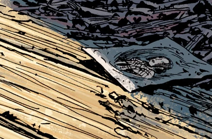
"Edith Howard. Edith Caul. My wife."

There, Edith's ghost appeared to Abe and tried to persuade him in a conjured recreation of their old life, with her alive and Abe as Caul once again. Though he was tempted -- Abe had never dreamed of being a normal man or having a wife, and it was a profound experience for him -- he ultimately decided that he couldn't live in a dream, however appealing. Telling Edith that they had to accept what had happened, he helped her spirit face her own death, freeing her from her grief.

### The Black Flame

Abe returned to the new B.P.R.D. headquarters in Colorado, more haunted and distant than ever; only Kate knew about his history as Caul, and even then Abe shared no details of his experience with Edith. His behavior grew erratic; he withdrew from his friends and coworkers -- including new team leader Ben Daimio -- and made strange attempts to act more like the man he once was; he tried to put more conventional clothing over his very unconventional body, and his speech patterns changed either in a deliberate or subconscious effort to sound more like a man of a hundred years ago -- a man he still couldn't remember, and only knew from bits and pieces of investigation.

Preoccupied with his past, Abe stepped away from his field duties as the Bureau as it faced a grave new threat -- a growing population of frog monsters spread across the northern United States. Kate encouraged Abe to seek help with a counselor, but he ignored the offer.

But the team was dealt a terrible blow when Roger was killed in action by [Landis Pope](/entry/Landis_Pope), a Zinco CEO who was using the mantle of the Black Flame to lead the frogs. Abe blamed himself and his retreat from fieldwork for Roger's murder, and overcompensated by rushing off into battle, nearly getting himself killed in the process.

The frogs ultimately retreated underground -- cold comfort for the team, which spent the next few months trying to find a way to revive Roger to no success. Abe continued to wrestle with the ghosts of his past, trying to figure out who he should be.

### The Oannes Society

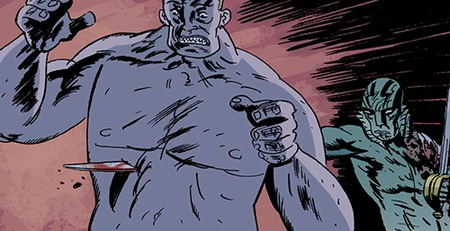
Old friends, now enemies.

In August 2006, Abe received an old cigar box with the initials 'L. E. C.' with a map to Indonesia. With Captain Daimio for company -- who he divulged the secret about his former identity -- he was compelled by the Egyptian mummy [Panya](/entry/Panya_%28character%29) to a secret island where he encountered several of his former colleagues from the Oannes Society. The Society planned to kill millions of people in order to save them by housing the souls in artificial bodies under their control, claiming that if they cannot save all mankind they will at least save "the essence" of it. In their company, Abe learned more about his lost past and recognized that the man he'd once been had little in common with the man he was now. With the help of Panya and Captain Daimio, Abe was able to foil their plan, returning to the Bureau with Panya, one of the bodies the Society had been making... and some peace of mind.

### Captain Daimio lost, Memnan Saa found

[Daryl the wendigo](/entry/Daryl_Tynon) was moved to B.P.R.D. headquarters for their stronger holding facilities. Shortly thereafter, Captain Daimio transformed into a jaguar-like monster after years of trying to control the change; the transformed captain killed five people, including Johann Kraus's new body, and freed Daryl before escaping into the Colorado wilderness. Abe and Ben had become good friends since Ben's joining the Bureau, and it was Abe who led a force to try and find him, though whether to get him back or to put an end to his threat is questionable.

Notably, he did not bring Johann along with him, seeming to believe that Johann's own agenda could be a risk to the mission. A rift of suspicion began to form between the two agents.

Abe and agents spent weeks searching for Ben with little evidence as to where he was before they were called back by the Bureau.

New evidence had been found to locate a man called Memnen Saa who had been simultaneously harassing and aiding the Bureau in their war against the frogs and the Black Flame. But when the team went to a jungle temple to find him, Liz Sherman vanished before their eyes and one of their planes flew off without any form of pilot. Memnan Saa appeared before Abe, warning him that he could have killed them all but chose not to, before forcibly evicting them from the area. They later tracked the missing plane to where it had crashed Munich, Germany. There, the team discovered the same subterranean race that had once kidnapped Liz was now in league with the frogs to build monstrous machines. When discovered, the machines began to destroy Munich, leaving Abe and team largely powerless to do more than watch as they desolated the city.

They turned their efforts underground, Abe and Johann took a small force of men to destroy the power source the monsters were using to power their robots. They succeeded in doing so, but Munich was largely lost. Abe realized that the plane had been crashed in Munich by Memnan Saa on purpose, to lead them to the proof that he wasn't lying to Liz. Troubled by this news and still no new information to Liz's safety, Abe was infuriated when Memnan Saa appeared to him in a hotel room shortly after, warning him of what he deemed an unavoidable future.

With the discovery of notes from Lobster Johnson that pointed towards Memnan Saa's location, the ancient city of Thadrethes, the B.P.R.D. partnered with the Armed Forces to show up on Memnan Saa's doorstep. Despite coming fully armed, Saa welcomed Abe, Kate and Devon into Thadrethes where they found Liz, unresponsive but safe as her fire was used to destroy the invading forces of frogs outside. Abe tried to force Memnan Saa to turn her over, and was responded with being slammed into a pillar. But Memnan Saa met his end when Liz burned him alive, and everyone returned safely to the Bureau.

### A New Race of Man

With Memnan Saa dealt with and Liz returned, the team turned their full attention to stopping the Black Flame. With Liz, Devon, and several more armed agents behind him, Abe led the assault deep down beneath the Argathan monastery from *Hollow Earth*. The Black Flame was found, but with unexpected results; Liz vanished into thin air when she went out to scout ahead.

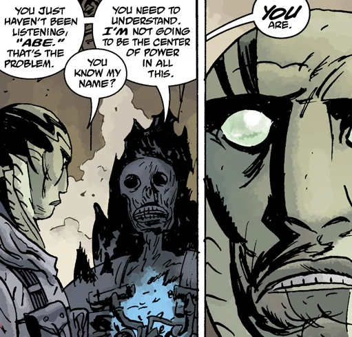The Black Flame also made a startling claim: that Abe was the first of a new race of men, and that he would have a central place of power in bringing about the next world after humanity's extinction. Abe angrily refused to believe it, threatening to knife open one of the incubating frogspawn. But when the Black Flame showed him one of the Ogrdu Hem, Abe stepped forward as if hypnotized, staring back with wide eyes.

Meanwhile, Liz experienced a vision of the future in which the B.P.R.D. had failed in saving humanity. In the wreck of one of their planes, she finds several photos of team members; an older Devon, a full mobile Panya, even Hellboy. Among them, she finds a photo of what looks like a more mutated, bestial Abe, nearly all traces of his humanity lost.

The rest of the Black Flame's machinations were put to an end when Liz used her flame to destroy everything in the caverns, with a mysterious shaman figure from her visions teleporting Abe and the team away before flames engulfed the underground. It's currently believed that the Black Flame and his remaining forces were all destroyed.

The team was found in the mountains of Austria, afflicted with minor frostbite but otherwise safe and sound. After Kate Corrigan and Tom Manning got UN funding for the Bureau, Kate came to come visit them. It was then that Devon quietly asked to be moved as far away from Abe as before; the Black Flame had placed a barrier between them with his claims, one that would prove to be significant in the future.

Things seemingly go back to business at the Bureau. With UN funding, the Bureau now has to spread their work load, keeping everyone busy with even the most minor cases. But despite the busy hours, Abe keeps researching for possibilities of finding Ben Daimio and Daryl, locating the pair in the wilds of British Columbia. At the same time, he deals with Devon's uneasiness at the Black Flame's words; Abe firmly denies them, where Devon believes there may be some truth to it that the team is ignoring.

Abe took leave to find Ben, and found himself in the middle of conflict when he does; a town mysteriously empty, he and Ben discover that a pair of Ogdru Hem were responsible and kill them as well as the human woman protecting them. Ben revealed that these juvenile Ogdru Hem had found their way through a human woman's body, who believed they were her children.

Ben expressed his belief that the tipping point and only now are these horrors able to slip through into their world. Abe requested his friend to return to the Bureau but Ben declines, warning Abe the greatest danger is the invasion into people's hearts and minds; that this poses a great risk than any mere monster like the one that has risen from the Salton Sea. He does ask Abe to retrieve a few things from HQ however, and Abe later returns with Daryl's photo of his family and some supplies for Ben. Ben wished him well, and the two part on good terms.

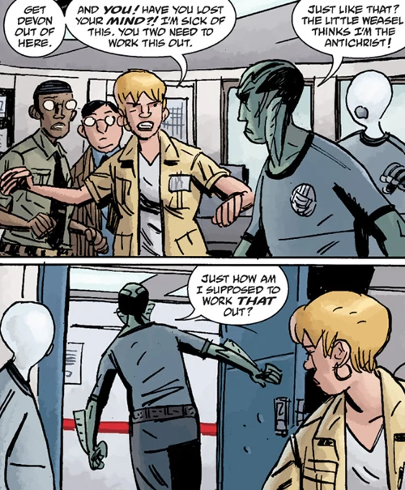Once back at B.P.R.D headquarters Abe was debriefed alongside Agent Devon, Johann and Kate Corrigan about what he found; Abe lied and said he found the situation on a hunch, neglecting to mention Ben or Daryl. Devon was hostile toward Abe, questioning why he ventured to British Columbia in the first place. Abe defended his actions and started to storm out only for a tech assistant to enter and report that Abe's laptop had been bugged with spyware. An enraged Abe accuses Devon of spying on him while Devon pleads ignorance. Kate tried to diffuse the situation but to no avail.

But in reality, it was Johann who had bugged Abe's computer; believing Ben to be entirely at fault for the death of his second body, Johann had become obsessed with finding the former captain and getting revenge. Knowing Abe and Ben had been good friends, Johann continues to spy on him for more information about how to accomplish his vengeance, putting some distance between the comrades.

### Changed

The problems between Devon and Abe continued for months. Kate attempted to get them to talk more openly with each other about their fears regarding the Black Flame's words. Devon repeatedly brings up Daimio's possession as an example that Abe could be potentially dangerous, and that Abe's reaction did nothing to dispel the villain's claim.

Abe argued that his reaction was one of fear. He points out that no one really knows what he is, so when the Black Flame pointed out how much he is like the frogs, it "brought up a fear I've been trying not to have for fifteen years". Devon admits this makes some sense, but is not entirely convinced however, and the meeting ends fairly unwell.

The team is sent to Texas to find a new lead; a teenager named [Fenix](/entry/Fenix) who seems to have incredible luck surviving the monster and environmental attacks on the area. Abe leads a team including Devon to investigate, discovering both Fenix and new giant monsters attacking the people following her. Saving her from being eaten, Abe attempted to calm her, introducing himself by name.

Fenix replied, "I *know* who you are" and shot him repeatedly in the chest and neck.

Devon witnessed the entire assault, staring in horror for some time before medics arrive to help. But when he called Kate to report what happened and she asks who shot Abe, he paused briefly before answering that he didn't see who. Fenix vanished from the scene, and Abe was rushed back to headquarters.

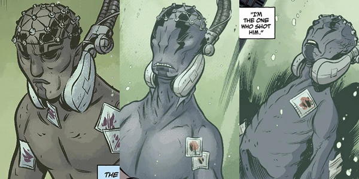
The changes to Abe's body in <em>Gods</em>, <em>Russia</em>, and <em>The Return of the Master</em> respectively.

Abe was placed into constant supervision to heal, the fish-man having been unconscious since the shooting. His recovery seemed to be going smoothly until he suddenly crashed. The doctors got his heart beating again and place him on life support, but the damage was done: Abe had extensive brain damage, and appeared to be all but dead.

Kate argued with the Bureau to keep Abe on life support at least for a time, but confides in Johann that she's unsure of his chances. When asked what he's observed, Johann said he still senses a soul trapped in Abe's body but that it feels "desperate", and that he thinks it's time to let Abe go.

As Kate wrapped up her meeting in Russia, she got a call. The doctors reported that Abe's heart was beating again on its own, his brainwaves stabilizing, and that the staff were baffled as to how. But at the same time, Abe's bodyan beg to change, becoming less human than ever before. 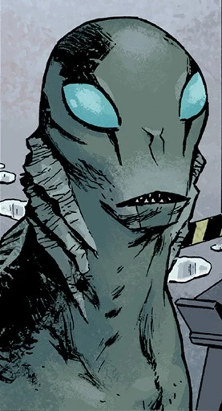

### Gone AWOL

Abe remained in a coma for 4 months while evolving from his previous appearance to his current one. Unfortunately he awoke just as the [The Black Flame](/entry/The_Black_Flame_%28character%29) worsened the apocalypse by awakening dozens of Ogdru Hem across the globe. The only person to meet him immediately after his emergence was Panya, who told him to figure out his place in the apocalypse. Concerned for his own well-being and believing that he had something to do with the emergence of the Ogdru Hem, Abe stole a truck and fled from from headquarters to seek his own answers. Immediately he was pursued by B.P.R.D. agents led by a reluctant [Agent Vaughn](/entry/Agent_Vaughn).

Abe began moving on foot across the Southwest, encountering various townships that struggled to survive amid the crisis, with many falling to hysteria and madness that resulted in cults and crazed mobs. He was unfortunate enough to witness Vaughn's death at the hands of a mutant and made his way to the Salton Sea.

There he found that the Ogdru Hem had moved on and laid eggs in its wake, while others began to gather around and meet with him. Abe thought he could come here to disprove any links between him and the rampant creatures, only for fanatical nomads to view him as a figurehead of the Apocalypse, starting a new cult.

Abe moved on, encountering more roving survivors and towns, but could find no opportunity to ease his worries among those he tried to help. When the BPRD caught up with him, they quietly let him go, sympathizing with his goal of self-discovery. Even when he traveled with some survivors in search of safe havens, Abe could not keep them safe and fed up, returned to traveling alone. His goal this time was to return to Rhode Island, Caul's old residence, in search of answers.

Upon reaching North Carolina, Abe was led to a mysterious 12-year old girl named Maggie, who spoke in an ancient language that only her mother could understand and was knowledgeable in prophecies and secret lore. She affirmed of Abe's connections to the coming Race of Man, and spoke with a heavy heart that his future does not coincide with the future of mankind. Abe was meant to be a carrier of the divine power of Vril from the age of mankind to his descendants, the new race of man that was to inherit the Earth. Even the spirit of Edith Caul appeared to him, urging him to stop going to Rhode Island, and he left them to return instead to Professor Bruttenholm's old home in New York.

At Bruttenholm's apartment Abe uncovered secret hypnotism sessions that revealed Bruttenholm's knowledge of Langdon Caul, and how the information he had gathered in their conversations influenced his decision to join the fateful Cavendish expedition in 1993. Before he could learn more, the warlock [Gustav Strobl](/entry/Gustav_Strobl) had finally caught up to Abe, using the deceased Vaughn as his puppet to help bind Abe. Strobl, desperate to find a new place of prestige after the fall of his old demonic masters, attempted to take control of Abe to uplift himself into a new seat of importance. Abe escaped and fled into the sea, but Strobl overheard the tapes of Bruttenholm and went to Saint-Sebastien to further his goals.

Abe swam to the sunken ruins where Caul first recovered the egg, only to find a realm inhabited by [Shonchin](/entry/Shonchin), the Vril-wielding shaman from the prehistoric era who once spirited Abe and his cohorts away from the Black Flame in the Hollow Earth. Shonchin explained the origins of the mysterious water angel that had transformed him. Shonchin showed Abe that the angel was once his friend and fellow shaman, tortured by followers of the Black Goddess for refusing to denounce his faith. Before the shaman could be executed, he was transformed by the power of Vril into the jellyfish-like being Caul and Abe had seen, sinking the city around him into the sea. Shonchin showed Abe that he was made by noble powers for a noble purpose, and urged him to face his destiny.

After leaving the sunken ruins, Abe ended up in the shores of England, which had vanished from the face of the Earth several months prior. There he encountered [Alice Monaghan](/entry/Alice_Monaghan), who explained to Abe that Hellboy was indeed dead and that the verdant paradise once known as England was created by his sacrifice, allowing this piece of the old world to survive into the next one. Abe tells her that he wants to stay, but Alice told him he couldn't, for his purpose lied with the new world to come. Like Shonchin before her, she told Abe to not be afraid and that he cannot run or hide from his destiny even there.

Abe finally returned to American shores, only to be attacked by Strobl once more. Strobl had traveled to Saint-Sebastien and killed the Water Angel hiding in the church, transforming himself into an Ichthyo-humanoid just like Abe. He gave Abe the chance to join him in bringing forth the Final Race of Man and be their guiders and teachers, but Abe refused to let him succeed and killed him. Abe passed out from the wounds in their fight, just as B.P.R.D. agents arrived to recover him.

### The Devil You Know

Abe's truck was waylaid during its return, forcing a rescue operation by Liz, Ted Howards and a few other agents. Liz found Abe still in the back of the truck, which began to form into an organic cocoon to help him heal. They took him back to their new flying headquarters where he safely recovered and reunited with Liz and the others, and was caught up to speed on what happened since he fled.

## Abilities

Abe is an extremely talented swimmer, with a natural affinity for water. He can breathe both air and water, but can only stay out of water for about a week; when travelling, he sleeps in hotel bathtubs to keep his skin from drying out. He is sensitive to the condition of water he swims in. When swimming in Venice, the water was so polluted that he had to stay in his tank for a long time afterwards to recover.

He is a talented marksman, as well as one of the most skilled agents in the B.P.R.D. (beside Hellboy and Liz), with decades of experience.

He also appears to have greatly enhanced strength and healing capabilities. Some (but by no means all) of the wounds he has survived include being speared in the chest (so severely he was initially declared dead), getting shot multiple times and then tortured by an ape, being thrown onto large spikes, and being shot in the face and chest (again, declared dead for some time). Whether or not his body even can die is up for debate, as both times he's been declared dead he's returned to life.

It's also possible that he does not age, or that he ages at a much slower rate than normal humans, given that he was in the tube under the hospital for 113 years while he made his transformation. This may be a trait he inherited from his previous life as Langdon Everett Caul, who was roughly seventy at the time he became Abe, while still looking quite young.

It is possible he has some limited psychometry, although the instances of psychometry may actually be properties of the object he's interacting with, not an ability he possesses.

## Allies and Enemies

#### Allies:

- [Hellboy](/entry/Hellboy) : A red-skinned demon with a right hand made of stone. He was summoned to Earth as a child to be the catalyst for the approaching Apocalypse, but was rescued by American soldiers and raised to become a force for good. Hellboy was responsible for rescuing Abe from the Bureau's experiments, and for his following training; as such, Abe and Hellboy have been good friends, and Abe misses him strongly after he leaves.
- [Liz Sherman](/entry/Elizabeth_Sherman) : A pyrokinetic, this brooding, somber woman has the psychic ability to create and manipulate fire. Liz and Abe share a common bond from their 'freak' status, and have long supported each other both on and off the field.
- [Roger the Homunculus](/entry/Roger) : An artificial man created from blood and herbs, both mixed in a jar with horse manure. Abe saved the creature from the B.P.R.D.’s unethical experiments by freeing him -- much like how Hellboy saved Abe himself -- and helped train him to become a field agent. Abe was distraught when Roger was killed, blaming himself for not being there.
- [Trevor Bruttenholm](/entry/Trevor_Bruttenholm):
- [Tom Manning](/entry/Tom_Manning) : The Special Projects Director of the B.P.R.D. and Abe’s boss. The two have not been seen to interact much outside a professional relationship, though Tom does seem to recognize that having Abe on the payroll helps keep the Bureau funded and that he knows what he's doing.
- [Kate Corrigan](/entry/Kate_Corrigan) : The field director for the special talents team, and long time friend. Abe trusted her enough to let her help him find out more about Langdon Everett Caul, and respects her as a co-worker.
- [Johann Kraus](/entry/Johann_Kraus) : Kraus is a German medium who's body was destroyed, but his ectoplasmic form remained. Abe and Johann had an easygoing relationship until Ben killed Johann's second body. Ever since, their relationship has been tense if not outright hostile, though Abe does not know that Johann had been spying on him to try and locate Ben.
- [Panya](/entry/Panya_%28character%29):
- [Ben Daimio](/entry/Ben_Daimio) : The (now former) captain of the special talents team. Abe and Ben bonded over a shared ethic, and it was Abe who kept up the search for him and eventually discovered him after Ben had fled the Bureau. Abe lied to the Bureau to keep him safe, despite the possible risk Ben posed to both the public and himself.
- [Andrew Devon](/entry/Andrew_Devon) : A recent addition to the Bureau, former scholar. Though formerly on good terms, their relationship took a drastic turn after the events of King of Fear. Abe accused him of believing that he was the Antichrist, and Devon covered up Fenix's actions in shooting Abe.

#### Enemies:

- [Grigori Rasputin](/entry/Grigori_Rasputin) : An undead mystic who claims to be the official messenger of the terrible cosmic entity, the Ogdru Jahad, and is completely devoted to bringing about the end of days, by any means. During the Cavendish mission, Abe Sapien was possessed by the vengeful spirit of Elihu Cavendish, and while under the ghost’s influence harpooned Rasputin, killing his physical form. Rasputin's ghost later claimed that Abe would be punished for this, dying in a similar way that Rasputin did, which did in fact come true.
- [The Black Flame](/entry/The_Black_Flame_%28character%29) : A former Zinco CEO who sought to control the frogs, responsible for the death of Abe's friend, Roger. He claimed that Abe was the first of a new race of man, and that he would be a key figure in bringing about the doom of man. He is believed to be dead after Liz destroyed him and the last of the frogs.

## Appearances in Other Media

Abe Sapien, being a fan favorite, has been adapted into various other media, most prominently film and animation.

### *Hellboy* (2004–2008 film franchise)

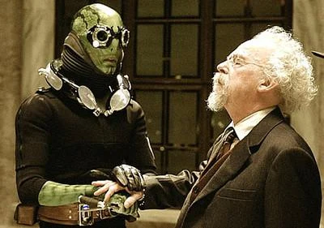
Abe Sapien in the film series with [Trevor Bruttenholm](/entry/Trevor_Bruttenholm).

In Guillermo del Toro's adaption of Hellboy, Abe Sapien as an important character whose design would be later used for the comic version's post *B.R.P.D.: Hell on Earth* appearance. While played by Doug Jones beneath extensive makeup and CGI-enhancement, but dubbed by an uncredited David Hyde Pierce in the 2004 film *Hellboy*.

In the film, Abe Sapien possesses unique psychic abilities, and requires a water-breathing device when out of the water for long periods of time. He is portrayed as having a rather passive personality, and has a sibling-like relationship with the more direct, “beat stuff into submission, ask questions later” philosophy of Hellboy. As well as having a fondness for thousand-year eggs.

Sapien appeared in the film's 2008 sequel, *Hellboy II: The Golden Army*, in he doesn't wear his breathing apparatus as much in this sequel, and he shows his marksman skills in the film. He is also the one who discovers Liz's pregnancy whilst instinctively protecting her during an attack from tooth faeries. He falls in love with the elf Princess Nuala, which leads to his helping Prince Nuada by giving him the magical crown piece (to control the Golden Army) for her safety.

Abe's more comedic side is touched on in the film also. The fact that he does not remember his past life means he is completely inexperienced with love and relationships, and finds himself at a loss of how to act around Nuala. However, he finally tells her how he felt as she dies in his arms at the end of the film, through telepathy.

### *Hellboy Animated*

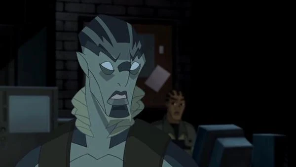 Second most prominently, his appearance more akin to original design in the comics, Abe is a main character alongside Hellboy and Liz Sherman in the animated feature-length movies that compose the *Hellboy: Animated* continuity. Two films have been released so far that star Abe, voiced by Doug Jones, as a cast member:

- *[Hellboy Animated: Sword of Storms](/entry/Sword_of_Storms)*, in which he and Liz Sherman are caught in a plane crash. The two fall into the ocean below, where Abe saves Liz's life by releasing air into her lungs. They become stranded on a rocky island during a supernatural hurricane and battle a "dragon".
- *[Hellboy Animated: Blood and Iron](/entry/Blood_and_Iron)*, where Abe is given a much larger action-packed role.

Abe also appears in the graphic-novella series books *Hellboy Animated: The Black Wedding* and *Hellboy Animated: The Judgement Bell*.

## Trivia

- Originally, Hellboy was to be a member of a superhero team Mignola conceived. In the conceptual drawing for the planned team, featuring a more monstrous, taller Hellboy, you can see Abe Sapien among the teammates.
- Filmmaker Guillermo del Toro, who is an acknowledged major fan of Mignola’s work, personally claims that Abe is his favorite “Hellboy” character.
- In the films, Abe describes his body as 'a temple' and avoids 'impurities', but does get drunk in Hellboy 2 when Hellboy 'bullies' him into having a drink with him. However, in the comics he is often seen enjoying cigars and sometimes drinking.
- In the books, Abe is said to enjoy chess, sometimes pulling Kate into playing with him and saying that she's a sore loser.

## Sources

- [Wikipedia article](http://en.wikipedia.org/wiki/Abe_Sapien)
- [Official Hellboy site](http://www.hellboy.com/)
- [2012 Comic Expo Panel](http://www.comicbookresources.com/?page=article&id=41329)
