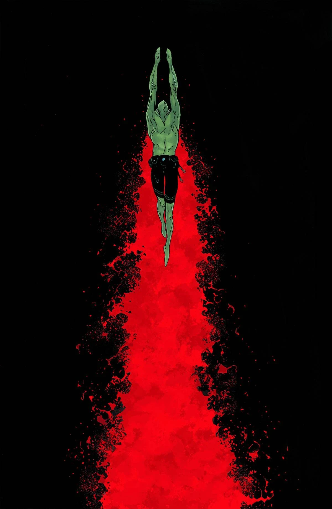
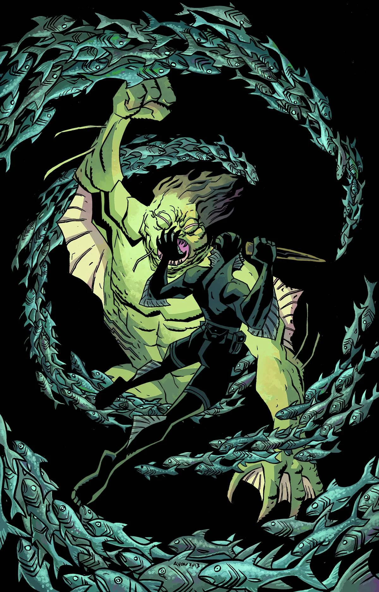

***The Land of the Dead*** is a one-shot arc published in December 2013 with art by Michael Avon Oeming.

## Publication History

This is a flashback story with a Mayan connection to the [previous arc](/entry/The_Shape_of_Things_to_Come) and ties to *[Hellboy in Mexico](/entry/Hellboy_in_Mexico_%28story%29)*.

### Early Previews

A glimpse of the story was released as a part of [Multiversity Comics' *31 Days of Abe*](http://multiversitycomics.com/special/31-days-of-abe-day-11-michael-avon-oeming/) art pieces. It was not revealed at the time that this was design work for a story. The announcement of the story came five months later on [Comic Book Resources](http://www.comicbookresources.com/?page=article&id=47435).

## Synopsis

In 1983, Abe Sapien goes into a cave in Campeche, Mexico, where an archaeological dig crew has encountered a monster. Abe descends into the cave, where he encounters a member of the expedition, and several dead bodies. Abe then encounters a chamber full of coffins containing vampires, most likely from the ship Madelyn Rose, first heard of in [The Pickens County Horror](/entry/The_Pickens_County_Horror). Also in that room is a large, white, amphibious creature that was once one of the vampires. Abe then proceeds to kill the vampires. After escaping from the cave, the room where this took place could not be found.

## Gallery

 \#8
by Max Fiumara

 \#8 variant
by Michael Avon Oeming
