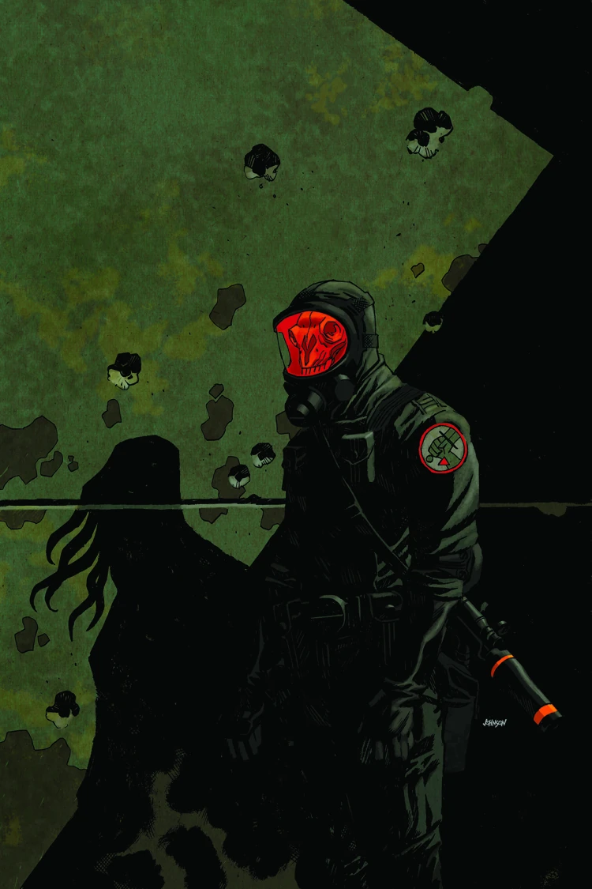
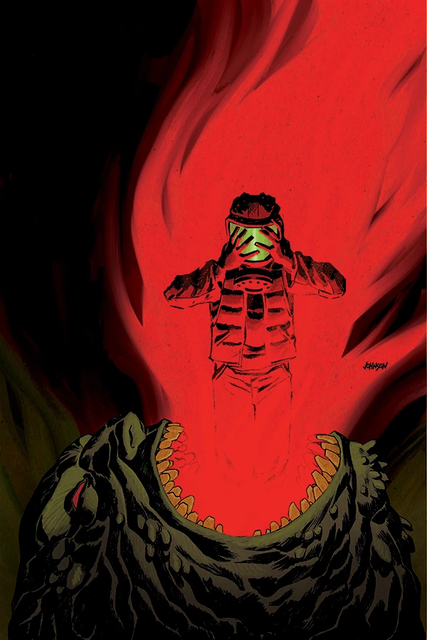
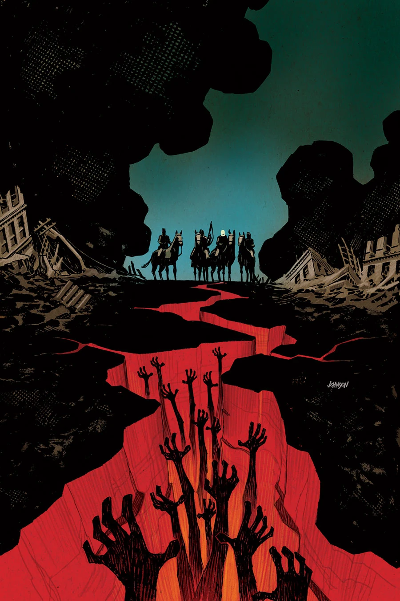

***Wasteland*** is a three-issue miniseries published in 2013 with covers by [Dave Johnson](/entry/Dave_Johnson).

## Synopsis

### Part One

A B.P.R.D. team on a rescue mission in Chicago trying to locate a group of agents lost during *[B.P.R.D. Hell on Earth: The Abyss of Time](/entry/The_Abyss_of_Time)*. What they find is a devastated city, full of giant Ogdru Hem, and a flood of humans transformed into monsters.

### Part Two

A spreading contagion in the Chicago wastelands turns the residents of the Windy City into vicious monsters. Will these creatures and the giant bat-faced monsters stop the B.P.R.D. from saving their missing agents?

### Part Three

As the agents ride deeper into the Chicago ruins they locate the final resting place of the missing B.P.R.D. agents from *[The Abyss of Time](/entry/The_Abyss_of_Time)*. What they find is a bizarre paranormal crime scene and an army of mutated humans preventing them from getting back to headquarters.

## Gallery

