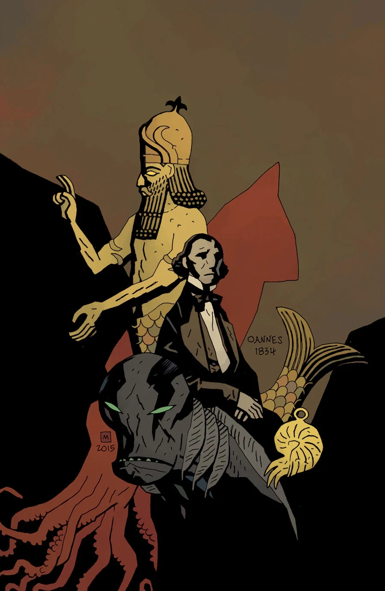

***Icthyo Sapien*** is a flashback story set in 1834 with [Langdon Caul](/entry/Abraham_Sapien). This story was extended for the *[Abe Sapien: The Drowning and Other Stories](/entry/Omnibus_Editions)* omnibus, which ties it into *[B.P.R.D.: The Devil You Know—Pandemonium](/entry/Pandemonium_%28story_arc%29)*.

## Synopsis

[Abe](/entry/Abraham_Sapien)’s memories of his life as a man in the nineteenth century come to the surface as secret societies fight over an object that could prove the true origins of the human race!

## Gallery

