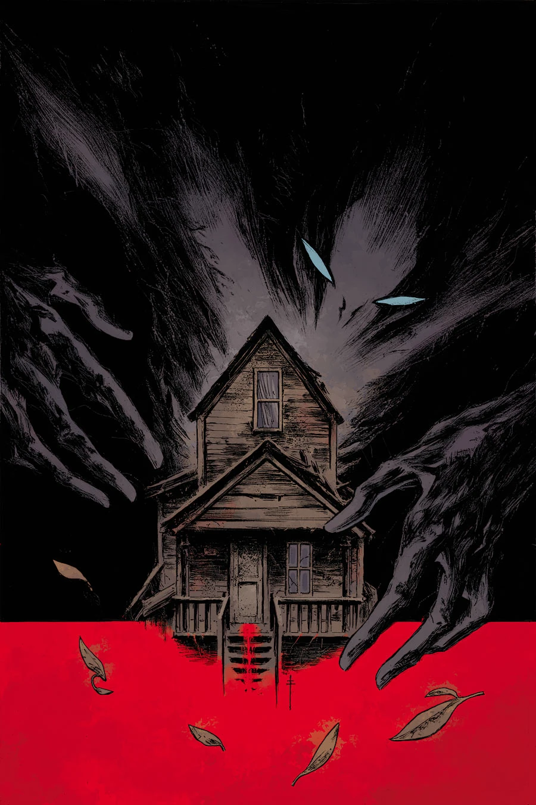

***The Garden (I)*** is a one-shot arc in May 2014 with art by Max Fiumara.

## Publishing History

This story was originally published as *"The Garden"* in *Abe Sapien* \#12, however when it was collected in trade paperback it was retitled *The Garden (I)*. It was later revealed to be the first part of a three-part thematic trilogy.

## Synopsis

Abe's journey takes a new turn as he meets a twisted couple in this rural horror story of a domestic relationship gone terribly awry.

## Gallery

