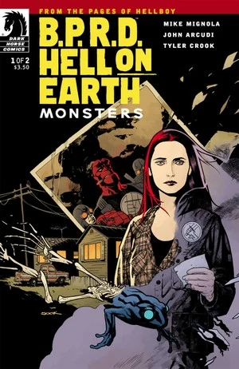
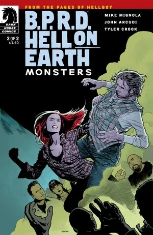

***Monsters*** is a two-issue miniseries published from July to August 2011.

## Publication History

This is the third arc of the [*Hell on Earth* cycle](/entry/BPRD%3F%E4%BA%BA%E9%97%B4%E5%9C%B0%E7%8B%B1)), following *[Gods](/entry/Gods)*. The issues were published with covers by [Ryan Sook](/entry/Ryan_Sook). This is also the first miniseries to feature Tyler Crook as the ongoing *B.P.R.D.* artist.

The story was collected together with *[Gods](/entry/Gods)* in the *[B.P.R.D.: Hell on Earth—Gods and Monsters](/entry/Trade_Collections)* trade paperback.

## Synopsis

### Part One

While the [Bureau's](/entry/Bureau_for_Paranormal_Research_and_Defense) off fighting giant bat-eared beasts in Texas, [Liz Sherman](/entry/Liz_Sherman) is living in a trailer park.

### Part Two

Trapped in a weird trailer park full of hillbilly cult fanatics, Liz Sherman must fight her way through the high priest of trash for safety.

## Gallery

 \#1

 \#1 ([Francesco Francavilla](/entry/Francesco_Francavilla) Variant)

 \#2
